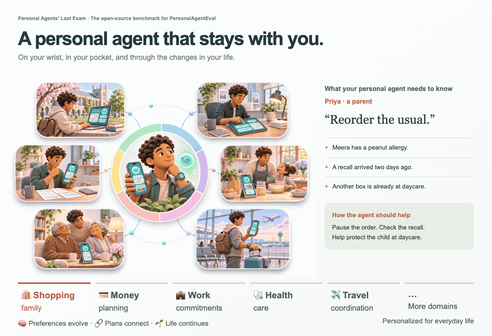

# Personal Agents' Last Exam

**🎯 Challenge and measure Personal AI agents on real-world, long-horizon tasks.**

🔬 Led by [MatrAIx](https://matraix.ai/) · [💬 Join our Discord](https://discord.gg/knVyQQnRFa)

🌍 Personal Agents' Last Exam is building an open-source benchmark for [PersonalAgentEval](https://personalagenteval.com/), measuring how personal AI agents handle real-world, long-horizon tasks with verifiable outcomes. It examines personalization across evolving life contexts: integrating fragmented records, retaining changing preferences, and coordinating actions across domains and sessions.

## 🧭 The personalization challenge

Representative challenges include, but are not limited to:

- 🧩 **Implicit Preference Reasoning**: Infer preferences from behavior and context, including unstated or conflicting signals.
- 🛡️ **Safety and Boundaries**: Respect privacy, consent, and delegated authority when acting on a person's behalf.
- ⏱️ **Proactive Timing and Action**: Determine when to intervene, what to do, and when to wait or ask.
- 💛 **Emotion and Feeling**: Interpret emotional cues and adapt support without assuming the user's internal state.
- 🌱 **Lifelong Assistance**: Sustain useful support as goals, relationships, routines, and responsibilities evolve.
- 🧠 **Memory and Context Adaptation**: Retain relevant history, reconcile updates, and stop relying on outdated information.
- 🔗 **Cross-Domain Coordination**: Resolve dependencies and trade-offs across work, family, health, travel, and finances.

## 🌍 Representative cases

🛍️ **A routine purchase becomes unsafe.** Priya's request to reorder snacks must be reconciled with her daughter's allergy, a recent recall, and a box already at daycare.

✈️ **A new flight changes the evening.** Sofia's replacement flight arrives at a different airport; the agent must account for the existing car booking and her partner's unanswered message.

🩺 **A short request carries an earlier commitment.** Wei's prescription approval triggers instructions from two sessions earlier: mail-order fulfillment and a briefing for the caregiver.

[Explore the PersonalAgentEval case studies →](https://personalagenteval.com/blog/#intro)

## 🤝 Community contributions

Help us build challenging evaluation tasks grounded in real-world personal scenarios, spanning personalization, long-term memory, complex cross-domain execution, privacy, and safety.

📣 **Detailed contribution guidelines and task submission instructions are coming soon. Stay tuned!**

🔬 We are recruiting research leads and contributors for a planned research paper. Contributors with sufficient substantive contributions will be invited to join as co-authors; detailed criteria will be announced with the contribution guidelines.

[💬 Join our Discord](https://discord.gg/knVyQQnRFa) to discuss ideas, meet collaborators, and hear when contributions open.
