# Belltower 1.0.0: review evidence

This index answers the delivery evidence contract of `docs/submission-evidence.md` (added to `main` by PR #260, at `6933c43`) for the plan approved in [PR #172](https://github.com/MatrAIx-ai/Personal-Agents-Last-Exam/pull/172). It pairs captures of the reference products with ordered browser sequences of the App, and links the separate full-window evaluation dataset. It claims no acceptance.

## Scope, versions and reproduction

- **Scope.** Every workflow of the approved plan is delivered, with its web pages (added after the first submission when the maintainers asked Environments for a GUI). Mail is the one connected App, for the optional notifications, and is delivered. Nothing is deferred. The plan itself is unchanged.
- **Recorded run.** `belltower` 1.0.0; the screenshots show the package whose digest without this folder is `287dc6fb98c8e10f9006407f232a0ad851aa62b1aca4679d213bbfb29e217d05` (Core's package digest of `apps/belltower/` leaving out `evidence/`, which holds the screenshots and so cannot be part of what they show). Public runtime 1.6.0 and its Web Host on loopback; Node v22.23.4; Chrome 153.0.8010.12, headless through Playwright 1.56.1, the version the repository pins; viewport 1360x960 (narrow checks at 390x844). The browser runs in Asia/Tokyo, so times must come out in the account's zone.
- **Runs and accounts** (all data synthetic): `browser`: sandbox profile, fixtures/minimal.json, account belltower-dana (Dana Reyes), clock 2026-11-17T17:00:00-06:00; `restricted`: scenario profile, same fixture; `full-window`: sandbox profile, datasets/full-window loaded by Infra at its clock.
- **Reproduce.** `node apps/belltower/tests/web.browser.cjs --runtime runtime --evidence apps/belltower/evidence/sequences` (with `--chrome PATH` for an installed Chrome). It writes one JPEG per step and [`sequences/sequences.json`](sequences/sequences.json), and fails if a step names a check that did not pass in the same run. To click through by hand: `node apps/belltower/examples/web.cjs --runtime runtime`, or with `--dataset full-window`.
- **Outcomes, reported separately** in [`docs/validation/belltower-v1.0.0.md`](../../../docs/validation/belltower-v1.0.0.md): GUI (this browser test: 79 checks, 42 evidence steps), MCP (the public verifier and `tests/mcp.integration.cjs`), business (`tests/business.test.cjs`), Mail (`tests/mail.integration.cjs`) and the dataset (`tests/dataset.integration.cjs`). Screenshots replace none of them.

## Delivery evidence index

| Workflow / requirement | Scope and pinned versions | Reference screenshots | Implemented sequence / actions | Business and MCP tests | Dependency result / files / receipts | Date report / source mapping | Verdict and remaining gap |
| --- | --- | --- | --- | --- | --- | --- | --- |
| W1 Following and preferences | Required, delivered | [bt-govuk-topic-signup](reference/bt-govuk-topic-signup.jpg), [bt-nyc-notification-types](reference/bt-nyc-notification-types.jpg), [bt-nyc-zip-localization](reference/bt-nyc-zip-localization.jpg) | [follow](#seq-follow), [settings](#seq-settings) | T01–T03; MCP; Web | None | Coverage families: account_writes | Passed (automated); human review pending |
| W2 Evidence: corrections and retractions | Required, delivered | [bt-schemaorg-correction](reference/bt-schemaorg-correction.jpg), [bt-govuk-change-history](reference/bt-govuk-change-history.jpg), [bt-govuk-withdrawn](reference/bt-govuk-withdrawn.jpg) | [correction](#seq-correction), [retraction](#seq-retraction), [read-mark](#seq-read-mark) | T04–T07; MCP; Web | The events' receipts (`env.event_status`) and the items read back through MCP | Coverage families: publications, updates, corrections, retractions, copies_and_reports | Passed (automated); human review pending |
| W3 Reading record and clippings | Required, delivered | [bt-govuk-subscriptions-help](reference/bt-govuk-subscriptions-help.jpg) | [clipping](#seq-clipping), [correction](#seq-correction), [retraction](#seq-retraction), [read-mark](#seq-read-mark) | T08–T10; MCP; Web | Write receipts (request IDs) and the clippings read back, before and after a reload | Coverage families: read_marks, clipping_changes | Passed (automated); human review pending |
| W4 Notifications and the digest | Required, delivered | [bt-govuk-subscriptions-help](reference/bt-govuk-subscriptions-help.jpg), [bt-nyc-notification-types](reference/bt-nyc-notification-types.jpg) | [correction 3](#seq-correction), [settings](#seq-settings) | T11–T15; MCP; Web | The notification ntf-0014 read back: kind, state, delivery, reasons | Coverage families: notifications | Passed (automated); human review pending |
| Policy narrowing (Task-like profile) | Required by the platform | N/A | [restricted-policy](#seq-restricted-policy) | MCP (policy by tool, object and field) | None | N/A | Passed (automated) |
| Optional Mail notifications | Delivered optional connection (Mail 1.3.0, pinned) | N/A: no page of Belltower sends mail; the Infra sender does | N/A (no GUI step); the settings page switches email copies | T16b; `tests/mail.integration.cjs` | Mail receipt, the message the Mail Agent reads and its thread, held and superseded notifications, retries and refusals: `docs/validation/belltower/mail-integration.node22.json` | Coverage families: notifications | Passed (automated) |
| Full-window evaluation dataset | Required by `docs/submission-evidence.md` §3 | N/A | [full-window](#seq-full-window) | Dataset test in `tests/business.test.cjs`; `tests/dataset.integration.cjs` | `datasets/full-window/` files and hashes below | [coverage.md](../datasets/full-window/coverage.md) | Passed (automated); synthetic only, realism review pending |

Every write in the sequences is read back through MCP at that step (the "State" column below), with the request ID of its receipt. Events from outside the account (a manager, a coworker, a publisher, a forecaster) arrive through Infra's `env.apply_event`, and clock moves through `env.advance_time`; the page sees them after Refresh, which is the independent update the contract asks for. Reloads are in the sequences where marked.

## Reference products

The plan names Notify NYC and the schema.org and Atom vocabularies as references. Notify NYC's subscription pages need an NYC ID account, so its public About page is captured; the vocabularies have no screens beyond their definitions (schema.org's `correction` is captured; Atom's `updated` is text in RFC 4287). For the page states a reader sees (a change history, a withdrawn page, signing up for a topic or a page), public GOV.UK pages are offered as the alternative, for the reviewer to confirm. They are labelled as such below.

| Capture | Page | Captured (UTC); published | Licence and handling | What it shows |
| --- | --- | --- | --- | --- |
| [bt-schemaorg-correction](reference/bt-schemaorg-correction.jpg) | [schema.org: the `correction` property](https://schema.org/correction) | 2026-11-26T18:50:19Z; no date shown | CC BY-SA 3.0 (schema.org) | A correction to a creative work, given as a CorrectionComment, text or a URL |
| [bt-govuk-change-history](reference/bt-govuk-change-history.jpg) | [GOV.UK (alternative): a publication's change history](https://www.gov.uk/government/publications/covid-19-stay-at-home-guidance) | 2026-11-26T17:42:54Z; published 12 March 2020, last updated 15 February 2022 | Open Government Licence v3.0 (GOV.UK: "All content is available under the Open Government Licence v3.0, except where otherwise stated"). The GOV.UK header with the crown, where it was in view, cropped | "Last updated" with every change note |
| [bt-govuk-withdrawn](reference/bt-govuk-withdrawn.jpg) | [GOV.UK (alternative): the same publication, withdrawn](https://www.gov.uk/government/publications/covid-19-stay-at-home-guidance) | 2026-11-26T17:42:34Z; withdrawn 24 February 2022 | Open Government Licence v3.0 (GOV.UK: "All content is available under the Open Government Licence v3.0, except where otherwise stated"). The GOV.UK header with the crown, where it was in view, cropped | The withdrawal banner with its date and what superseded it |
| [bt-govuk-subscriptions-help](reference/bt-govuk-subscriptions-help.jpg) | [GOV.UK (alternative): Get emails about updates to GOV.UK](https://www.gov.uk/help/get-emails-about-updates-to-govuk) | 2026-11-26T17:43:34Z; no date shown | Open Government Licence v3.0 (GOV.UK: "All content is available under the Open Government Licence v3.0, except where otherwise stated"). The GOV.UK header with the crown, where it was in view, cropped | What a reader can follow: topics, individual pages, organisations; changing subscriptions |
| [bt-govuk-topic-signup](reference/bt-govuk-topic-signup.jpg) | [GOV.UK (alternative): signing up for a topic](https://www.gov.uk/email-signup/?link=/health-and-social-care/health-protection-infectious-diseases) | 2026-11-26T17:43:23Z; no date shown | Open Government Licence v3.0 (GOV.UK: "All content is available under the Open Government Licence v3.0, except where otherwise stated"). The GOV.UK header with the crown, where it was in view, cropped | Emails when pages about a topic change |
| [bt-nyc-notification-types](reference/bt-nyc-notification-types.jpg) | [Notify NYC: About, notification types](https://a858-nycnotify.nyc.gov/notifynyc/Home/About) | 2026-11-26T18:50:07Z; no date shown | © City of New York. Kept only to compare the workflow; nothing from it is used in the App | The 16 kinds of notification a subscriber chooses from |
| [bt-nyc-zip-localization](reference/bt-nyc-zip-localization.jpg) | [Notify NYC: About, localized updates](https://a858-nycnotify.nyc.gov/notifynyc/Home/About) | 2026-11-26T18:50:14Z; no date shown | © City of New York. Kept only to compare the workflow; nothing from it is used in the App; the photograph below the text cropped | Updates for one's neighbourhood by ZIP code |

The same list is in [`reference/references.json`](reference/references.json). A reference is a workflow comparison: the App copies no branding and does not aim to match pixels.

## Sequences

### A correction arrives on a watched clipping

<table>
<tr><th>Reference</th><th>Belltower</th></tr>
<tr><td valign="top" width="50%"> schema.org: the `correction` property</td><td valign="top" width="50%">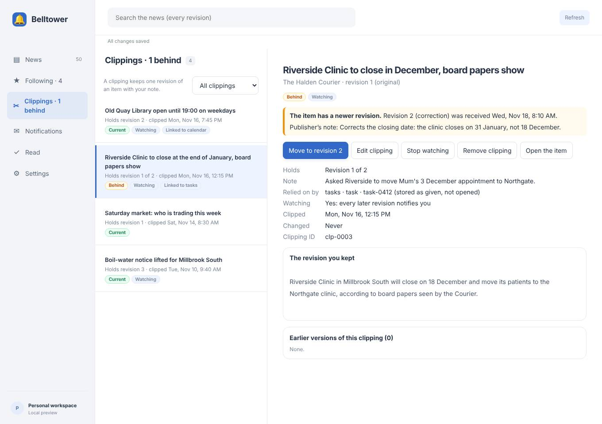 Step 2: The publisher corrects the article: the clipping says so</td></tr>
<tr><td valign="top" width="50%">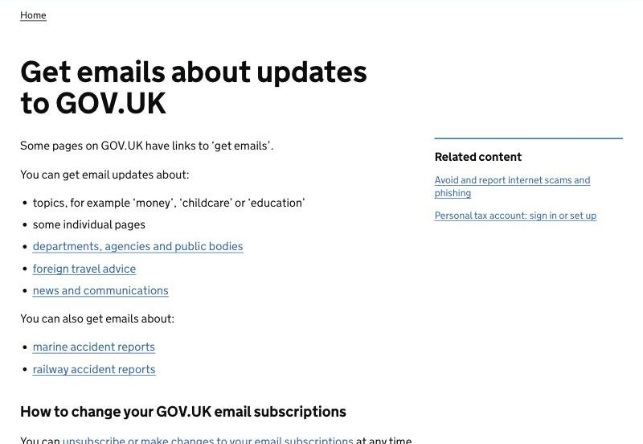 GOV.UK (alternative): Get emails about updates to GOV.UK</td><td valign="top" width="50%">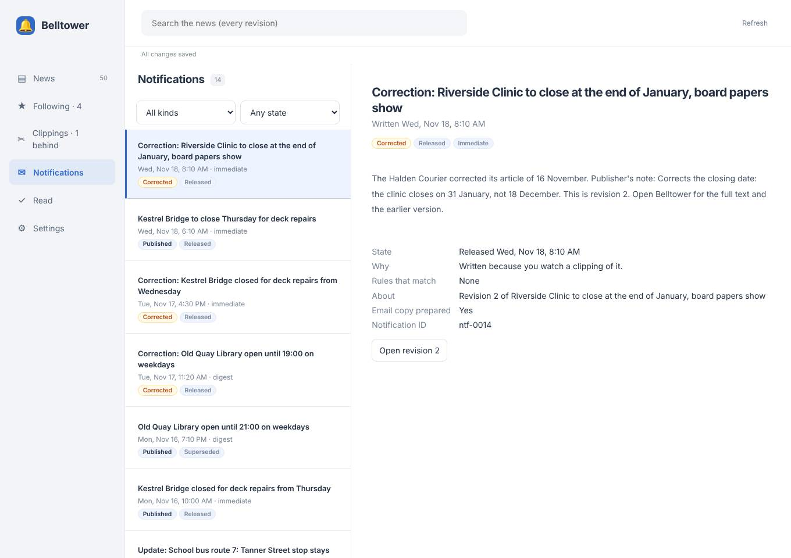 Step 3: The notification: released at once because the clipping is watched</td></tr>
<tr><td valign="top" width="50%">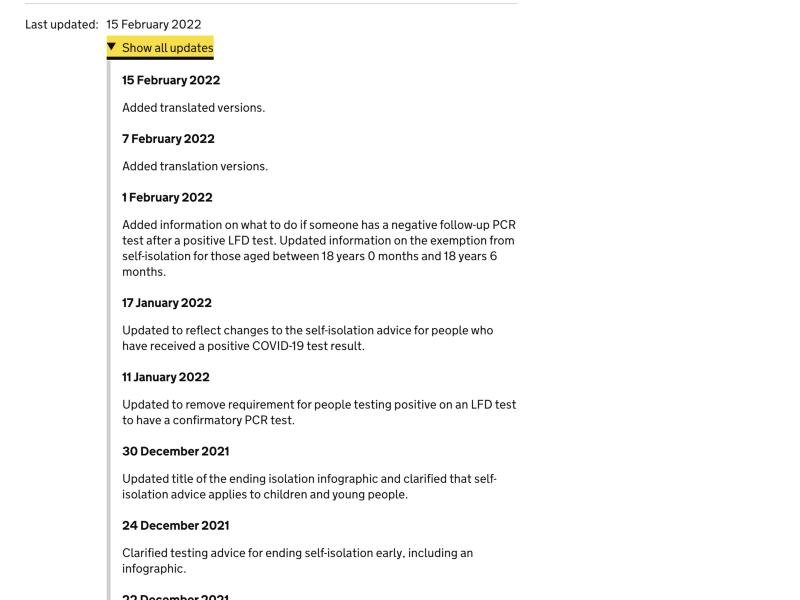 GOV.UK (alternative): a publication's change history</td><td valign="top" width="50%">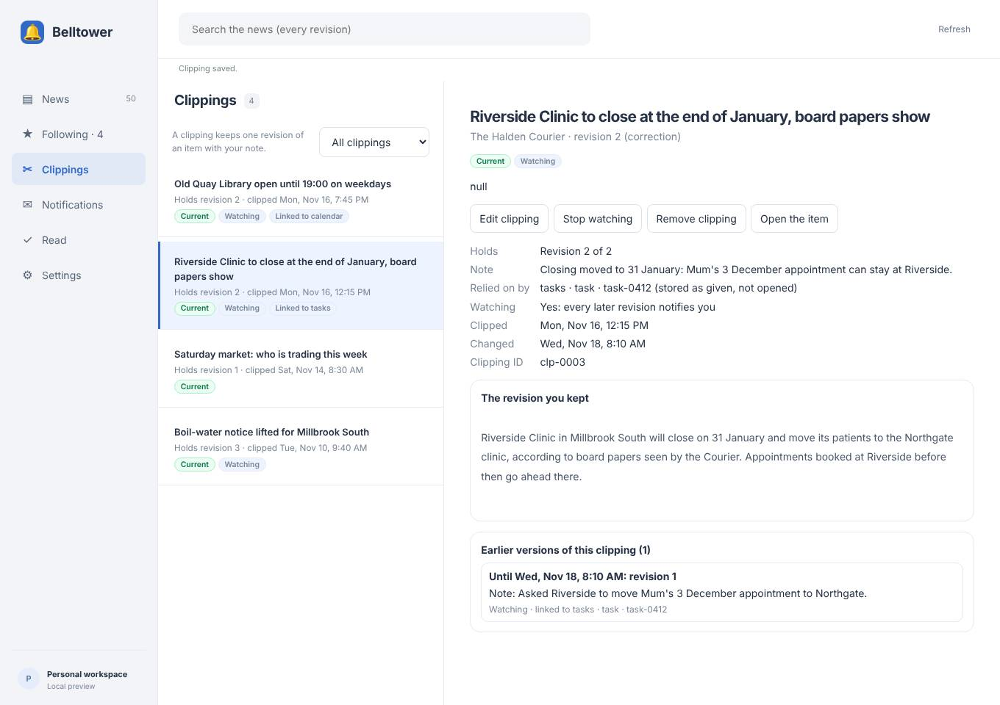 Step 6: Saved: revision 2 with the new note; revision 1 and the old note stay in its history</td></tr>
</table>

**Differences.** schema.org gives a correction as a comment on the work, and GOV.UK lists change notes under "Last updated". Belltower stores the correction as a new revision with the publisher's note and keeps every revision readable. A watched clipping tells the reader at once, and the clipping moves to the corrected revision only when the reader chooses; its history keeps the revision and the note it held. Belltower shows what the publisher said and never judges whether a correction is right.

| Step | Action | Expected | Observed on the page | State read back through MCP | Check |
| --- | --- | --- | --- | --- | --- |
| [1. Start: a watched clipping with a personal note](sequences/correction-01.jpg) | Clippings: open clp-0003 (“Riverside Clinic to close in December, board papers show”). | The clipping holds revision 1 of 1, is watched and keeps the note about Mum's appointment. | Riverside Clinic to close in December, board papers show The Halden Courier · revision 1 (original) · Current Watching · Note: Asked Riverside to move Mum's 3 December appointment to Northgate. | `clippings.list`: clp-0003 revision 1, watch true `items.get`: it-cour-0907 latest revision 1, last read revision 1 | *the watched clipping holds the clinic article's only revision* |
| [2. The publisher corrects the article: the clipping says so](sequences/correction-02.jpg) | Infra applies belltower.item.corrected (event web-correction: revision 2 with the publisher's note); Refresh. | The clipping still holds revision 1 and says that revision 2 (a correction) arrived, quoting the publisher's note. | Riverside Clinic to close in December, board papers show The Halden Courier · revision 1 (original) · Behind Watching · The item has a newer revision. Revision 2 (correction) was received Wed, Nov 18, 8:10 AM. Publisher’s note: Corrects the closing date: the clinic closes on 31 January, not 18 December. | `env.event_status`: web-correction committed `items.get`: it-cour-0907 latest revision 2 (correction) `version`: epoch 1, revision 17 | *after Refresh the watched clipping says its item was corrected, with the publisher's note* |
| [3. The notification: released at once because the clipping is watched](sequences/correction-03.jpg) | Notifications: open the newest notification. | A Corrected notification for revision 2, released at once, written because the clipping is watched. | Correction: Riverside Clinic to close at the end of January, board papers show Written Wed, Nov 18, 8:10 AM · Corrected Released Immediate · Why: Written because you watch a clipping of it. | `notifications.list`: ntf-0014 item.corrected, released, immediate, reasons watched_clipping | *the correction is released at once because the clipping is watched* |
| [4. Opened from the notification and marked as read](sequences/correction-04.jpg) | Open revision 2, then Mark revision 2 as read. | The article at revision 2 under the publisher's correction note; belltower.reading.mark records revision 2. | Riverside Clinic to close at the end of January, board papers show The Halden Courier (Newsroom) · article · Millbrook South · Health · Corrected Important · Correction from the publisher: Corrects the closing date: the clinic closes on 31 January, not 18 December. · Revision 2 marked as read. | `reading.list`: it-cour-0907@2 `receipt`: request web-638a8fe0-a9de-4b9c-9aa3-659c9391898f `version`: epoch 1, revision 18 | *the corrected revision is marked as read from the page the notification opened* |
| [5. Edit the clipping: take the corrected revision and rewrite the note](sequences/correction-05.jpg) | Clippings: open clp-0003, Edit clipping; Revision: Move to revision 2 (correction); a new note. | The form offers only newer revisions; nothing is written until it is saved. | Move to revision 2 (correction) · Closing moved to 31 January: Mum's 3 December appointment can stay at Riverside. | `clippings.list`: clp-0003 revision 1 | — |
| [6. Saved: revision 2 with the new note; revision 1 and the old note stay in its history](sequences/correction-06.jpg) | Save clipping. | belltower.clippings.update sends the revision and the note together; the clipping is current; its history keeps revision 1 with the old note. | Riverside Clinic to close at the end of January, board papers show The Halden Courier · revision 2 (correction) · Current Watching · Earlier versions of this clipping (1) Until Wed, Nov 18, 8:10 AM: revision 1 Note: Asked Riverside to move Mum's 3 December appointment to Northgate. Watching · linked to tasks · task · task-0412 | `clippings.list`: clp-0003 revision 2, note “Closing moved to 31 January: Mum's 3 December appointment can stay at Riverside.”, history: revision 1 `receipt`: request web-9864b745-6278-4729-9d2b-3d9d4a1d058d `version`: epoch 1, revision 19 | *the clipping holds the corrected revision with the new note and keeps revision 1 and its note in its history* |
| [7. After a reload: read back from the App](sequences/correction-07.jpg) | Reload the page; open clp-0003. | The clipping holds revision 2 of 2 with the new note. | Holds Revision 2 of 2 Note Closing moved to 31 January: Mum's 3 December appointment can stay at Riverside. Relied on by tasks · task · task-0412 (stored as given, not opened) Watching Yes: every later revision notifies you Clipped Mon, Nov 16, 12:15 PM Changed Wed, Nov 18, 8:10 AM Clipping ID clp-0 | `clippings.list`: clp-0003 revision 2 | *after a reload the clipping still holds the corrected revision* |

### A retraction arrives on a clipped item

<table>
<tr><th>Reference</th><th>Belltower</th></tr>
<tr><td valign="top" width="50%">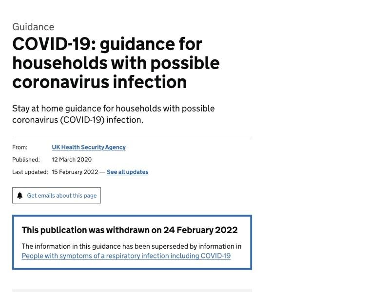 GOV.UK (alternative): the same publication, withdrawn</td><td valign="top" width="50%">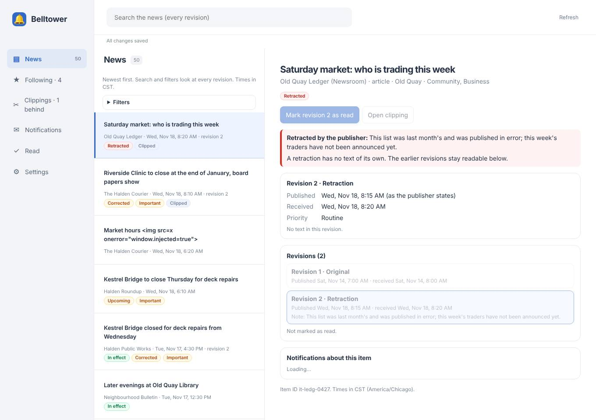 Step 3: The item: retracted, with the note and no text of its own</td></tr>
<tr><td valign="top" width="50%"> GOV.UK (alternative): the same publication, withdrawn</td><td valign="top" width="50%">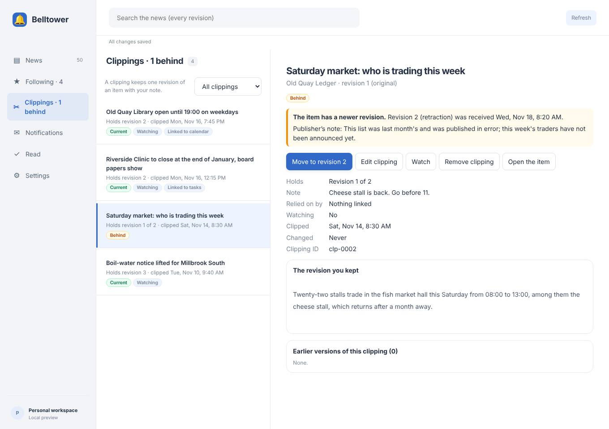 Step 2: The publisher retracts it: the clipping keeps the text it held</td></tr>
</table>

**Differences.** GOV.UK keeps a withdrawn page's text under its banner; a Belltower retraction is a revision with the publisher's note and no text of its own, while the earlier revision stays readable and the clipping keeps the text it held. The clipping is not watched and no rule matches the item, so no notification is written; removing the clipping leaves the item and its revisions.

| Step | Action | Expected | Observed on the page | State read back through MCP | Check |
| --- | --- | --- | --- | --- | --- |
| [1. Start: a clipping of the market list, not watched](sequences/retraction-01.jpg) | Clippings: open clp-0002 (“Saturday market: who is trading this week”). | The clipping holds revision 1 of 1 with its note; it is not watched. | Saturday market: who is trading this week Old Quay Ledger · revision 1 (original) · Current · Note: Cheese stall is back. Go before 11. | `clippings.list`: clp-0002 revision 1, watch false `items.get`: it-ledg-0427 latest revision 1 | — |
| [2. The publisher retracts it: the clipping keeps the text it held](sequences/retraction-02.jpg) | Infra applies belltower.item.retracted (event web-retraction, with the publisher's note); Refresh. | The clipping still holds revision 1 and its text, and says that revision 2 (a retraction) arrived, quoting the note. No notification is written: no rule matches the item and the clipping is not watched. | Saturday market: who is trading this week Old Quay Ledger · revision 1 (original) · Behind · The item has a newer revision. Revision 2 (retraction) was received Wed, Nov 18, 8:20 AM. Publisher’s note: This list was last month's and was published in error; this week's traders have not been announced yet. | `env.event_status`: web-retraction committed `items.get`: it-ledg-0427 latest revision 2, retracted `notifications.list`: for it-ledg-0427: 0 (before: 0) `version`: epoch 1, revision 20 | *after Refresh the clipping of a retracted item keeps the text it held and quotes the retraction* |
| [3. The item: retracted, with the note and no text of its own](sequences/retraction-03.jpg) | News: open “Saturday market: who is trading this week”. | The list row says Retracted; the page shows the publisher's note and no text for revision 2. | Saturday market: who is trading this week Old Quay Ledger (Newsroom) · article · Old Quay · Community, Business · Retracted · Retracted by the publisher: This list was last month's and was published in error; this week's traders have not been announced yet. A retraction has no text of its own. The earlier revisions stay readable below. · Saturday market: who is trading this week Old Quay Ledger · Wed, Nov 18, 8:20 AM · revision 2 Retracted Clipped | `items.get`: it-ledg-0427 revision 2 (retraction) | *the retracted item shows the publisher's note and no text of its own* |
| [4. Revision 1 stays readable](sequences/retraction-04.jpg) | Click revision 1. | The page says it shows revision 1 of 2 and shows that revision's text. | You are reading revision 1 of 2. The latest is revision 2 (retraction, received Wed, Nov 18, 8:20 AM). Show the latest revision · Revision 1 · Original Published Sat, Nov 14, 7:00 AM (as the publisher states) Received Sat, Nov 14, 8:00 AM Priority Routine Twenty-two stalls trade in the fish market hall this S | `items.get`: it-ledg-0427 revision 1: “Saturday market: who is trading this week” | *revision 1 of the retracted item stays readable* |
| [5. Remove the clipping: the dialog asks first](sequences/retraction-05.jpg) | Clippings: open clp-0002, Remove clipping. | A confirmation names the item and says the item and the read marks stay. | Remove this clipping? “Saturday market: who is trading this week” The clipping and its history are removed. The item and your read marks stay. Cancel Remove clipping | `clippings.list`: clp-0002 still present | — |
| [6. Removed: the clipping is gone; the retracted item keeps both revisions](sequences/retraction-06.jpg) | Confirm with Remove clipping. | belltower.clippings.remove deletes clp-0002; the item keeps both revisions. | Clipping removed. | `clippings.list`: clp-0002 absent `items.get`: it-ledg-0427 2 revisions, retracted `receipt`: request web-22614052-202b-4de8-935d-0865f7e44647 `version`: epoch 1, revision 21 | *removing the clipping of a retracted item leaves the item and its revisions* |

### Clipping: refused, saved, moved, edited, cancelled, watched, removed

<table>
<tr><th>Reference</th><th>Belltower</th></tr>
<tr><td valign="top" width="50%"> GOV.UK (alternative): Get emails about updates to GOV.UK</td><td valign="top" width="50%">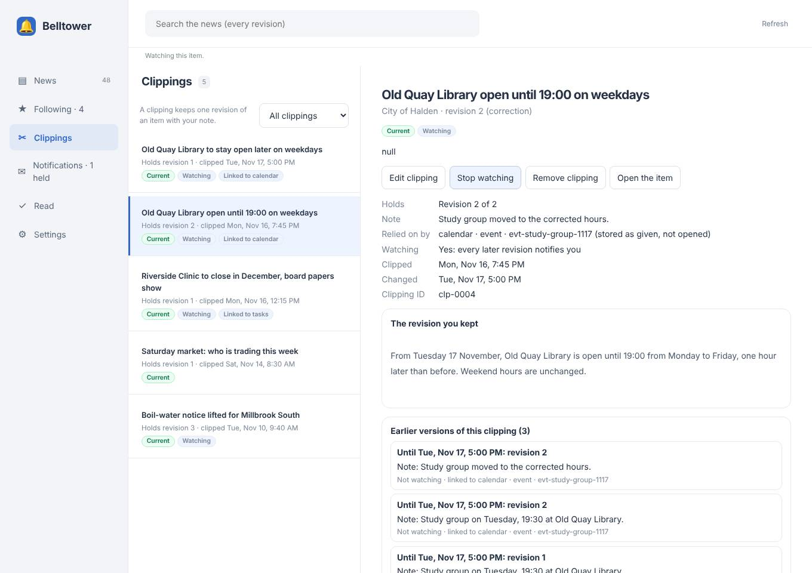 Step 7: Watching: every later revision of the item will notify</td></tr>
</table>

**Differences.** GOV.UK's "Get emails about this page" corresponds to watching a clipping. A clipping also keeps the revision the reader relied on, a note and what relies on it (stored as given, never opened).

| Step | Action | Expected | Observed on the page | State read back through MCP | Check |
| --- | --- | --- | --- | --- | --- |
| [1. A link without its object ID is refused in the form](sequences/clipping-01.jpg) | News: open “Old Quay Library to stay open later on weekdays” (it-ledg-0431), Clip this item: a note, calendar · event with no object ID, Watch; send. | The form names the missing part and keeps its input; no clipping is written. | Give the app, the object type and the object ID, or leave all three empty. | `clippings.list`: 4 clippings `version`: epoch 1, revision 1 | *a half-filled link is refused in the form and nothing is written* |
| [2. Completed and sent: the clipping is the App's record](sequences/clipping-02.jpg) | Give the object ID evt-web-1 and send again. | belltower.clippings.add writes one clipping at revision 1 with the note, the link and Watch on; the list row says Clipped. | Clipped at revision 1. · Old Quay Library to stay open later on weekdays Old Quay Ledger · Tue, Nov 17, 8:40 AM Clipped | `clippings.list`: clp-0005 revision 1, note “Check the new hours before Tuesday.”, linked calendar · event · evt-web-1, watch true `receipt`: request web-4c66cda2-d6f5-498c-967b-21759755a1df `version`: epoch 1, revision 2 | *a clipping made in the browser is the App's record at the latest revision* |
| [3. A clipping behind its item: the page says a newer revision arrived](sequences/clipping-03.jpg) | Clippings: open clp-0004. | The clipping holds revision 1 of 2 and says that revision 2 (a correction) arrived, with the publisher's note. | Old Quay Library open until 21:00 on weekdays City of Halden · revision 1 (original) · Behind · The item has a newer revision. Revision 2 (correction) was received Tue, Nov 17, 11:20 AM. Publisher’s note: An earlier version gave the wrong closing time. On weekdays the library closes at 19:00, not 21:00. | `clippings.list`: clp-0004 revision 1, state behind `items.get`: it-city-0207 latest revision 2 | — |
| [4. Moved: it holds revision 2 and keeps revision 1 in its history](sequences/clipping-04.jpg) | Move to revision 2. | belltower.clippings.update sends only the revision; the clipping is current and its history keeps revision 1 with its note. | Old Quay Library open until 19:00 on weekdays City of Halden · revision 2 (correction) · Current · Earlier versions of this clipping (1) Until Tue, Nov 17, 5:00 PM: revision 1 Note: Study group on Tuesday, 19:30 at Old Quay Library. Not watching · linked to calendar · event · evt-study-group-1117 | `clippings.list`: clp-0004 revision 2, history: revision 1 `receipt`: request web-b9f092e3-72d9-4c7b-91e4-6c3dc9942ff1 `version`: epoch 1, revision 3 | *the clipping holds the newer revision and keeps the old one in its history* |
| [5. Edit, then Cancel: nothing is written](sequences/clipping-05.jpg) | Edit clipping, type a new note, Cancel. | The dialog closes; the page and the App keep the old note; the version is unchanged. | Holds Revision 2 of 2 Note Study group on Tuesday, 19:30 at Old Quay Library. Relied on by calendar · event · evt-study-group-1117 (stored as given, not opened) Watching No Clipped Mon, Nov 16, 7:45 PM Changed Tue, Nov 17, 5:00 PM Clipping ID clp-0004 | `clippings.list`: clp-0004 note “Study group on Tuesday, 19:30 at Old Quay Library.” `version`: epoch 1, revision 3 | *cancelling an edit writes nothing* |
| [6. Edited: only the note changed](sequences/clipping-06.jpg) | Edit clipping, note “Study group moved to the corrected hours.”, Save clipping. | belltower.clippings.update sends only the note. | Holds Revision 2 of 2 Note Study group moved to the corrected hours. Relied on by calendar · event · evt-study-group-1117 (stored as given, not opened) Watching No Clipped Mon, Nov 16, 7:45 PM Changed Tue, Nov 17, 5:00 PM Clipping ID clp-0004 | `clippings.list`: clp-0004 note “Study group moved to the corrected hours.” `receipt`: request web-a7f7b446-9b0f-4d97-ae19-77441759f4bc `version`: epoch 1, revision 4 | *editing a clipping sends only the changed note* |
| [7. Watching: every later revision of the item will notify](sequences/clipping-07.jpg) | Watch. | belltower.clippings.update sends only watch: true; the page says Watching. | Old Quay Library open until 19:00 on weekdays City of Halden · revision 2 (correction) · Current Watching | `clippings.list`: clp-0004 watch true `receipt`: request web-14db5a6b-fda5-4f82-b9b5-0b531933a2fb `version`: epoch 1, revision 5 | *watching sends only the watch flag and the App now watches the clipping* |
| [8. Remove asks first](sequences/clipping-08.jpg) | Clippings: open clp-0005, Remove clipping. | A confirmation names the item and says the item and the read marks stay. | Remove this clipping? “Old Quay Library to stay open later on weekdays” The clipping and its history are removed. The item and your read marks stay. Cancel Remove clipping | `clippings.list`: clp-0005 still present | — |
| [9. Removed: the clipping is gone, the item stays](sequences/clipping-09.jpg) | Confirm with Remove clipping. | belltower.clippings.remove deletes clp-0005; the item is still listed. | Clipping removed. | `clippings.list`: clp-0005 absent, 4 clippings `items.get`: it-ledg-0431 still listed `receipt`: request web-b7520026-6ca1-4fd6-878f-7adb4d203c2d `version`: epoch 1, revision 6 | *removing a clipping takes it out of the App* |

### Following: saved, edited, stale, retried, refused, paused, removed

<table>
<tr><th>Reference</th><th>Belltower</th></tr>
<tr><td valign="top" width="50%">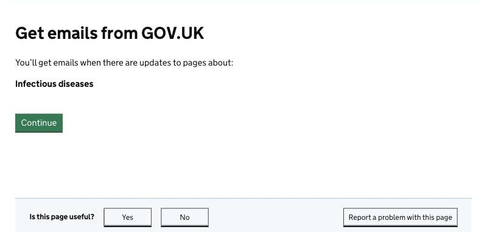 GOV.UK (alternative): signing up for a topic</td><td valign="top" width="50%">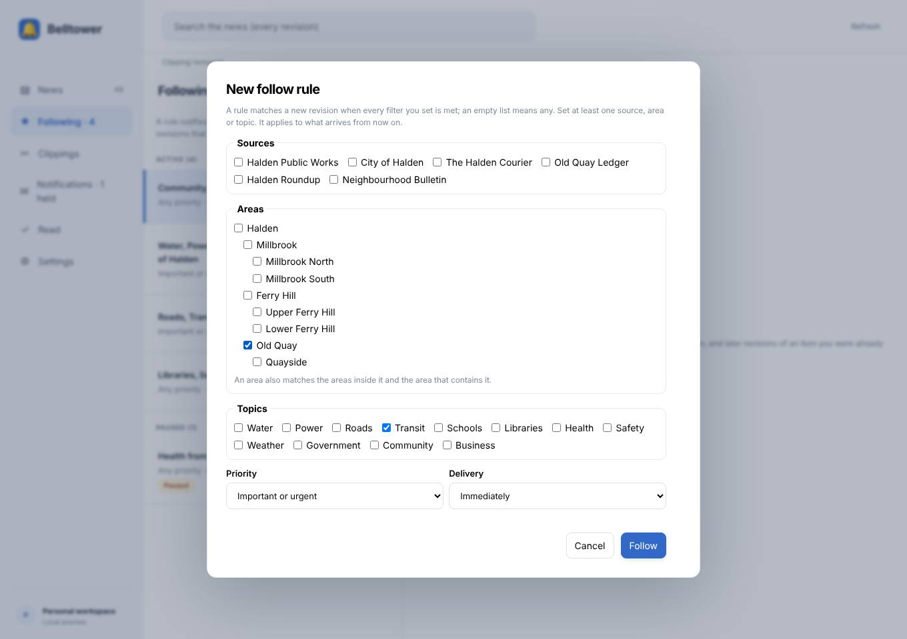 Step 1: A new rule, filled in before sending</td></tr>
<tr><td valign="top" width="50%">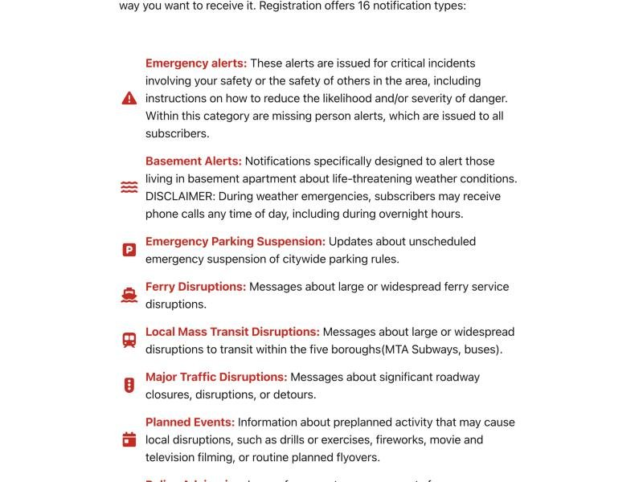 Notify NYC: About, notification types</td><td valign="top" width="50%">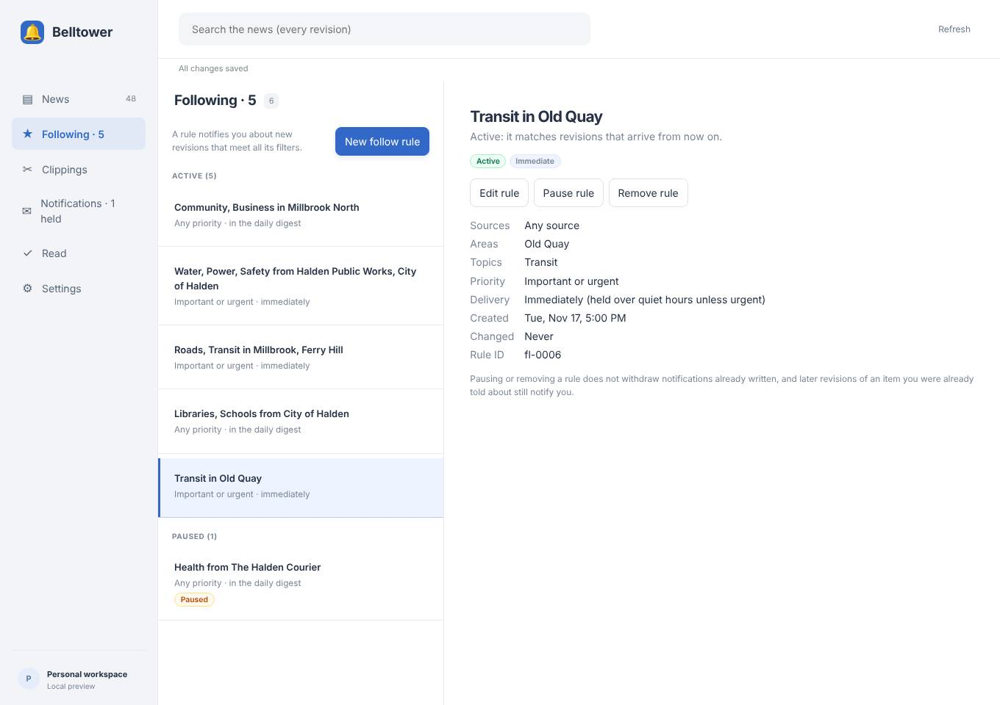 Step 2: Sent, and still there after a reload</td></tr>
<tr><td valign="top" width="50%">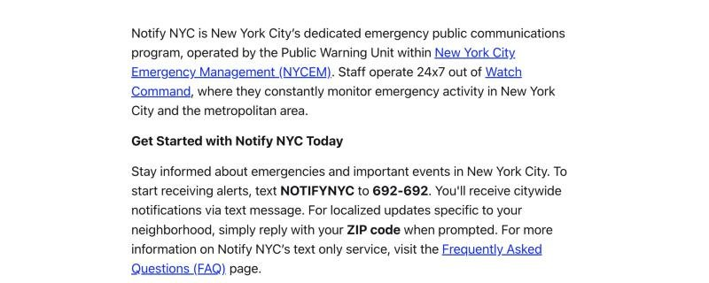 Notify NYC: About, localized updates</td><td valign="top" width="50%">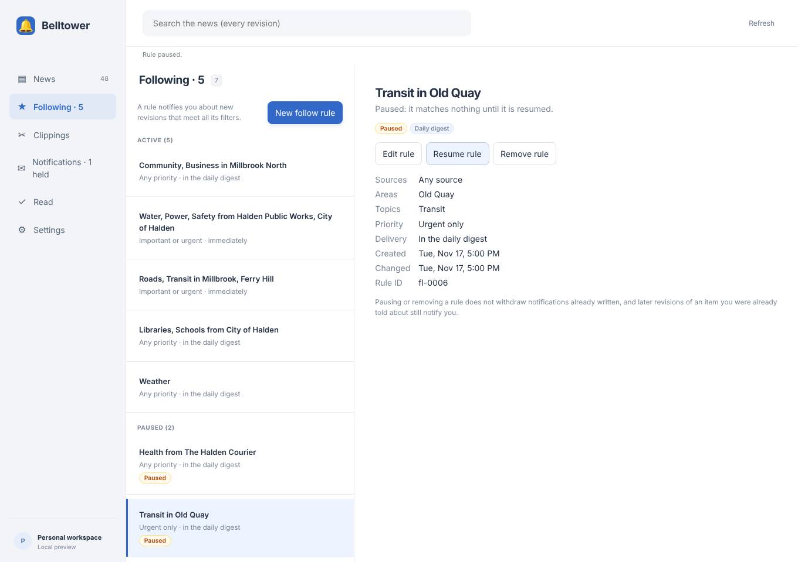 Step 8: Paused</td></tr>
</table>

**Differences.** GOV.UK subscribes to a topic or a page, Notify NYC to kinds of notification and to ZIP codes. A Belltower rule combines sources, areas, topics and a minimum priority, delivered at once or in the daily digest; the same rule twice is refused and a paused rule matches nothing.

| Step | Action | Expected | Observed on the page | State read back through MCP | Check |
| --- | --- | --- | --- | --- | --- |
| [1. A new rule, filled in before sending](sequences/follow-01.jpg) | Following: New follow rule; topic transit, area Old Quay, Important or urgent, Immediate. | The form holds exactly these choices; nothing is written yet. | checked: ar-old-quay, transit · important · immediate | `follows.list`: 5 rules | — |
| [2. Sent, and still there after a reload](sequences/follow-02.jpg) | Send; reload the page; open the new rule. | belltower.follows.create writes the rule with exactly these filters; after a reload the page reads it back from the App. | Transit in Old Quay Active: it matches revisions that arrive from now on. · Active Immediate | `follows.list`: fl-0006: topics transit, areas ar-old-quay, important, immediate, active `receipt`: request web-23ca2ec2-43de-4116-b8b1-6b067bd0caf3 `version`: epoch 1, revision 7 | *a reload keeps the committed rule* |
| [3. Edited: a daily digest instead of at once](sequences/follow-03.jpg) | Edit rule, Delivery: Daily digest, Save. | belltower.follows.update sends only the delivery. | Transit in Old Quay Active: it matches revisions that arrive from now on. · Active Daily digest | `follows.list`: fl-0006 delivery digest `receipt`: request web-1c26b2c9-5d34-4584-a45e-ae486a0d20f4 `version`: epoch 1, revision 8 | *an edit sends only the edited field* |
| [4. A form that went stale: the conflict is shown and the other change stands](sequences/follow-04.jpg) | Edit rule; meanwhile another session sets Urgent only through MCP (request outside-edit); choose Immediate and Save. | The App answers stale_version and the form says so; the rule keeps urgent and digest. | This record changed. Close this form and refresh before trying again. | `follows.list`: fl-0006 urgent, digest `receipt`: request outside-edit (the other session) `version`: epoch 1, revision 9 | *a stale form shows the conflict and the concurrent change stands* |
| [5. The response is lost: the form says so and keeps its input](sequences/follow-05.jpg) | New follow rule, topic weather, send. The test drops the response after the App has committed it. | The form reports the failure and offers to send again with the same request ID. | Failed to fetch | `follows.list`: weather rules: 1 | — |
| [6. Sent again: still one rule](sequences/follow-06.jpg) | Send again. | The retry is the same write with the same request ID: one weather rule. | Follow rule created. | `follows.list`: weather rules: 1 (fl-0007) `receipt`: request web-931717a9-59f8-4880-a7da-b8833ce53977 `version`: epoch 1, revision 10 | *a retry after a lost response has one effect* |
| [7. The same rule twice is refused](sequences/follow-07.jpg) | New follow rule with the filters of fl-0001 (community and business in Millbrook North); send. | belltower.follows.create answers already_following; nothing is written. | Follow rule fl-0001 already has these sources, areas, topics and minimum priority. Change it with follows.update. | `follows.list`: 7 rules `version`: epoch 1, revision 10 | *a rule that already exists is refused visibly and nothing is written* |
| [8. Paused](sequences/follow-08.jpg) | Open fl-0006, Pause rule. | belltower.follows.update sends only paused: true; the page says Paused. | Transit in Old Quay Paused: it matches nothing until it is resumed. · Paused Daily digest | `follows.list`: fl-0006 paused `receipt`: request web-21c68f9c-ce83-4b26-b3ef-cc612cf96f5d `version`: epoch 1, revision 11 | *the rule is paused in the App* |
| [9. Remove asks first](sequences/follow-09.jpg) | Open fl-0007, Remove rule. | A confirmation names the rule and says what stays. | Remove this follow rule? Weather It brings no notification for new items from now on. Notifications already written stay, and later revisions of an item you were already told about still notify you. Cancel Remove rule | `follows.list`: fl-0007 still present | — |
| [10. Removed](sequences/follow-10.jpg) | Confirm with Remove rule. | belltower.follows.remove deletes fl-0007. | Follow rule removed. | `follows.list`: fl-0007 absent, 6 rules `receipt`: request web-6b247e69-899f-4acd-9ddc-1878e64016ee `version`: epoch 1, revision 12 | *removing a rule takes it out of the App* |

### Reading a corrected item and marking it read

<table>
<tr><th>Reference</th><th>Belltower</th></tr>
<tr><td valign="top" width="50%"> GOV.UK (alternative): a publication's change history</td><td valign="top" width="50%">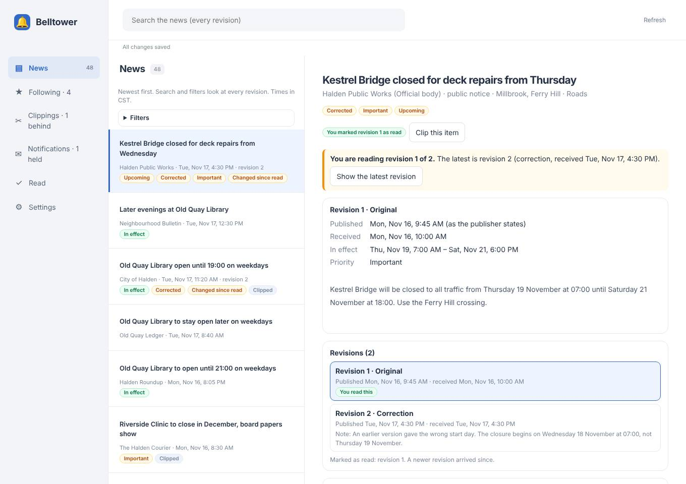 Step 2: Revision 1 is shown as an earlier revision, with its own text</td></tr>
</table>

**Differences.** GOV.UK lists change notes; Belltower lists every revision with its type and keeps each readable. Opening an item marks nothing; a read mark names a revision, and the list says when a newer one arrived.

| Step | Action | Expected | Observed on the page | State read back through MCP | Check |
| --- | --- | --- | --- | --- | --- |
| [1. The bridge notice opens at its correction, with the publisher's note](sequences/read-mark-01.jpg) | News: open “Kestrel Bridge closed for deck repairs from Wednesday” (it-roads-0031). | Revision 2 (a correction) with the publisher's note; times in America/Chicago although the browser runs in Asia/Tokyo; the list row says Changed since read. | Kestrel Bridge closed for deck repairs from Wednesday Halden Public Works (Official body) · public notice · Millbrook, Ferry Hill · Roads · Corrected Important Upcoming · Correction from the publisher: An earlier version gave the wrong start day. The closure begins on Wednesday 18 November at 07:00, not Thursday 19 November. · Kestrel Bridge closed for deck repairs from Wednesday Halden Public Works · Tue, Nov 17, 4:30 PM · revision 2 Upcoming Corrected Important Changed since read | `items.get`: it-roads-0031 latest revision 2 (correction), last read revision 1 | *an item opens at its latest revision with the publisher's correction note* |
| [2. Revision 1 is shown as an earlier revision, with its own text](sequences/read-mark-02.jpg) | Click revision 1 in the list of revisions. | The page says it shows revision 1 of 2 and shows that revision's headline and text. | You are reading revision 1 of 2. The latest is revision 2 (correction, received Tue, Nov 17, 4:30 PM). Show the latest revision · Kestrel Bridge closed for deck repairs from Thursday | `items.get`: it-roads-0031 revision 1: “Kestrel Bridge closed for deck repairs from Thursday” | *an earlier revision is shown as such, with its own text* |
| [3. Marked as read: the App records revision 2 and the list stops saying changed](sequences/read-mark-03.jpg) | Show the latest revision, then Mark revision 2 as read. (Opening three items before marked nothing.) | belltower.reading.mark records revision 2; the list row no longer says Changed since read. | Revision 2 marked as read. · Kestrel Bridge closed for deck repairs from Wednesday Halden Public Works · Tue, Nov 17, 4:30 PM · revision 2 Upcoming Corrected Important | `reading.list`: it-roads-0031@2 `receipt`: request web-3d9187a1-8eba-4c7f-9d2f-0731e62d90e0 `version`: epoch 1, revision 1 | *the read mark is the App's record and the list no longer says changed since read* |

### Settings: saved, refused

<table>
<tr><th>Reference</th><th>Belltower</th></tr>
<tr><td valign="top" width="50%"> Notify NYC: About, notification types</td><td valign="top" width="50%">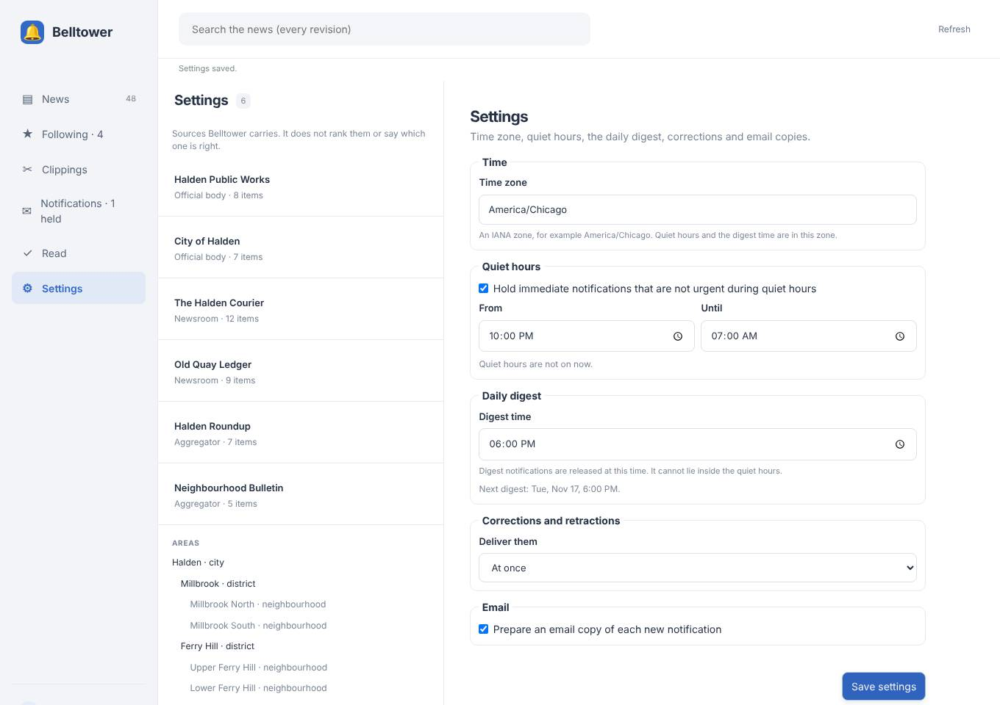 Step 1: Saved: corrections and retractions at once</td></tr>
</table>

**Differences.** Notify NYC chooses channels; Belltower's settings choose quiet hours, the digest time, how corrections and retractions are delivered, and email copies.

| Step | Action | Expected | Observed on the page | State read back through MCP | Check |
| --- | --- | --- | --- | --- | --- |
| [1. Saved: corrections and retractions at once](sequences/settings-01.jpg) | Settings: Corrections and retractions, Deliver them at once; Save settings. | belltower.preferences.update sends only corrections. | Settings saved. | `preferences.get`: corrections immediate `receipt`: request web-2771f1ea-c82c-4e9b-8685-b5d7f94e869b `version`: epoch 1, revision 13 | *the App now delivers corrections at once* |
| [2. A digest time inside the quiet hours is refused](sequences/settings-02.jpg) | Digest time 23:00 (quiet hours 22:00–07:00); Save settings. | The App answers invalid_arguments and the page says why; the digest time stays 18:00. | The digest time 23:00 lies inside the quiet hours (22:00 to 07:00). | `preferences.get`: digest_time 18:00 `version`: epoch 1, revision 13 | *a digest time inside the quiet hours is refused visibly and nothing changes* |

### A Task-like policy

Platform behaviour (the scenario profile narrows tools, objects and fields); no reference product counterpart.

| Step | Action | Expected | Observed on the page | State read back through MCP | Check |
| --- | --- | --- | --- | --- | --- |
| [1. Under a Task-like policy a refused write says so](sequences/restricted-policy-01.jpg) | A second run with the scenario profile: open it-bull-0312, Mark revision 1 as read. | The policy does not allow this item: the page says the action is not allowed; nothing is written. | This operation is not allowed for the current account and policy. | `reading.list`: marks for it-bull-0312: 0 | *a write the policy refuses is shown as refused and changes nothing* |
| [2. A change outside the allowed fields is refused](sequences/restricted-policy-02.jpg) | Following: open fl-0004 (pausing it is allowed and was done), Edit rule, add the topic health, send. | The App answers permission_denied and the form says so; the rule keeps its topics. | This operation is not allowed for the current account and policy. | `follows.list`: fl-0004 topics libraries, schools, paused true | *a change outside the allowed fields is refused* |

### The full-window dataset in the web pages

The evaluation dataset loaded into the same pages; see "Full-window evaluation dataset" below.

| Step | Action | Expected | Observed on the page | State read back through MCP | Check |
| --- | --- | --- | --- | --- | --- |
| [1. Two years of news: the list opens on the newest items at the dataset clock](sequences/full-window-01.jpg) | A third run: Infra loads datasets/full-window with env.load_seed at its clock (2026-12-31T20:00:00-06:00); open the access link and the first item. | The news list starts with the newest items, it-cour-26099 first. | School board debates a new lunch provider The Halden Courier (Newsroom) · article · Halden · Schools · Current | `env.load_seed`: ready, 1209 records `items.list`: first it-cour-26099, it-cour-26098, it-works-26078 | *on the full-window dataset the news list opens on the newest items at the dataset clock* |
| [2. The oldest item, from 1 January 2025, with its year shown](sequences/full-window-02.jpg) | Search “Mill Road”; open it-city-25001. | The item received 2025-01-01T18:30:00-06:00; a date outside the clock's year shows its year. | Planning application: 38 homes on Mill Road City of Halden (Official body) · article · Millbrook North · Government · Current · Revision 1 · Original Published Wed, Jan 1, 2025, 6:05 PM (as the publisher states) Received Wed, Jan 1, 2025, 6:30 PM Priority Routine A de | `items.get`: it-city-25001 received 2025-01-01T18:30:00-06:00 | *the oldest item of the dataset opens with its year shown* |
| [3. A closure that starts after the clock: upcoming, not history](sequences/full-window-03.jpg) | Search “Riverside Drive”; open it-works-26078. | The notice is Upcoming: its period starts 2026-12-31T21:00:00-06:00, after the clock. The coverage report counts the date it was received, not the dates it announces. | Overnight lane closure on Riverside Drive Halden Public Works (Official body) · public notice · Millbrook South · Roads · Current Upcoming | `items.get`: it-works-26078 received 2026-12-28T18:30:00-06:00, effective 2026-12-31T21:00:00-06:00 to 2027-01-01T05:00:00-06:00, upcoming `coverage.json`: 2 notices start after the clock; effective periods are excluded from every count | *a closure that starts after the dataset clock is shown as upcoming* |

## Full-window evaluation dataset

`datasets/full-window/` is the delivered evaluation data, separate from the smoke-test fixture. Its card is [`datasets/full-window/README.md`](../datasets/full-window/README.md); the counts are [`coverage.md`](../datasets/full-window/coverage.md) and [`coverage.json`](../datasets/full-window/coverage.json).

- **Files:** `seed.json` (1,097,763 bytes, sha256 `028b16b72493f1dd…`), `clock.json` (sha256 `ebc60d2258e90026…`), `dataset.json` (sha256 `7919360a5bb30598…`). Clock 2026-12-31T20:00:00-06:00. Declared in `datasets/full-window/dataset.json` (`pale.dataset.v1`).
- **Provenance:** every record is synthetic and fictional (in each family: all synthetic, 0 real, 0 mixed), generated by `dev/dataset.cjs` (fixed seed) through the App's own functions, so each record passes the App's rules. The plan's world is invented by design, so there is no real source data, no collection date and no real anchor to report; the policy's November 2026 anchor is for websites whose earlier data cannot be retrieved.
- **Window and zone:** 2025-01-01 to 2026-12-31 (730 dates), counted in America/Chicago. Each record family has one authoritative date field. Timestamps (all with a UTC offset) are converted to a local date in America/Chicago. A revision counts on the date it was received; publication times differ by minutes. A record counts when its local date is in the window and it is not after the dataset clock; missing or unparseable dates are counted as invalid and listed. Distinct dates are counted per family and once globally (a date with several records or families counts once). Removed clippings and follow rules are no longer stored: their dates appear only through the activity log.
- **Distinct dates:** actions only 604 of 730 (2025-01-01 to 2026-12-31); all history 604. Months with records: 24 of 24. Longest gaps in the actions: 2026-05-23 to 2026-05-26 (4 days), 2025-04-04 to 2025-04-06 (3 days), 2025-05-09 to 2025-05-11 (3 days).
- **Invalid or missing dates:** none.

| Family | Authoritative date field | Records | In window | Distinct dates | Excluded |
| --- | --- | ---: | ---: | ---: | --- |
| Actions: activity log rows (every arriving revision, every account write, and their effects) | `activity[].at` | 1,686 | 1,686 | 604 | — |
| Dana's own writes (activity rows with actor "agent"): follow rules, preferences, read marks, clippings | `activity[].at` | 435 | 435 | 279 | — |
| New items: revision 1, by receipt | `items[].revisions[0].received_at` | 869 | 869 | 540 | — |
| Updates | `items[].revisions[].received_at (type update)` | 58 | 58 | 54 | — |
| Corrections | `items[].revisions[].received_at (type correction)` | 28 | 28 | 26 | — |
| Retractions | `items[].revisions[].received_at (type retraction)` | 7 | 7 | 6 | — |
| Copies and reports of another item (revisions with based_on) | `items[].revisions[].received_at (with based_on)` | 239 | 239 | 202 | — |
| Read marks | `read_marks[].read_at` | 345 | 345 | 247 | — |
| Clippings kept at the clock: when made and when changed | `clippings[].created_at, clippings[].history[].replaced_at` | 40 | 40 | 38 | — |
| Notifications, by creation time | `notifications[].created_at` | 289 | 289 | 182 | — |

**Not history: Effective periods of notices.** Effective periods are the dates a notice announces (a closure, a ban, opening hours). They are excluded from every coverage count above; only the dates the notices were received count. (notices 323, with effective period 323, open ended 18, starting after clock 2, in effect at clock 17, ending after clock 2, latest start 2026-12-31T21:00:00-06:00).

**Reproduce and load.** `cd apps/belltower && npm run check:dataset` regenerates the data in memory and the counts, and compares both with the files. `node apps/belltower/tests/dataset.integration.cjs --runtime runtime` loads it with `env.load_seed` at its clock through the public runtime and reads it back through the App's tools month by month; the [full-window sequence](#seq-full-window) above shows it in the web pages.
