# Pegboard 1.0.0: review evidence

This index answers the delivery evidence contract of `docs/submission-evidence.md` (added to `main` by PR #260, at `6933c43`) for the plan approved in [PR #173](https://github.com/MatrAIx-ai/Personal-Agents-Last-Exam/pull/173). It pairs captures of the reference products with ordered browser sequences of the App, and links the separate full-window evaluation dataset. It claims no acceptance.

## Scope, versions and reproduction

- **Scope.** Every workflow of the approved plan is delivered, with its web pages (added after the first submission when the maintainers asked Environments for a GUI). Mail is the one connected App, for the optional notifications, and is delivered. Nothing is deferred. The plan itself is unchanged.
- **Recorded run.** `pegboard` 1.0.0; the screenshots show the package whose digest without this folder is `ba557e8d42c6adbb40fffe375d5d9482371e87aa8a23149d58463f2ed89c3ae0` (Core's package digest of `apps/pegboard/` leaving out `evidence/`, which holds the screenshots and so cannot be part of what they show). Public runtime 1.6.0 and its Web Host on loopback; Node v22.23.4; Chrome 153.0.8010.12, headless through Playwright 1.56.1, the version the repository pins; viewport 1360x960 (narrow checks at 390x844). The browser runs in Asia/Tokyo, so times must come out in the workplace's zone.
- **Runs and accounts** (all data synthetic): `browser`: sandbox profile, fixtures/minimal.json, account pegboard-noor (Noor Haddad), clock 2026-11-21T18:00:00-08:00; `restricted`: scenario profile, same fixture; `full-window`: sandbox profile, datasets/full-window loaded by Infra at its clock.
- **Reproduce.** `node apps/pegboard/tests/web.browser.cjs --runtime runtime --evidence apps/pegboard/evidence/sequences` (with `--chrome PATH` for an installed Chrome). It writes one JPEG per step and [`sequences/sequences.json`](sequences/sequences.json), and fails if a step names a check that did not pass in the same run. To click through by hand: `node apps/pegboard/examples/web.cjs --runtime runtime`, or with `--dataset full-window`.
- **Outcomes, reported separately** in [`docs/validation/pegboard-v1.0.0.md`](../../../docs/validation/pegboard-v1.0.0.md): GUI (this browser test: 65 checks, 36 evidence steps), MCP (the public verifier and `tests/mcp.integration.cjs`), business (`tests/business.test.cjs`), Mail (`tests/mail.integration.cjs`) and the dataset (`tests/dataset.integration.cjs`). Screenshots replace none of them.

## Delivery evidence index

| Workflow / requirement | Scope and pinned versions | Reference screenshots | Implemented sequence / actions | Business and MCP tests | Dependency result / files / receipts | Date report / source mapping | Verdict and remaining gap |
| --- | --- | --- | --- | --- | --- | --- | --- |
| W1 Schedule and hours | Required, delivered | [pb-wiw-shift-details](reference/pb-wiw-shift-details.jpg) | [cover-refused 1](#seq-cover-refused), [full-window 1](#seq-full-window), [full-window 3](#seq-full-window) | T01–T05; MCP; Web | None | Coverage families: shifts_worked, schedule_postings, shift_changes | Passed (automated); human review pending |
| W2 Availability, time off and preferences | Required, delivered | [pb-wiw-availability](reference/pb-wiw-availability.jpg), [pb-wiw-time-off](reference/pb-wiw-time-off.jpg) | [time-off](#seq-time-off), [availability](#seq-availability), [settings](#seq-settings) | T06, T07; MCP; Web | None | Coverage families: time_off, account_writes | Passed (automated); human review pending |
| W3 Getting a shift covered: approval | Required, delivered | [pb-wiw-overview](reference/pb-wiw-overview.jpg), [pb-wiw-swap](reference/pb-wiw-swap.jpg), [pb-wiw-flow](reference/pb-wiw-flow.jpg), [pb-wiw-statuses](reference/pb-wiw-statuses.jpg) | [trade-approved](#seq-trade-approved) | T08–T12; MCP; Web | Notification ntf-0018 and the shifts' history rows read back through MCP; Mail: see below | Coverage families: handoffs, handoff_steps | Passed (automated); human review pending |
| W3 Getting a shift covered: denial | Required, delivered | [pb-wiw-get-covered](reference/pb-wiw-get-covered.jpg), [pb-wiw-release-confirm](reference/pb-wiw-release-confirm.jpg), [pb-wiw-statuses](reference/pb-wiw-statuses.jpg) | [release-denied](#seq-release-denied), [cover-refused](#seq-cover-refused), [incoming-declined](#seq-incoming-declined) | T08–T12; MCP; Web | Receipts of the retried release (one effect); the denial and the notification read back | Coverage families: handoffs, handoff_steps | Passed (automated); human review pending |
| W3 Getting a shift covered: timeout and void | Required, delivered | [pb-wiw-drop-coworkers](reference/pb-wiw-drop-coworkers.jpg), [pb-wiw-statuses](reference/pb-wiw-statuses.jpg) | [cover-expired](#seq-cover-expired), [manager-change](#seq-manager-change), [request-cancelled](#seq-request-cancelled), [stale-form](#seq-stale-form) | T14, T17; MCP; Web | The expired and void states after Infra moves the clock or applies the manager's event | Coverage families: handoffs, handoff_steps | Passed (automated); human review pending |
| W4 Open shifts | Required, delivered | [pb-wiw-openshifts](reference/pb-wiw-openshifts.jpg) | [pickup-refused](#seq-pickup-refused) | T13; MCP; Web | None | Coverage families: handoffs | Passed (automated); human review pending |
| Policy narrowing (Task-like profile) | Required by the platform | N/A | [restricted-policy](#seq-restricted-policy) | MCP (policy by tool, object and field) | None | N/A | Passed (automated) |
| Optional Mail notifications | Delivered optional connection (Mail 1.3.0, pinned) | N/A: no page of Pegboard sends mail; the Infra sender does | N/A (no GUI step); the settings page switches email copies | T16b; `tests/mail.integration.cjs` | Mail receipt, the message the Mail Agent reads, retries and refusals: `docs/validation/pegboard/mail-integration.node22.json` | Coverage families: notifications | Passed (automated) |
| Full-window evaluation dataset | Required by `docs/submission-evidence.md` §3 | N/A | [full-window](#seq-full-window) | Dataset test in `tests/business.test.cjs`; `tests/dataset.integration.cjs` | `datasets/full-window/` files and hashes below | [coverage.md](../datasets/full-window/coverage.md) | Passed (automated); synthetic only, realism review pending |

Every write in the sequences is read back through MCP at that step (the "State" column below), with the request ID of its receipt. Events from outside the account (a manager, a coworker, a publisher, a forecaster) arrive through Infra's `env.apply_event`, and clock moves through `env.advance_time`; the page sees them after Refresh, which is the independent update the contract asks for. Reloads are in the sequences where marked.

## Reference products

The plan names When I Work as the reference product. Its help article cited in the plan (`get-your-shifts-covered-computer`) now answers 404; the captures come from the current version of that article, "Getting Your Shifts Covered", and five neighbouring articles. Odoo Planning, captured earlier as a second reference, is not used: the plan does not name it.

| Capture | Page | Captured (UTC); published | Licence and handling | What it shows |
| --- | --- | --- | --- | --- |
| [pb-wiw-overview](reference/pb-wiw-overview.jpg) | [When I Work Help Center: Getting Your Shifts Covered, overview](https://help.wheniwork.com/articles/getting-your-shifts-covered/) | 2026-11-26T18:47:26Z; article updated 26 March 2026 | © When I Work, Inc., all rights reserved. Kept only to compare the workflow; nothing from it is used in the App; the site header with its logo cropped | The three ways to get a shift covered: release it to OpenShifts, drop it to a coworker, swap it with a coworker; the manager can switch each off |
| [pb-wiw-shift-details](reference/pb-wiw-shift-details.jpg) | [When I Work Help Center: Viewing Your Personal Schedule, shift details](https://help.wheniwork.com/articles/viewing-your-personal-schedule-computer/) | 2026-11-26T19:24:21Z; article updated 15 January 2026 | © When I Work, Inc., all rights reserved. Kept only to compare the workflow; nothing from it is used in the App; the map in the vendor's sample is © Google | A shift opened from My Schedule: time, position, place, breaks and Get Shift Covered |
| [pb-wiw-get-covered](reference/pb-wiw-get-covered.jpg) | [Same article: Release a Shift on a computer](https://help.wheniwork.com/articles/getting-your-shifts-covered/) | 2026-11-26T18:47:49Z; article updated 26 March 2026 | © When I Work, Inc., all rights reserved. Kept only to compare the workflow; nothing from it is used in the App | A shift's Get Shift Covered menu: Release, Drop, Swap |
| [pb-wiw-release-confirm](reference/pb-wiw-release-confirm.jpg) | [Same article: the Release Shift confirmation](https://help.wheniwork.com/articles/getting-your-shifts-covered/) | 2026-11-26T18:47:35Z; article updated 26 March 2026 | © When I Work, Inc., all rights reserved. Kept only to compare the workflow; nothing from it is used in the App | Releasing asks first and says the shift becomes an OpenShift |
| [pb-wiw-drop-coworkers](reference/pb-wiw-drop-coworkers.jpg) | [Same article: Request Shift Drop](https://help.wheniwork.com/articles/getting-your-shifts-covered/) | 2026-11-26T18:48:02Z; article updated 26 March 2026 | © When I Work, Inc., all rights reserved. Kept only to compare the workflow; nothing from it is used in the App; the pictures of the vendor's sample people blurred | Choosing the coworkers to offer a shift to; "you're still responsible to work this shift until someone accepts" |
| [pb-wiw-swap](reference/pb-wiw-swap.jpg) | [Same article: Shift Swap](https://help.wheniwork.com/articles/getting-your-shifts-covered/) | 2026-11-26T18:48:09Z; article updated 26 March 2026 | © When I Work, Inc., all rights reserved. Kept only to compare the workflow; nothing from it is used in the App | Choosing the coworkers' shifts one would work instead |
| [pb-wiw-statuses](reference/pb-wiw-statuses.jpg) | [Same article: Statuses for Shift Requests](https://help.wheniwork.com/articles/getting-your-shifts-covered/) | 2026-11-26T18:48:21Z; article updated 26 March 2026 | © When I Work, Inc., all rights reserved. Kept only to compare the workflow; nothing from it is used in the App | Pending Approval, Pending Acceptance, Accepted, Canceled (also when management changes the offered shift), Declined, Expired, Denied |
| [pb-wiw-flow](reference/pb-wiw-flow.jpg) | [Same article: Shift request process flow](https://help.wheniwork.com/articles/getting-your-shifts-covered/) | 2026-11-26T18:48:17Z; article updated 26 March 2026 | © When I Work, Inc., all rights reserved. Kept only to compare the workflow; nothing from it is used in the App | A swap or drop with manager review: initiated, pending approval, pending acceptance, accepted |
| [pb-wiw-accept-swap](reference/pb-wiw-accept-swap.jpg) | [When I Work Help Center: Accepting Shift Swap and Drop Requests](https://help.wheniwork.com/articles/accepting-shift-swap-and-drop-requests/) | 2026-11-26T18:48:42Z; article updated 5 August 2025 | © When I Work, Inc., all rights reserved. Kept only to compare the workflow; nothing from it is used in the App; the requester's picture and name in the sample blurred | A coworker's request as the person asked sees it |
| [pb-wiw-openshifts](reference/pb-wiw-openshifts.jpg) | [When I Work Help Center: Bid on OpenShifts](https://help.wheniwork.com/articles/bid-on-openshifts-openshift-requests/) | 2026-11-26T18:49:02Z; no date shown | © When I Work, Inc., all rights reserved. Kept only to compare the workflow; nothing from it is used in the App | Available OpenShifts and Take Shift |
| [pb-wiw-availability](reference/pb-wiw-availability.jpg) | [When I Work Help Center: Setting Your Availability](https://help.wheniwork.com/articles/setting-your-availablity/) | 2026-11-26T19:24:51Z; article updated 29 August 2025 | © When I Work, Inc., all rights reserved. Kept only to compare the workflow; nothing from it is used in the App | Add Preference: times one is unavailable or prefers to work, repeating weekly |
| [pb-wiw-time-off](reference/pb-wiw-time-off.jpg) | [When I Work Help Center: Requesting Time Off](https://help.wheniwork.com/articles/requesting-time-off/) | 2026-11-26T18:49:13Z; article updated 20 February 2026 | © When I Work, Inc., all rights reserved. Kept only to compare the workflow; nothing from it is used in the App | The Request Time Off form |

The same list is in [`reference/references.json`](reference/references.json). A reference is a workflow comparison: the App copies no branding and does not aim to match pixels.

## Sequences

### Handoff approval: a trade accepted by the coworker and approved by the manager

<table>
<tr><th>Reference</th><th>Pegboard</th></tr>
<tr><td valign="top" width="50%">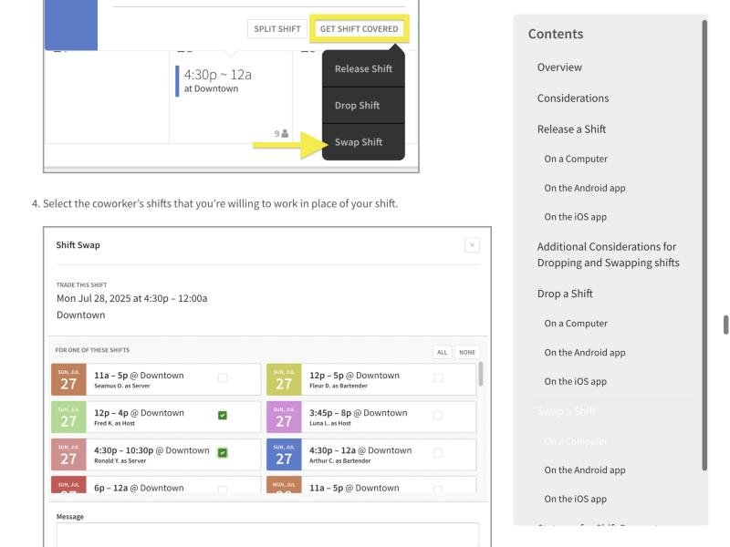 Same article: Shift Swap</td><td valign="top" width="50%">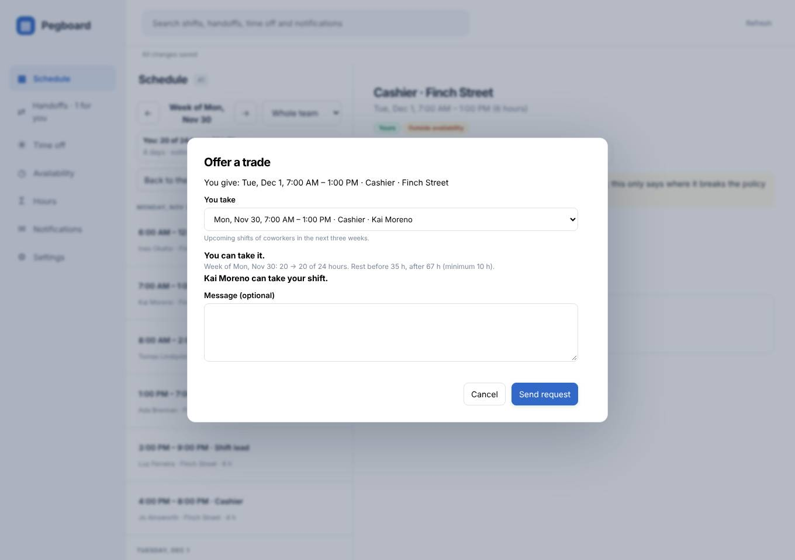 Step 1: The trade form checks both sides</td></tr>
<tr><td valign="top" width="50%">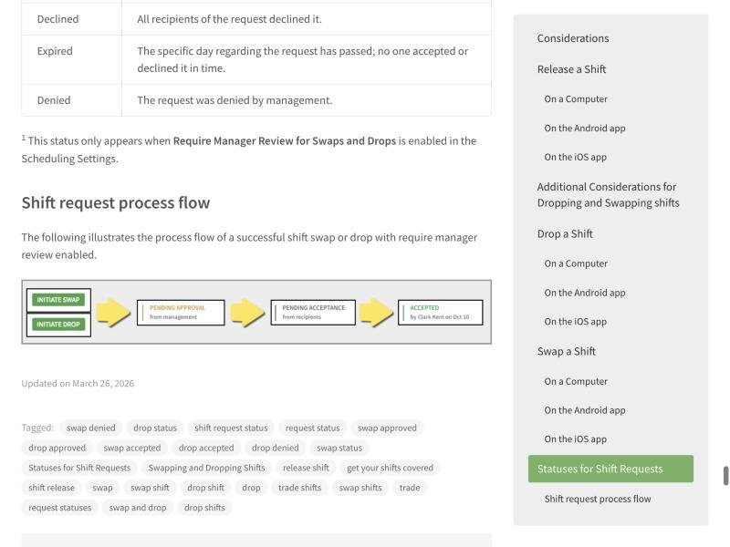 Same article: Shift request process flow</td><td valign="top" width="50%">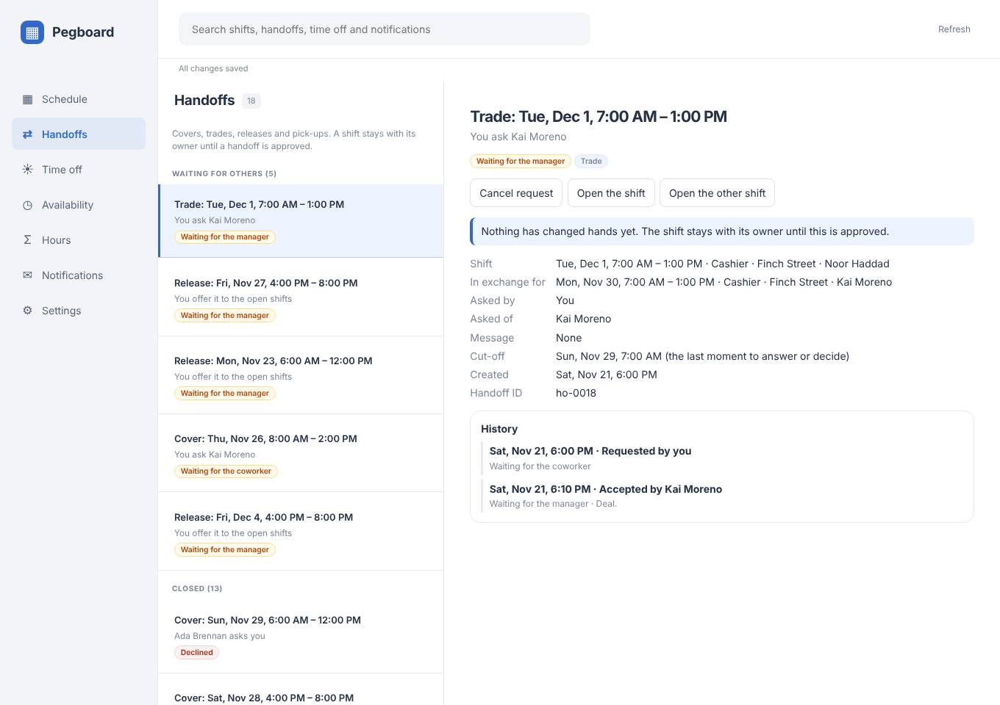 Step 3: Kai accepts: it now waits for the manager</td></tr>
<tr><td valign="top" width="50%">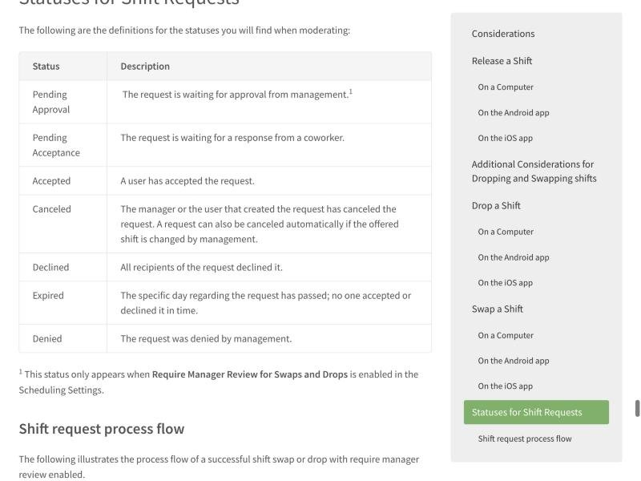 Same article: Statuses for Shift Requests</td><td valign="top" width="50%">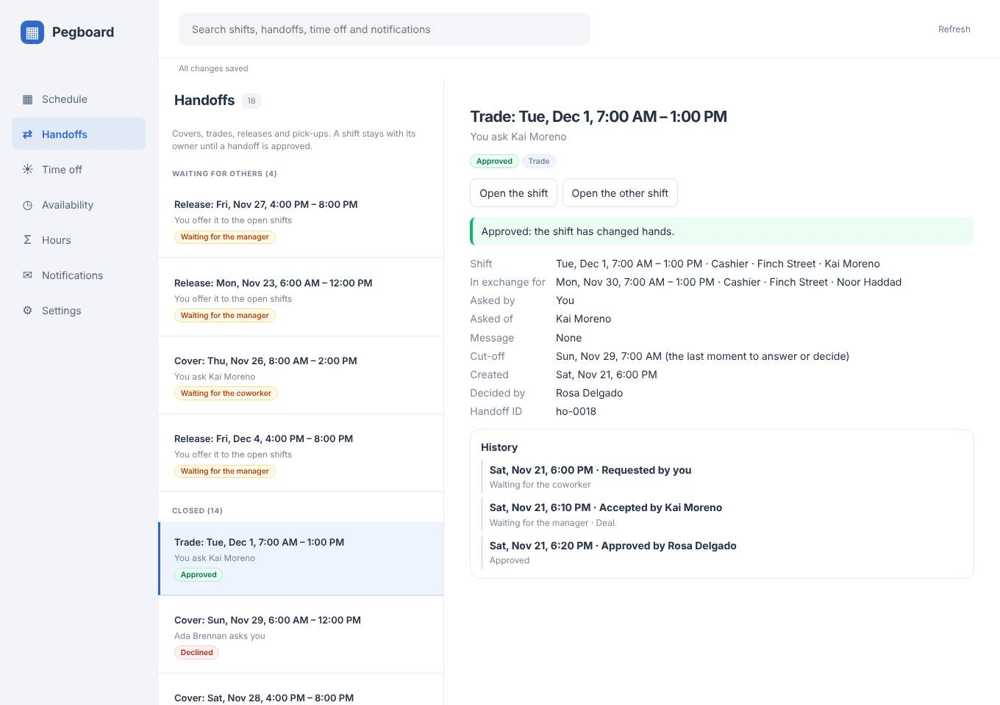 Step 4: Rosa approves: both shifts change hands</td></tr>
</table>

**Differences.** When I Work's swap offers one's shift for any of several coworkers' shifts; a Pegboard trade names one shift of one coworker, as the plan's state table has it. In When I Work's flow the manager reviews before the coworkers answer; in Pegboard the coworker answers first and the manager decides last, and nothing changes hands until the approval. The pages are a list and a detail page rather than a calendar, and copy no branding.

| Step | Action | Expected | Observed on the page | State read back through MCP | Check |
| --- | --- | --- | --- | --- | --- |
| [1. The trade form checks both sides](sequences/trade-approved-01.jpg) | Week of 30 November: open Noor's sh-1201-03, Offer a trade, choose Kai's sh-1130-03. | Noor may take Kai's shift and Kai may take hers: both checks pass. | You can take it. Week of Mon, Nov 30: 20 → 20 of 24 hours. Rest before 35 h, after 67 h (minimum 10 h). Kai Moreno can take your shift. | `eligibility.check`: Noor true, Kai true | — |
| [2. Sent: it waits for Kai; nothing has changed hands](sequences/trade-approved-02.jpg) | Send the offer. | One trade waits for Kai; both shifts keep their assignees. | Cashier · Finch Street Tue, Dec 1, 7:00 AM – 1:00 PM (6 hours) · Yours Handoff pending Outside availability · Outside your availability. The manager’s schedule stands; this only says where it breaks the policy or your own records. | `handoffs.get`: ho-0018 awaiting_coworker `shifts.get`: sh-1201-03 person-noor, sh-1130-03 person-kai `receipt`: request web-acd167c7-ab26-487a-986e-9e0ab790fbfb `version`: epoch 1, revision 4 | — |
| [3. Kai accepts: it now waits for the manager](sequences/trade-approved-03.jpg) | Infra applies pegboard.handoff.answered (accept) from Kai; Refresh. | The trade waits for the manager; still nothing has changed hands. | Trade: Tue, Dec 1, 7:00 AM – 1:00 PM You ask Kai Moreno · Waiting for the manager Trade · Nothing has changed hands yet. The shift stays with its owner until this is approved. | `handoffs.get`: ho-0018 awaiting_manager `shifts.get`: sh-1201-03 person-noor `version`: epoch 1, revision 7 | *after Refresh the trade Kai accepted waits for the manager* |
| [4. Rosa approves: both shifts change hands](sequences/trade-approved-04.jpg) | Infra applies pegboard.handoff.decided (approve) from Rosa; Refresh. | The trade is approved: sh-1201-03 is Kai's, sh-1130-03 is Noor's, each with a history row naming the trade; Noor gets a notification. | Trade: Tue, Dec 1, 7:00 AM – 1:00 PM You ask Kai Moreno · Approved Trade · Approved: the shift has changed hands. | `handoffs.get`: ho-0018 approved `shifts.get`: sh-1201-03 person-kai, sh-1130-03 person-noor `notifications.list`: ntf-0018 "Your trade was approved" `version`: epoch 1, revision 8 | *after Refresh the approved trade has moved both shifts, each with a history row naming it* |
| [5. After a reload: Kai's Monday shift is Noor's, with the move in its history](sequences/trade-approved-05.jpg) | Reload the page; Schedule, week of 30 November; open sh-1130-03. | The shift is Noor's; its history ends with the move by the approved trade. | Cashier · Finch Street Mon, Nov 30, 7:00 AM – 1:00 PM (6 hours) · Yours | `shifts.get`: sh-1130-03 person-noor, last history row: handoff ho-0018 | *after a reload, Kai's Monday shift is shown as Noor's, with the trade in its history* |

### Handoff denial: a release, a lost response and a retry, then denied by the manager

<table>
<tr><th>Reference</th><th>Pegboard</th></tr>
<tr><td valign="top" width="50%">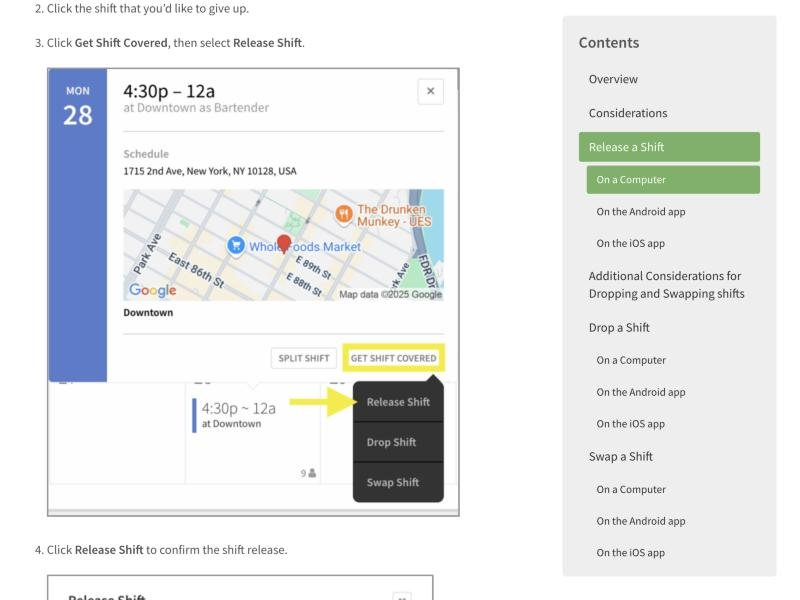 Same article: Release a Shift on a computer</td><td valign="top" width="50%">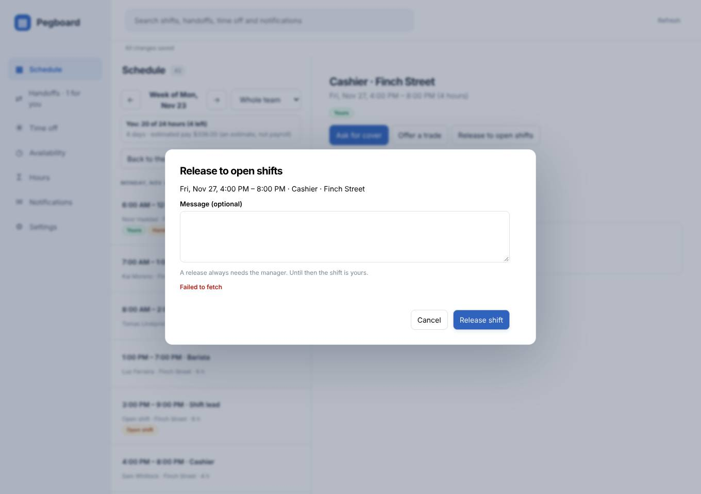 Step 1: The response to "Release" is lost: the form says so and keeps its input</td></tr>
<tr><td valign="top" width="50%">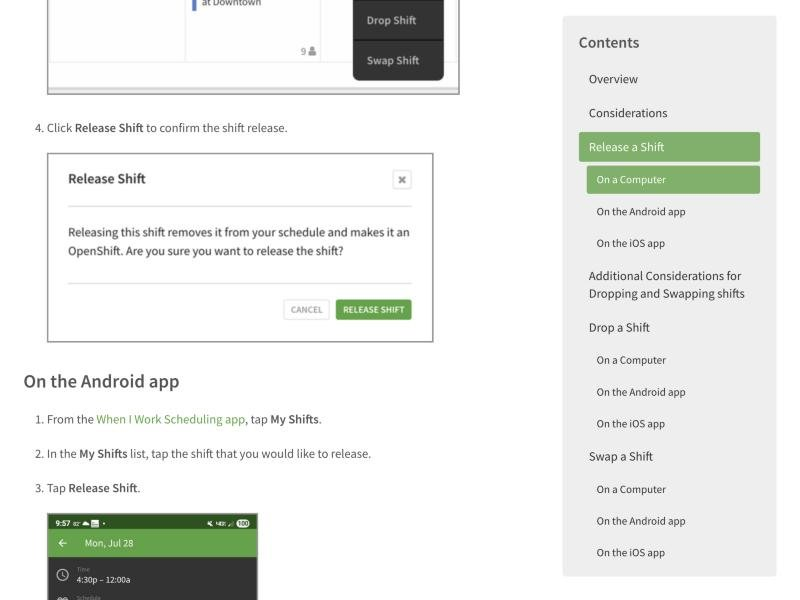 Same article: the Release Shift confirmation</td><td valign="top" width="50%">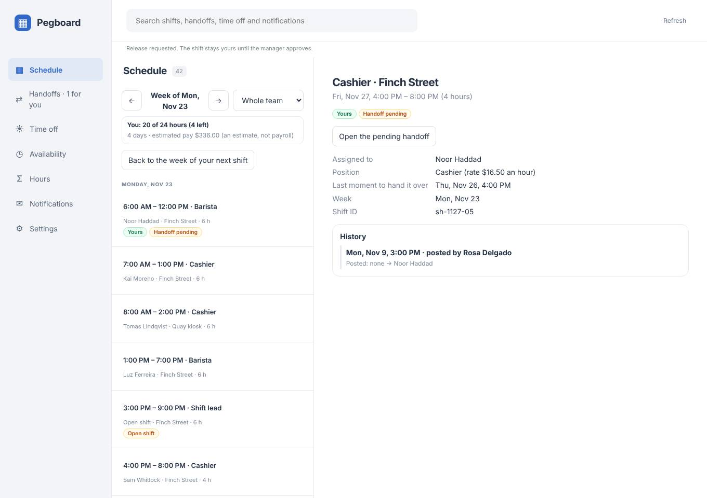 Step 2: Sent again: one release, waiting for the manager</td></tr>
<tr><td valign="top" width="50%"> Same article: Statuses for Shift Requests</td><td valign="top" width="50%">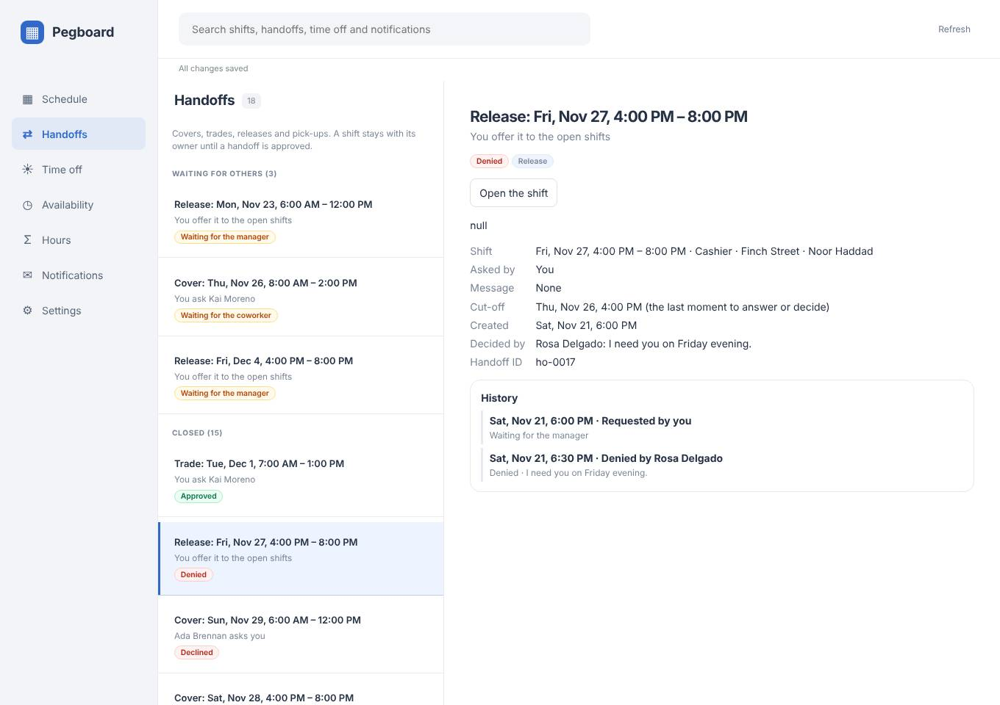 Step 3: Rosa denies it: nothing changes hands</td></tr>
</table>

**Differences.** In When I Work a released shift becomes an OpenShift at once unless the manager reviews it; in Pegboard a release always waits for the manager and the shift stays the employee's until it is approved (the plan's state table). The denial carries the manager's note.

| Step | Action | Expected | Observed on the page | State read back through MCP | Check |
| --- | --- | --- | --- | --- | --- |
| [1. The response to "Release" is lost: the form says so and keeps its input](sequences/release-denied-01.jpg) | Open Friday's shift sh-1127-05, Release to open shifts, send. The test drops the response after the App has committed it. | The form reports the failure and offers to send again with the same request ID. | Failed to fetch | `handoffs.list`: releases of sh-1127-05: 1 | — |
| [2. Sent again: one release, waiting for the manager](sequences/release-denied-02.jpg) | Send again. | The retry is the same write: one release, waiting for the manager; the shift is still Noor's. | Cashier · Finch Street Fri, Nov 27, 4:00 PM – 8:00 PM (4 hours) · Yours Handoff pending | `handoffs.get`: ho-0017 awaiting_manager `shifts.get`: person-noor `version`: epoch 1, revision 3 | *a retry after a lost response has one effect* |
| [3. Rosa denies it: nothing changes hands](sequences/release-denied-03.jpg) | Infra applies pegboard.handoff.decided (deny, with a note) from Rosa; Refresh. | The release is denied with Rosa's note; sh-1127-05 is still Noor's; Noor gets a notification. | Release: Fri, Nov 27, 4:00 PM – 8:00 PM You offer it to the open shifts · Denied Release | `handoffs.get`: ho-0017 denied `shifts.get`: sh-1127-05 person-noor `notifications.list`: ntf-0019 "Your release was denied" `version`: epoch 1, revision 9 | *after Refresh the denied release shows the manager's note and the shift is still mine* |

### Handoff timeout: a cover request that expires at its cut-off

<table>
<tr><th>Reference</th><th>Pegboard</th></tr>
<tr><td valign="top" width="50%">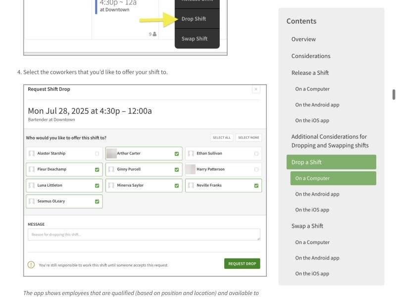 Same article: Request Shift Drop</td><td valign="top" width="50%">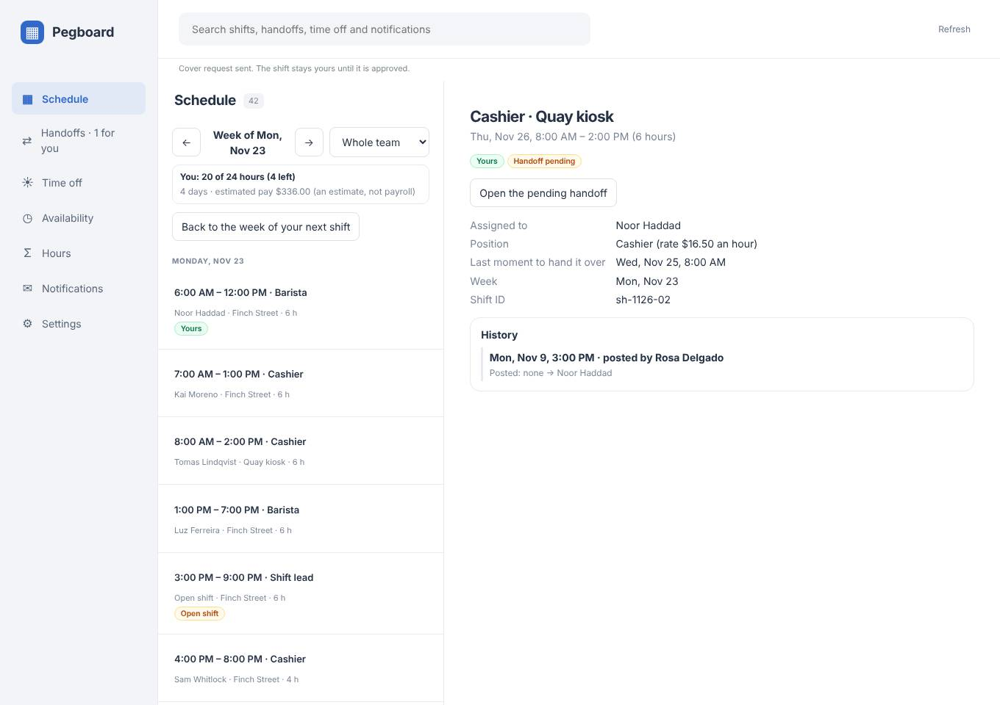 Step 2: Sent: it waits for Kai and the shift stays Noor's</td></tr>
<tr><td valign="top" width="50%"> Same article: Statuses for Shift Requests</td><td valign="top" width="50%">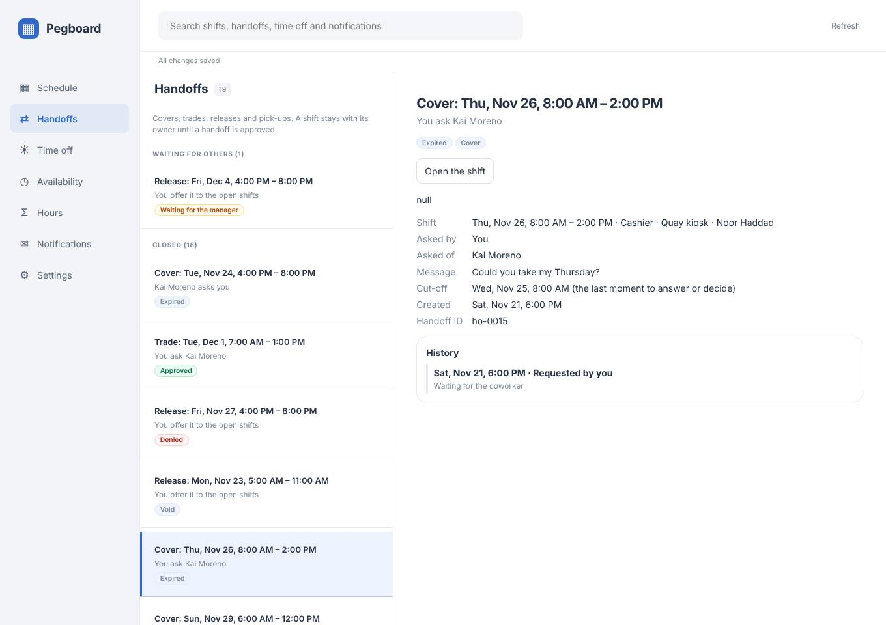 Step 3: Kai never answered: past the cut-off the request reads Expired</td></tr>
</table>

**Differences.** When I Work's drop goes to every chosen coworker and expires when its day has passed; Pegboard's cover asks one named coworker (an approved open question of the plan) and expires at the workplace's cut-off before the shift, 24 hours in the fixture, read from the App's clock.

| Step | Action | Expected | Observed on the page | State read back through MCP | Check |
| --- | --- | --- | --- | --- | --- |
| [1. The form shows Kai can take it](sequences/cover-expired-01.jpg) | Ask for cover again, choose Kai Moreno and write a message. | The App's check says Kai is eligible (14 → 20 of 20 hours). | Kai Moreno can take it. Week of Mon, Nov 23: 14 → 20 of 20 hours. Rest before 12 h, after 89 h (minimum 10 h). | `eligibility.check`: eligible true | — |
| [2. Sent: it waits for Kai and the shift stays Noor's](sequences/cover-expired-02.jpg) | Send the request. | A handoff waits for Kai until its cut-off; the shift keeps its assignee and shows the pending handoff. | Cashier · Quay kiosk Thu, Nov 26, 8:00 AM – 2:00 PM (6 hours) · Yours Handoff pending | `handoffs.get`: ho-0015 awaiting_coworker, cut-off 2026-11-25T08:00:00-08:00 `shifts.get`: person-noor, pending ho-0015 `receipt`: request web-33d778f5-dd51-4c92-8958-7584cb38514c `version`: epoch 1, revision 1 | *the cover is the App's record and the shift stays mine until it is approved* |
| [3. Kai never answered: past the cut-off the request reads Expired](sequences/cover-expired-03.jpg) | Infra moves the clock to 25 November 09:00 with env.advance_time (no App event); Refresh; open the request. | The request is expired (derived from its cut-off, nothing rewritten); the shift is still Noor's. | Cover: Thu, Nov 26, 8:00 AM – 2:00 PM You ask Kai Moreno · Expired Cover | `handoffs.get`: ho-0015 expired `shifts.get`: sh-1126-02 person-noor `version`: epoch 1, revision 16 | *after a clock move by Infra alone, a request past its cut-off reads expired* |

### A cover the rules refuse

<table>
<tr><th>Reference</th><th>Pegboard</th></tr>
<tr><td valign="top" width="50%">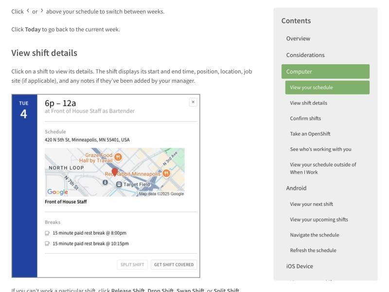 When I Work Help Center: Viewing Your Personal Schedule, shift details</td><td valign="top" width="50%">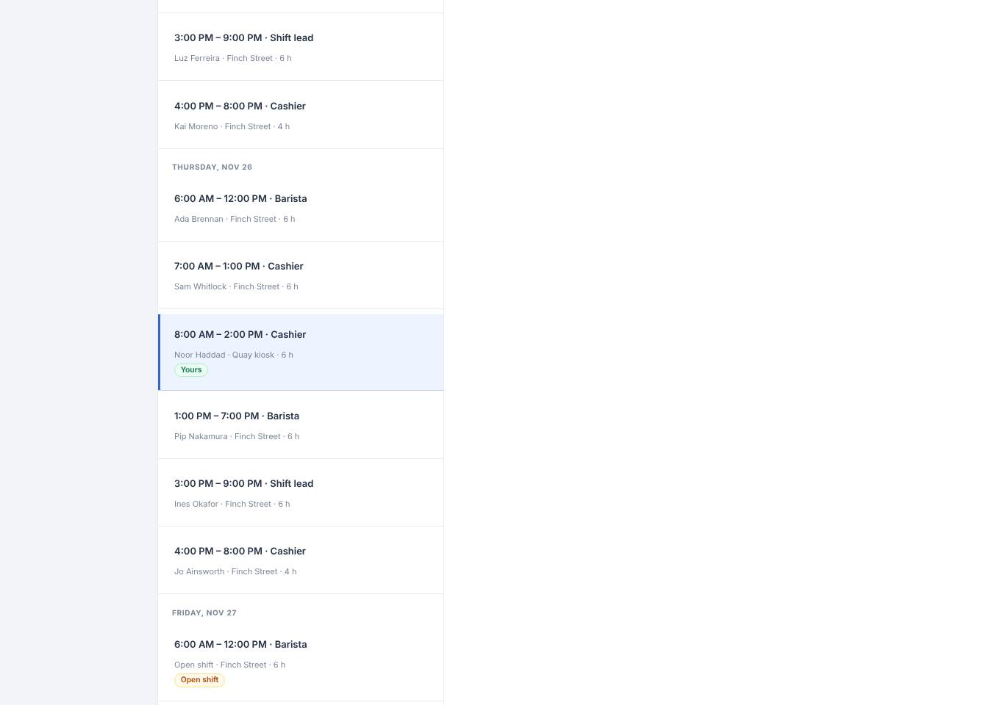 Step 1: Noor's Thursday shift, before anything is asked</td></tr>
<tr><td valign="top" width="50%"> Same article: Request Shift Drop</td><td valign="top" width="50%">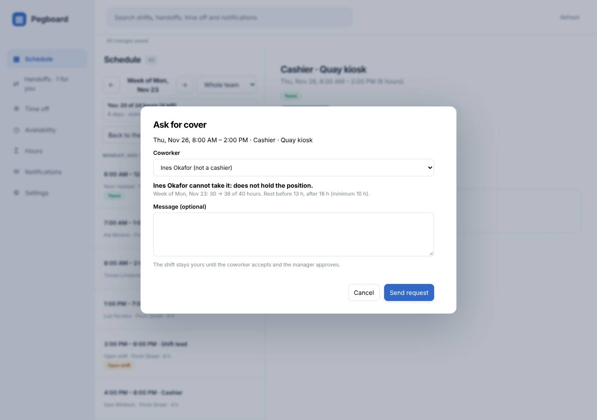 Step 2: The form shows the App's check for Ines</td></tr>
</table>

**Differences.** Both open a shift and offer to get it covered. When I Work lists only the coworkers who are qualified and available; Pegboard lists the team, shows the App's check for the chosen coworker, and refuses with the App's reason if the request is sent anyway. Pegboard's shift page also shows the shift's flags, its cut-off and its history.

| Step | Action | Expected | Observed on the page | State read back through MCP | Check |
| --- | --- | --- | --- | --- | --- |
| [1. Noor's Thursday shift, before anything is asked](sequences/cover-refused-01.jpg) | Schedule, week of 23 November: open sh-1126-02. | The shift is Noor's, with no handoff pending. | Cashier · Quay kiosk Thu, Nov 26, 8:00 AM – 2:00 PM (6 hours) · Yours | `shifts.get`: person-noor, pending handoff null `version`: epoch 1, revision 0 | — |
| [2. The form shows the App's check for Ines](sequences/cover-refused-02.jpg) | Ask for cover, then choose Ines Okafor. | The check says she cannot take it: not_qualified. | Ines Okafor cannot take it: does not hold the position. Week of Mon, Nov 23: 30 → 36 of 40 hours. Rest before 13 h, after 18 h (minimum 10 h). | `eligibility.check`: eligible false, blocks not_qualified | — |
| [3. Sending it anyway is refused, and nothing is written](sequences/cover-refused-03.jpg) | Send the request. | pegboard.handoffs.cover answers not_qualified; no handoff is created. | Ines Okafor does not hold the position Cashier. Use eligibility.check to see every rule. | `handoffs.list`: pending for sh-1126-02: 0 `version`: epoch 1, revision 0 | *a cover the rules refuse is refused visibly and writes nothing* |

### A form that went stale

No reference capture: concurrency is a contract of the platform (`expected_version`), not a screen of the reference product.

| Step | Action | Expected | Observed on the page | State read back through MCP | Check |
| --- | --- | --- | --- | --- | --- |
| [1. A cover form open for Monday's shift](sequences/stale-form-01.jpg) | Open sh-1123-01, Ask for cover, choose Ada Brennan; do not send yet. | The form was read at the current version. | Ask for cover | `version`: epoch 1, revision 1 | — |
| [2. Another client released the shift first: the form says so](sequences/stale-form-02.jpg) | Meanwhile the same run releases sh-1123-01 through MCP (pegboard.handoffs.release); then send the form. | The write is refused as stale_version; the release made elsewhere stands. | This record changed. Close this form and refresh before trying again. | `handoffs.list`: sh-1123-01: release awaiting_manager `version`: epoch 1, revision 2 | *a stale form shows the conflict and the concurrent change stands* |

### Picking up an open shift: refused by the rules

<table>
<tr><th>Reference</th><th>Pegboard</th></tr>
<tr><td valign="top" width="50%">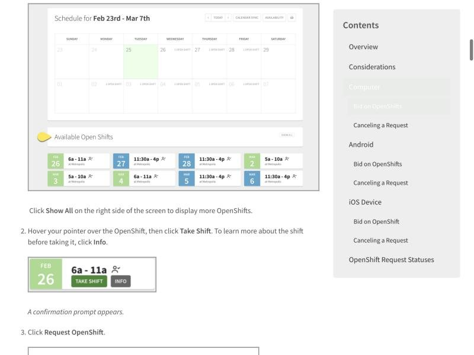 When I Work Help Center: Bid on OpenShifts</td><td valign="top" width="50%">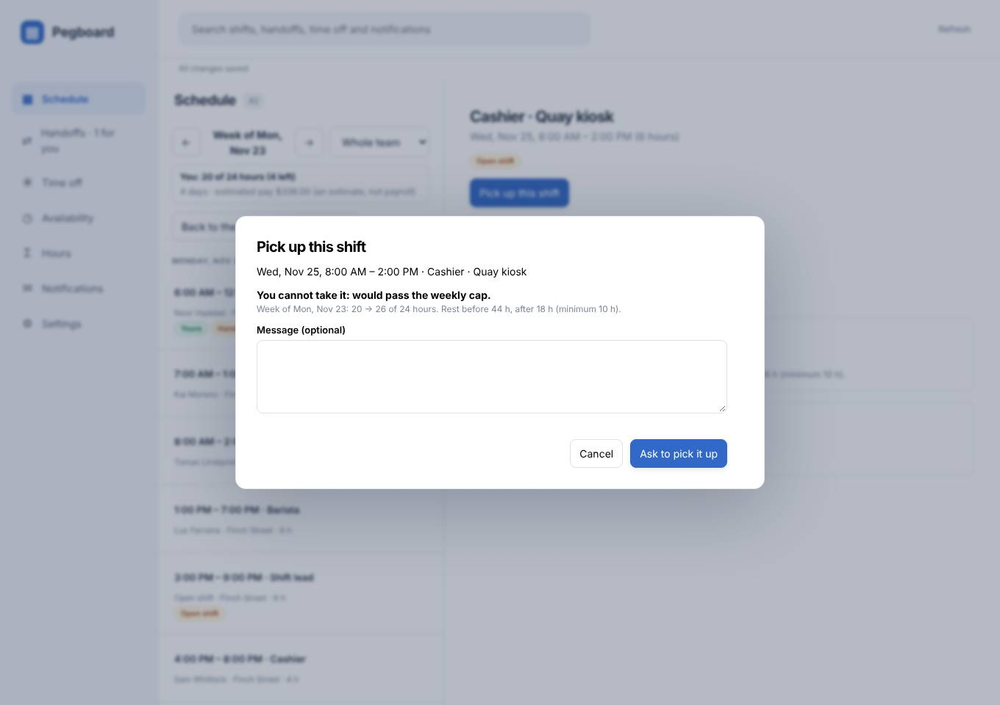 Step 1: The pick-up form shows Noor's hours for that week</td></tr>
</table>

**Differences.** When I Work sends a request to take an OpenShift; Pegboard first shows the App's check for that week's hours and refuses with `over_hours` if sent anyway.

| Step | Action | Expected | Observed on the page | State read back through MCP | Check |
| --- | --- | --- | --- | --- | --- |
| [1. The pick-up form shows Noor's hours for that week](sequences/pickup-refused-01.jpg) | Week of 23 November: open the open shift sh-1125-02, Pick up this shift. | The App's check: over_hours (20 → 26 of 24 hours). | You cannot take it: would pass the weekly cap. Week of Mon, Nov 23: 20 → 26 of 24 hours. Rest before 44 h, after 18 h (minimum 10 h). | `eligibility.check`: eligible false, blocks over_hours | — |
| [2. Sending it anyway is refused, and nothing is written](sequences/pickup-refused-02.jpg) | Send the request. | pegboard.handoffs.pickup answers over_hours; no pick-up is created. | The account holder would have 26 hours that week; the cap is 24. Use eligibility.check to see every rule. | `handoffs.list`: pick-ups of sh-1125-02: 0 `version`: epoch 1, revision 4 | *a pick-up the rules refuse is refused visibly and writes nothing* |

### A coworker's request: accepting refused, then declined

<table>
<tr><th>Reference</th><th>Pegboard</th></tr>
<tr><td valign="top" width="50%">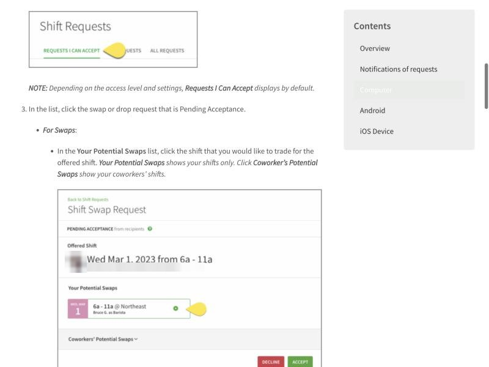 When I Work Help Center: Accepting Shift Swap and Drop Requests</td><td valign="top" width="50%">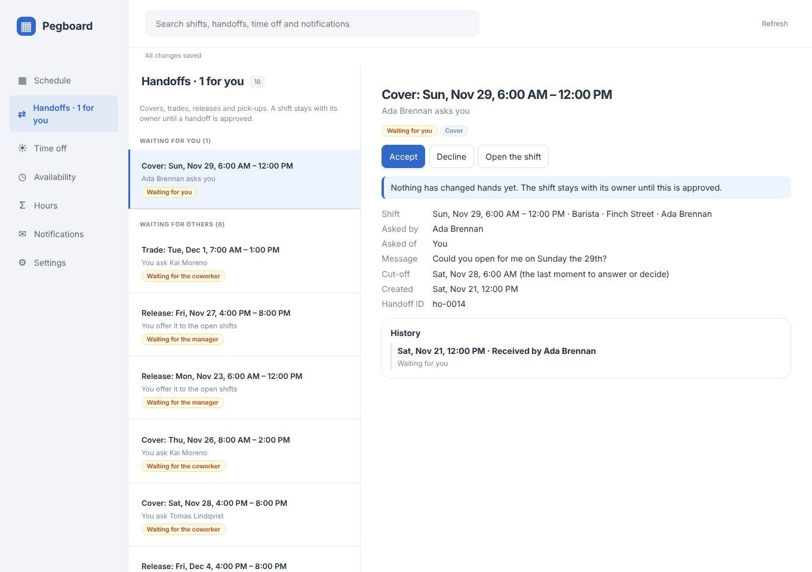 Step 1: Ada asks Noor to cover her Sunday shift</td></tr>
</table>

**Differences.** The same roles. Pegboard checks the account holder's own rules before an acceptance (here her weekly cap) and records a decline with its message.

| Step | Action | Expected | Observed on the page | State read back through MCP | Check |
| --- | --- | --- | --- | --- | --- |
| [1. Ada asks Noor to cover her Sunday shift](sequences/incoming-declined-01.jpg) | Handoffs: open the request that waits for Noor. | The request, the shift, Ada's message and the cut-off, waiting for Noor. | Cover: Sun, Nov 29, 6:00 AM – 12:00 PM Ada Brennan asks you · Waiting for you Cover · Nothing has changed hands yet. The shift stays with its owner until this is approved. | `handoffs.get`: ho-0014 awaiting_me, cut-off 2026-11-28T06:00:00-08:00 | — |
| [2. Accepting is refused by the rules](sequences/incoming-declined-02.jpg) | Accept, then send. | pegboard.handoffs.respond answers over_hours; the request still waits for Noor. | The account holder would have 26 hours that week; the cap is 24. Use eligibility.check to see every rule. | `handoffs.get`: ho-0014 awaiting_me | — |
| [3. Declined with a message](sequences/incoming-declined-03.jpg) | Decline, write "Sorry, I am at my cap that week." and send. | The request is declined, with Noor's message in its history; Ada's shift stays hers. | Cover: Sun, Nov 29, 6:00 AM – 12:00 PM Ada Brennan asks you · Declined Cover | `handoffs.get`: ho-0014 declined `shifts.get`: sh-1129-01 person-ada `version`: epoch 1, revision 5 | *the request is declined in the App* |

### Cancelling my own request

<table>
<tr><th>Reference</th><th>Pegboard</th></tr>
<tr><td valign="top" width="50%"> Same article: Statuses for Shift Requests</td><td valign="top" width="50%">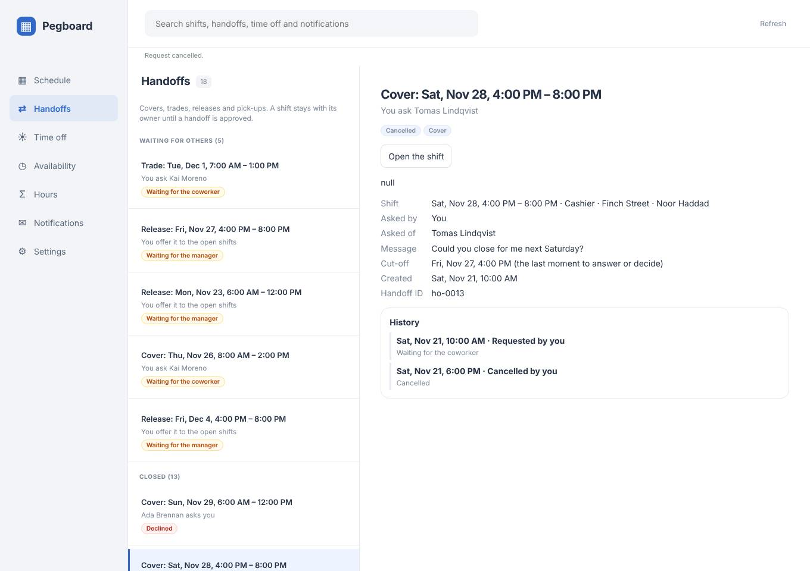 Step 2: Cancelled: closed, and the shift is still Noor's</td></tr>
</table>

**Differences.** Both call it cancelled. In Pegboard the request closes and the shift stays the employee's; nothing changed hands.

| Step | Action | Expected | Observed on the page | State read back through MCP | Check |
| --- | --- | --- | --- | --- | --- |
| [1. Noor's own request, still waiting for Tomas](sequences/request-cancelled-01.jpg) | Handoffs: open Noor's pending cover request to Tomas. | The request waits for the coworker and can be cancelled. | Cover: Sat, Nov 28, 4:00 PM – 8:00 PM You ask Tomas Lindqvist · Waiting for the coworker Cover · Nothing has changed hands yet. The shift stays with its owner until this is approved. | `handoffs.get`: ho-0013 awaiting_coworker | — |
| [2. Cancelled: closed, and the shift is still Noor's](sequences/request-cancelled-02.jpg) | Cancel request, then confirm. | The request is cancelled; nothing changed hands. | Cover: Sat, Nov 28, 4:00 PM – 8:00 PM You ask Tomas Lindqvist · Cancelled Cover | `handoffs.get`: ho-0013 cancelled `shifts.get`: sh-1128-05 person-noor `version`: epoch 1, revision 6 | *cancelling my request closes it in the App* |

### A manager's change voids a pending release

<table>
<tr><th>Reference</th><th>Pegboard</th></tr>
<tr><td valign="top" width="50%"> Same article: Statuses for Shift Requests</td><td valign="top" width="50%">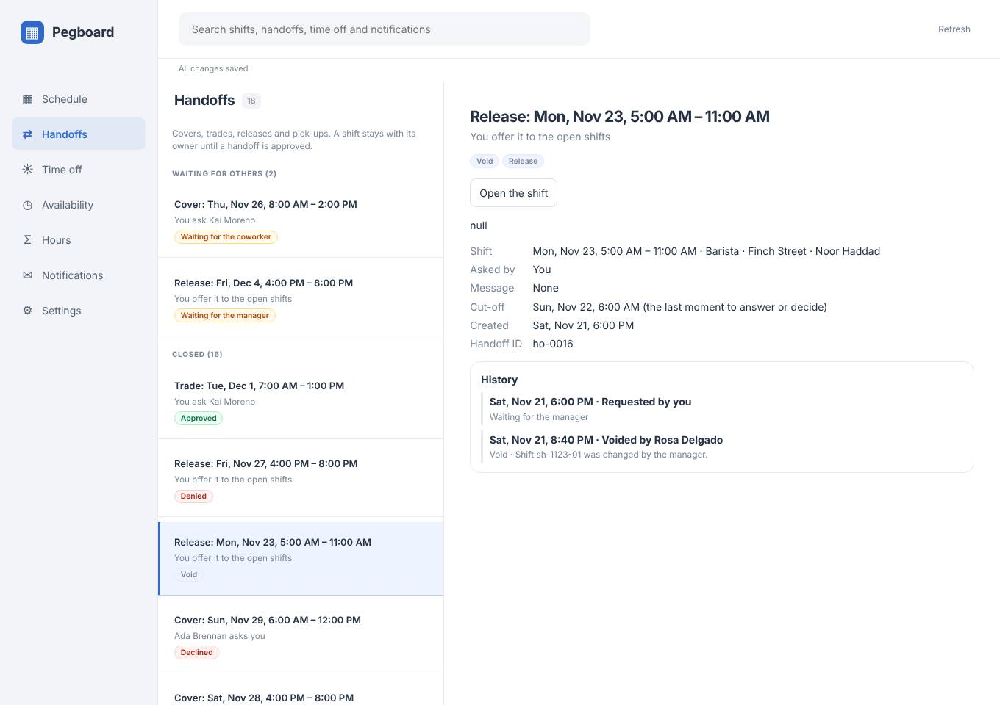 Step 2: The release that named it is void: nothing changed hands</td></tr>
</table>

**Differences.** When I Work cancels a request automatically when management changes the offered shift; Pegboard marks the request void, says so on the handoff, and the shift's history names the manager's change.

| Step | Action | Expected | Observed on the page | State read back through MCP | Check |
| --- | --- | --- | --- | --- | --- |
| [1. Rosa moves Monday's opening shift an hour earlier](sequences/manager-change-01.jpg) | Infra applies the package's scenario event (pegboard.shift.changed, ev-pb-310); Refresh; open sh-1123-01. | The shift now starts at 05:00, with the change and its reason in its history. | Barista · Finch Street Mon, Nov 23, 5:00 AM – 11:00 AM (6 hours) · Yours Short rest · Less rest than the minimum between working days. The manager’s schedule stands; this only says where it breaks the policy or your own records. | `shifts.get`: start 2026-11-23T05:00:00-08:00 `version`: epoch 1, revision 14 | *after Refresh the schedule shows a manager's change that arrived as a scenario event* |
| [2. The release that named it is void: nothing changed hands](sequences/manager-change-02.jpg) | Handoffs: open the release made earlier through MCP for sh-1123-01. | The release reads Void; the shift stays Noor's. | Release: Mon, Nov 23, 5:00 AM – 11:00 AM You offer it to the open shifts · Void Release | `handoffs.get`: ho-0016 void `shifts.get`: person-noor | *the pending handoff that named the changed shift reads void* |

### Time off: refused, requested, cancelled

<table>
<tr><th>Reference</th><th>Pegboard</th></tr>
<tr><td valign="top" width="50%">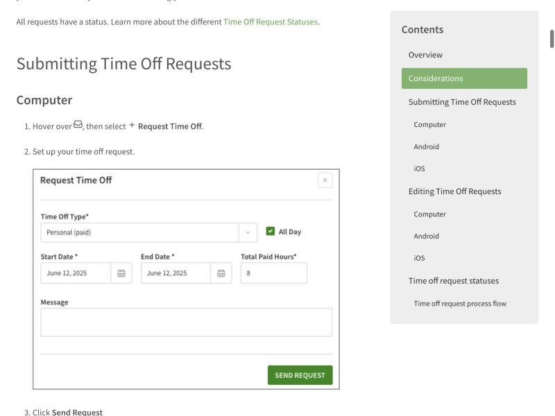 When I Work Help Center: Requesting Time Off</td><td valign="top" width="50%">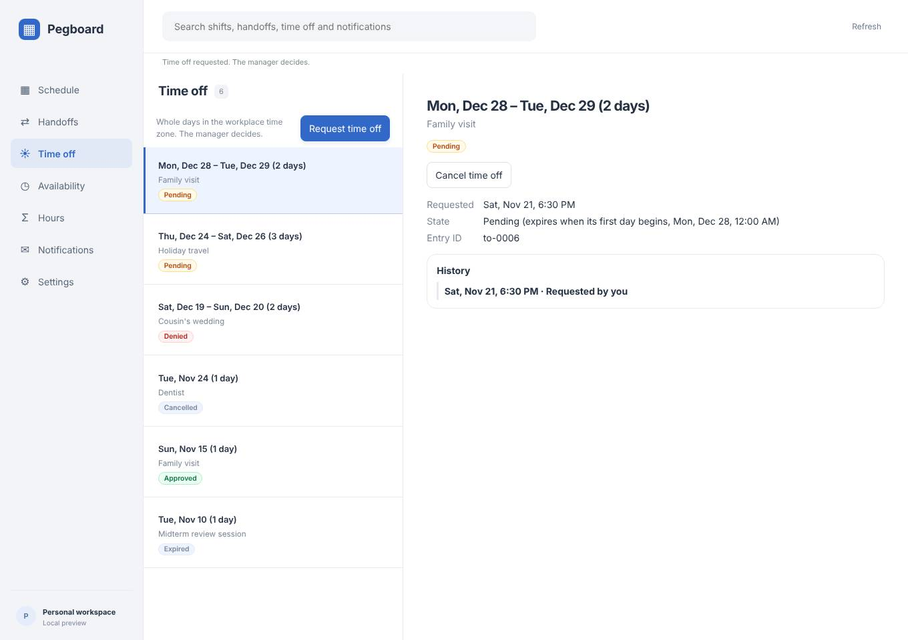 Step 2: Requested: two days, pending the manager</td></tr>
</table>

**Differences.** When I Work's form has a type and paid hours; Pegboard's entry has days and a reason, and the workplace's notice period (14 days in the fixture) is the App's rule, refused as `too_late`.

| Step | Action | Expected | Observed on the page | State read back through MCP | Check |
| --- | --- | --- | --- | --- | --- |
| [1. Nine days ahead is too late: the form says so](sequences/time-off-01.jpg) | Time off: Request time off for Monday 30 November and send. | pegboard.time_off.request answers too_late (the policy asks 14 days); nothing is written. | Time off needs 14 days of notice: the first day can be 2026-12-05 at the earliest. | `time_off.list`: 5 entries | — |
| [2. Requested: two days, pending the manager](sequences/time-off-02.jpg) | Request 28 and 29 December with the reason "Family visit". | A pending entry for the two days, waiting for the manager. | Mon, Dec 28 – Tue, Dec 29 (2 days) Family visit · Pending | `time_off.list`: to-0006 pending, 2 days `receipt`: request web-31251c71-8221-4734-9369-dcdb7a29e22f `version`: epoch 1, revision 10 | *the time off is the App's pending entry* |
| [3. Cancelled](sequences/time-off-03.jpg) | Cancel time off, then confirm. | The entry is cancelled and kept in the list of closed entries. | Mon, Dec 28 – Tue, Dec 29 (2 days) Family visit · Cancelled | `time_off.list`: to-0006 cancelled `version`: epoch 1, revision 11 | *cancelling the time off is recorded in the App* |

### Availability: refused, saved, flagged on a shift

<table>
<tr><th>Reference</th><th>Pegboard</th></tr>
<tr><td valign="top" width="50%">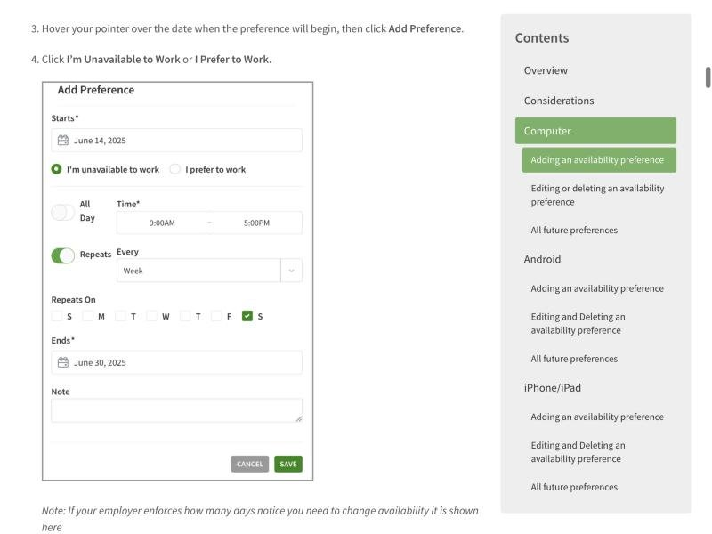 When I Work Help Center: Setting Your Availability</td><td valign="top" width="50%">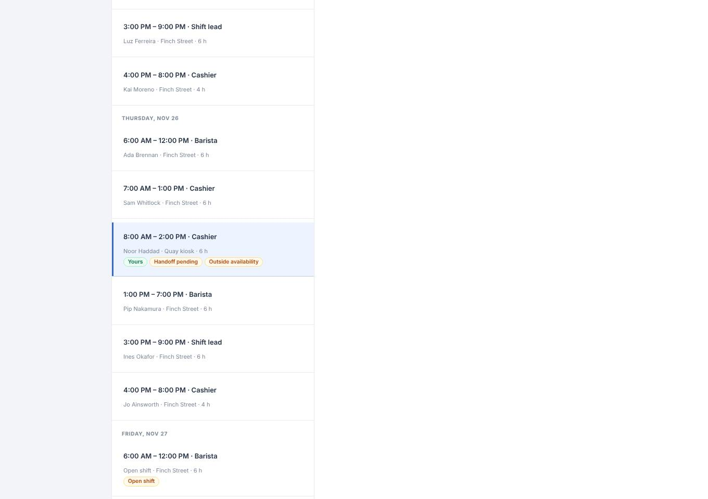 Step 2: Saved without the overlap: Thursday's shift is now flagged</td></tr>
</table>

**Differences.** In When I Work availability is a preference the manager may take into account, with an optional notice period. Pegboard keeps the weekly times the employee cannot work, refuses blocks that overlap, and flags a shift that falls in one at the next read; the manager's schedule stands.

| Step | Action | Expected | Observed on the page | State read back through MCP | Check |
| --- | --- | --- | --- | --- | --- |
| [1. Two Thursday times that overlap are refused](sequences/availability-01.jpg) | Availability: add Thursday 08:00–14:00 and Thursday 13:00–15:00, save. | pegboard.availability.update answers invalid_arguments; the saved list is unchanged. | Two blocks on thu overlap. | `availability.get`: 3 blocks | *overlapping times are refused visibly and nothing changes* |
| [2. Saved without the overlap: Thursday's shift is now flagged](sequences/availability-02.jpg) | Remove the second time and save; open Thursday's shift sh-1126-02. | The list is saved; the shift inside the new time carries the flag outside_availability. The manager's schedule stands. | Cashier · Quay kiosk Thu, Nov 26, 8:00 AM – 2:00 PM (6 hours) · Yours Handoff pending Outside availability · Outside your availability. The manager’s schedule stands; this only says where it breaks the policy or your own records. | `availability.get`: 4 blocks `shifts.get`: flags outside_availability `version`: epoch 1, revision 12 | *a shift in the new blocked time is flagged at the next read* |

### Settings: saved, refused

No reference capture.

| Step | Action | Expected | Observed on the page | State read back through MCP | Check |
| --- | --- | --- | --- | --- | --- |
| [1. Open-shift notices switched off and saved](sequences/settings-01.jpg) | Settings: untick open-shift notices, Save settings. | Only open_shift_notices is sent; the App stores it. | Status: Settings saved. | `preferences.get`: open_shift_notices false `version`: epoch 1, revision 13 | *settings send only what changed* |
| [2. Quiet hours from 07:00 to 07:00 are refused](sequences/settings-02.jpg) | Set quiet hours to start at 07:00 (they end at 07:00), Save settings. | pegboard.preferences.update answers invalid_arguments; quiet hours stay 22:00–07:00. | Quiet hours cannot start and end at the same time. | `preferences.get`: quiet hours 22:00–07:00 | *quiet hours that start and end at the same time are refused visibly and nothing changes* |

### A Task-like policy

Platform behaviour (the scenario profile narrows tools, objects and fields); no reference product counterpart.

| Step | Action | Expected | Observed on the page | State read back through MCP | Check |
| --- | --- | --- | --- | --- | --- |
| [1. Under the scenario policy, a cover for a shift it does not list is refused](sequences/restricted-policy-01.jpg) | A second run with the scenario profile: open sh-1123-01, Ask for cover, choose Ada, send. | Core answers permission_denied (the policy allows covers for three shifts only); nothing is written. | This operation is not allowed for the current account and policy. | `env.snapshot`: pending handoffs for sh-1123-01: 0 | — |

### The full-window dataset in the web pages

The evaluation dataset loaded into the same pages; see "Full-window evaluation dataset" below.

| Step | Action | Expected | Observed on the page | State read back through MCP | Check |
| --- | --- | --- | --- | --- | --- |
| [1. Two years of history: the page opens on Noor's next shift after the clock](sequences/full-window-01.jpg) | A third run: Infra loads datasets/full-window with env.load_seed at its clock (2026-12-31T20:00:00-08:00); open the access link. | The schedule opens on the week of Noor's next shift that has not ended, 2027-01-04, with that shift selected. | Barista · Finch Street Wed, Jan 6, 6:00 AM – 12:00 PM (6 hours) · Yours Handoff pending | `env.load_seed`: ready, 3799 records `shifts.list`: next shift sh-270106-01 (week of 2027-01-04) | *on the full-window dataset the schedule opens on the week of Noor's next shift, past two years of history, with that shift selected* |
| [2. The oldest handoff, from January 2025](sequences/full-window-02.jpg) | Handoffs: open the last closed request in the list. | The request of 2025-01-10 with its history; dates outside the opening year show their year. | Trade: Mon, Jan 13, 2025, 7:00 AM – 1:00 PM Jo Ainsworth asks you · Cancelled Trade | `handoffs.get`: ho-0001 cancelled, created 2025-01-10T19:45:00-08:00 | *the oldest handoff of the dataset opens with its year shown* |
| [3. Its shift, in its week of January 2025](sequences/full-window-03.jpg) | Open the shift. | The schedule moves to the week of 2025-01-13 and lists the whole team's shifts of that week. | ← Week of Mon, Jan 13, 2025 → · Cashier · Finch Street Mon, Jan 13, 2025, 7:00 AM – 1:00 PM (6 hours) · Ended | `shifts.list`: 31 shifts that week | *opening its shift moves the schedule to that week of January 2025* |

## Full-window evaluation dataset

`datasets/full-window/` is the delivered evaluation data, separate from the smoke-test fixture. Its card is [`datasets/full-window/README.md`](../datasets/full-window/README.md); the counts are [`coverage.md`](../datasets/full-window/coverage.md) and [`coverage.json`](../datasets/full-window/coverage.json).

- **Files:** `seed.json` (1,608,682 bytes, sha256 `aa84c05745f94b0d…`), `clock.json` (sha256 `c90d79a8f51321e5…`), `dataset.json` (sha256 `076a3cf1806e2e31…`). Clock 2026-12-31T20:00:00-08:00. Declared in `datasets/full-window/dataset.json` (`pale.dataset.v1`).
- **Provenance:** every record is synthetic and fictional (in each family: all synthetic, 0 real, 0 mixed), generated by `dev/dataset.cjs` (fixed seed) through the App's own functions, so each record passes the App's rules. The plan's world is invented by design, so there is no real source data, no collection date and no real anchor to report; the policy's November 2026 anchor is for websites whose earlier data cannot be retrieved.
- **Window and zone:** 2025-01-01 to 2026-12-31 (730 dates), counted in America/Los_Angeles. Each record family has one authoritative date field. Timestamps (all with a UTC offset) are converted to a local date in America/Los_Angeles. A record counts when its local date is in the window and it is not after the dataset clock; missing or unparseable dates are counted as invalid and listed. Distinct dates are counted per family and once globally (a date with several records or families counts once). Shift dates after the clock are posted future schedule, not history: they are excluded and reported under future_posted_shifts.
- **Distinct dates:** actions only 333 of 730 (2025-01-03 to 2026-12-31); all history 725. Months with records: 24 of 24. Longest gaps in the actions: 2025-01-28 to 2025-02-02 (6 days), 2025-03-18 to 2025-03-23 (6 days), 2025-05-27 to 2025-06-01 (6 days).
- **Invalid or missing dates:** none.

| Family | Authoritative date field | Records | In window | Distinct dates | Excluded |
| --- | --- | ---: | ---: | ---: | --- |
| Actions: activity log rows (every committed App write and applied event, with its effects) | `activity[].at` | 783 | 777 | 333 | before window 6 |
| Noor's own writes (activity rows with actor "agent") | `activity[].at` | 112 | 112 | 101 | — |
| Events from the workplace: postings, manager changes and decisions, coworker requests and answers (activity rows with actor "event", without their effects) | `activity[].at` | 379 | 376 | 284 | before window 3 |
| Weekly schedule postings | `weeks[].posted_at` | 107 | 104 | 104 | before window 3 |
| Shift history rows after the posting: manager changes, cancellations and handoff moves | `shifts[].history[].at` | 175 | 175 | 141 | — |
| Handoffs: covers, trades, releases and pickups, by request time | `handoffs[].created_at` | 85 | 85 | 79 | — |
| Handoff history rows: requests, answers, decisions, cancellations, voids | `handoffs[].history[].at` | 173 | 173 | 125 | — |
| Time-off requests, by request time | `time_off[].requested_at` | 20 | 20 | 20 | — |
| Notifications, by creation time | `notifications[].created_at` | 259 | 256 | 204 | before window 3 |
| Shifts by start date, not cancelled (any assignee or open); in the window, all started before the clock | `shifts[].start` | 3,404 | 3,328 | 724 | before window 8, after window 68 |
| Noor's shifts by start date | `shifts[].start` | 375 | 369 | 368 | before window 1, after window 5 |

**Not history: Posted shifts after the clock.** They are not history and fall outside the window, so every coverage count above excludes them. (shifts 69, distinct dates 16, first 2027-01-02, last 2027-01-17, account shifts 5).

**Reproduce and load.** `cd apps/pegboard && npm run check:dataset` regenerates the data in memory and the counts, and compares both with the files. `node apps/pegboard/tests/dataset.integration.cjs --runtime runtime` loads it with `env.load_seed` at its clock through the public runtime and reads it back through the App's tools month by month; the [full-window sequence](#seq-full-window) above shows it in the web pages.
