# Rainshadow 1.0.0: review evidence

This index answers the delivery evidence contract of `docs/submission-evidence.md` (added to `main` by PR #260, at `6933c43`) for the plan approved in [PR #123](https://github.com/MatrAIx-ai/Personal-Agents-Last-Exam/pull/123). It pairs captures of the reference products with ordered browser sequences of the App, and links the separate full-window evaluation dataset. It claims no acceptance.

## Scope, versions and reproduction

- **Scope.** Every workflow of the approved plan is delivered, with its web pages (added after the first submission when the maintainers asked Environments for a GUI). Mail is the one connected App, for the optional notices, and is delivered. Nothing is deferred. The plan itself is unchanged.
- **Recorded run.** `rainshadow` 1.0.0; the screenshots show the package whose digest without this folder is `2a90d37e3ebaea1a9d54eea36e9c04ef1f3d45b770de5444bc67f1ff48574778` (Core's package digest of `apps/rainshadow/` leaving out `evidence/`, which holds the screenshots and so cannot be part of what they show). Public runtime 1.6.0 and its Web Host on loopback; Node v22.23.4; Chrome 153.0.8010.12, headless through Playwright 1.56.1, the version the repository pins; viewport 1360x960 (narrow checks at 390x844). The browser runs in Asia/Tokyo, so times must come out in each place's own zone.
- **Runs and accounts** (all data synthetic): `browser`: sandbox profile, fixtures/minimal.json, account rainshadow-maya (Maya Chen), clock 2026-11-20T20:00:00-07:00; `restricted`: scenario profile, same fixture; `full-window`: sandbox profile, datasets/full-window loaded by Infra at its clock.
- **Reproduce.** `node apps/rainshadow/tests/web.browser.cjs --runtime runtime --evidence apps/rainshadow/evidence/sequences` (with `--chrome PATH` for an installed Chrome). It writes one JPEG per step and [`sequences/sequences.json`](sequences/sequences.json), and fails if a step names a check that did not pass in the same run. To click through by hand: `node apps/rainshadow/examples/web.cjs --runtime runtime`, or with `--dataset full-window`.
- **Outcomes, reported separately** in [`docs/validation/rainshadow-v1.0.0.md`](../../../docs/validation/rainshadow-v1.0.0.md): GUI (this browser test: 61 checks, 36 evidence steps), MCP (the public verifier and `tests/mcp.integration.cjs`), business (`tests/business.test.cjs`), Mail (`tests/mail.integration.cjs`) and the dataset (`tests/dataset.integration.cjs`). Screenshots replace none of them.

## Delivery evidence index

| Workflow / requirement | Scope and pinned versions | Reference screenshots | Implemented sequence / actions | Business and MCP tests | Dependency result / files / receipts | Date report / source mapping | Verdict and remaining gap |
| --- | --- | --- | --- | --- | --- | --- | --- |
| W1 Places and preferences | Required, delivered | [rs-airnow-current-forecast](reference/rs-airnow-current-forecast.jpg) | [place](#seq-place), [settings](#seq-settings) | T01–T03; MCP; Web | None | Coverage families: saved_places, account_writes | Passed (automated); human review pending |
| W2 Forecast evidence | Required, delivered | [rs-nws-point-forecast-hazards](reference/rs-nws-point-forecast-hazards.jpg), [rs-nws-forecast-issued](reference/rs-nws-forecast-issued.jpg), [rs-nws-earlier-version](reference/rs-nws-earlier-version.jpg), [rs-airnow-current-forecast](reference/rs-airnow-current-forecast.jpg) | [forecast](#seq-forecast) | T04–T07; MCP; Web | The scenario event's receipt and the issuances read back through MCP | Coverage families: weather_issuances, air_quality_issuances, observations | Passed (automated); human review pending |
| W3 Alerts | Required, delivered | [rs-nws-alert-message](reference/rs-nws-alert-message.jpg), [rs-nws-alert-update](reference/rs-nws-alert-update.jpg) | [alert](#seq-alert) | T08–T11; MCP; Web | The acknowledgement's receipt; the update and the cancellation as event receipts | Coverage families: alert_messages, acknowledgements | Passed (automated); human review pending |
| W4 Watches and notices | Required, delivered | N/A: no public product with such watches (see above) | [watch](#seq-watch) | T04, T12–T15; MCP; Web | Write receipts and the watches read back, before and after a reload and a clock move | Coverage families: watch_changes, notices | Passed (automated); human review pending |
| Policy narrowing (Task-like profile) | Required by the platform | N/A | [restricted-policy](#seq-restricted-policy) | MCP (policy by tool, object and field) | None | N/A | Passed (automated) |
| Optional Mail notices | Delivered optional connection (Mail 1.3.0, pinned) | N/A: no page of Rainshadow sends mail; the Infra sender does | N/A (no GUI step) | T15b; `tests/mail.integration.cjs` | Mail receipt, the message the Mail Agent reads, retries and refusals: `docs/validation/rainshadow/mail-integration.node22.json` | Coverage families: notices | Passed (automated) |
| Full-window evaluation dataset | Required by `docs/submission-evidence.md` §3 | N/A | [full-window](#seq-full-window) | Dataset test in `tests/business.test.cjs`; `tests/dataset.integration.cjs` | `datasets/full-window/` files and hashes below | [coverage.md](../datasets/full-window/coverage.md) | Passed (automated); synthetic only, realism review pending |

Every write in the sequences is read back through MCP at that step (the "State" column below), with the request ID of its receipt. Events from outside the account (a manager, a coworker, a publisher, a forecaster) arrive through Infra's `env.apply_event`, and clock moves through `env.advance_time`; the page sees them after Refresh, which is the independent update the contract asks for. Reloads are in the sequences where marked.

## Reference products

The plan names the National Weather Service and AirNow as references; both are public. No public product found lets a person define a watch of forecast conditions over a time window at a place, so the watch sequence has no reference capture; the closest public element, the hazards listed at a forecast point, is paired with the alerts.

| Capture | Page | Captured (UTC); published | Licence and handling | What it shows |
| --- | --- | --- | --- | --- |
| [rs-nws-point-forecast-hazards](reference/rs-nws-point-forecast-hazards.jpg) | [NWS: 7-day point forecast, Downtown Seattle WA](https://forecast.weather.gov/MapClick.php?lat=47.6062&lon=-122.3321) | 2026-11-26T17:40:49Z; forecast last updated 10:26 PM PST 25 November 2026 | U.S. federal government work, public domain. The page banner with the NOAA and NWS emblems cropped | The hazards at a point (a coastal flood warning, a wind advisory), current conditions and the extended forecast |
| [rs-nws-forecast-issued](reference/rs-nws-forecast-issued.jpg) | [NWS: the same page, "About this forecast"](https://forecast.weather.gov/MapClick.php?lat=47.6062&lon=-122.3321) | 2026-11-26T17:41:04Z; as above | U.S. federal government work, public domain | Last Update and Forecast Valid of the point forecast, and the link to the forecast discussion |
| [rs-nws-earlier-version](reference/rs-nws-earlier-version.jpg) | [NWS: Area Forecast Discussion, an earlier version](https://forecast.weather.gov/product.php?site=SEW&issuedby=SEW&product=AFD&format=CI&version=2&glossary=1) | 2026-11-26T17:41:33Z; version 2 of 28, issued 1:39 AM PST 26 November 2026 | U.S. federal government work, public domain. The page banner with the NOAA and NWS emblems cropped | Earlier issuances of a product kept and listed by version |
| [rs-nws-alert-message](reference/rs-nws-alert-message.jpg) | [NWS: Watches, Warnings & Advisories for the point, a Wind Advisory](https://forecast.weather.gov/showsigwx.php?warnzone=WAZ315&warncounty=WAC033&firewxzone=WAZ654&local_place1=Downtown%20Seattle%20WA&product1=Wind+Advisory&lat=47.6062&lon=-122.3321) | 2026-11-26T17:41:15Z; issued 2:01 AM PST 26 November 2026 | U.S. federal government work, public domain. The page banner with the NOAA and NWS emblems cropped; reached from the hazard link of the point forecast | An alert message with its issue time, zones and its VTEC code (CON: the alert continues) |
| [rs-nws-alert-update](reference/rs-nws-alert-update.jpg) | [NWS: the same advisory, further down](https://forecast.weather.gov/showsigwx.php?warnzone=WAZ315&warncounty=WAC033&firewxzone=WAZ654&local_place1=Downtown%20Seattle%20WA&product1=Wind+Advisory&lat=47.6062&lon=-122.3321) | 2026-11-26T17:41:22Z; as above | U.S. federal government work, public domain | "Wind Advisory remains in effect until noon": what, where, when, impacts, actions |
| [rs-airnow-current-forecast](reference/rs-airnow-current-forecast.jpg) | [AirNow: Seattle, WA](https://www.airnow.gov/?city=Seattle&state=WA&country=USA) | 2026-11-26T18:50:40Z; current air quality at 10 AM PST 26 November 2026 | U.S. EPA AirNow, federal government work; data courtesy of the Washington Department of Ecology. AirNow and EPA logos cropped | Current AQI and the AQI forecast for today and tomorrow, for a city found by name or ZIP code |

The same list is in [`reference/references.json`](reference/references.json). A reference is a workflow comparison: the App copies no branding and does not aim to match pixels.

## Sequences

### Forecasts: the latest issuance, another source, an earlier issuance, a new and a late arrival

<table>
<tr><th>Reference</th><th>Rainshadow</th></tr>
<tr><td valign="top" width="50%">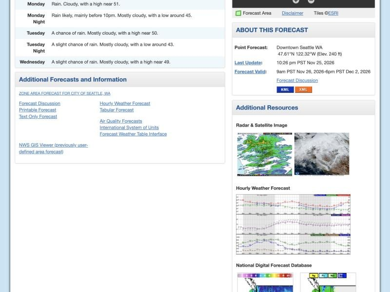 NWS: the same page, "About this forecast"</td><td valign="top" width="50%">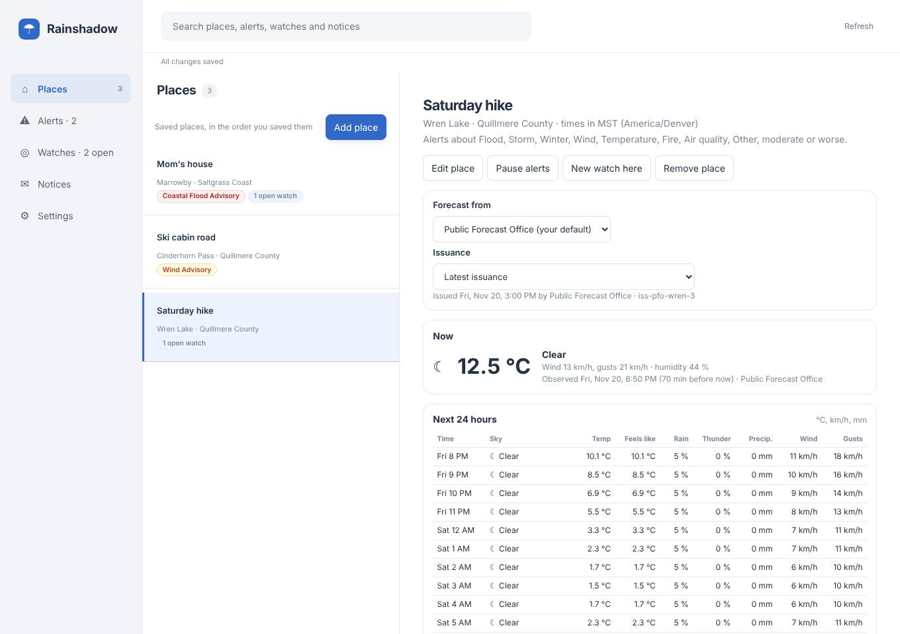 Step 1: Wren Lake: the latest issuance of the default source, in the place's own time zone</td></tr>
<tr><td valign="top" width="50%">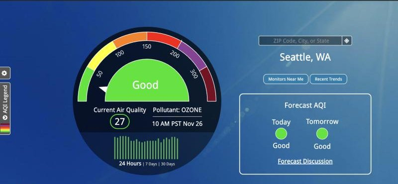 AirNow: Seattle, WA</td><td valign="top" width="50%">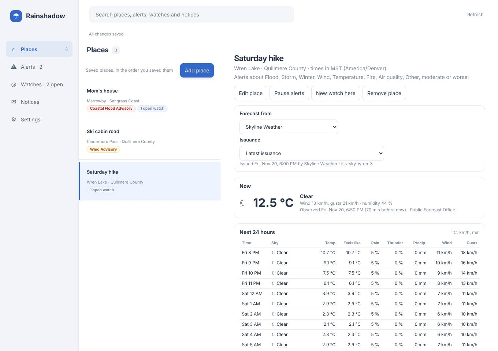 Step 2: Another source: its own latest issuance, never a mix</td></tr>
<tr><td valign="top" width="50%">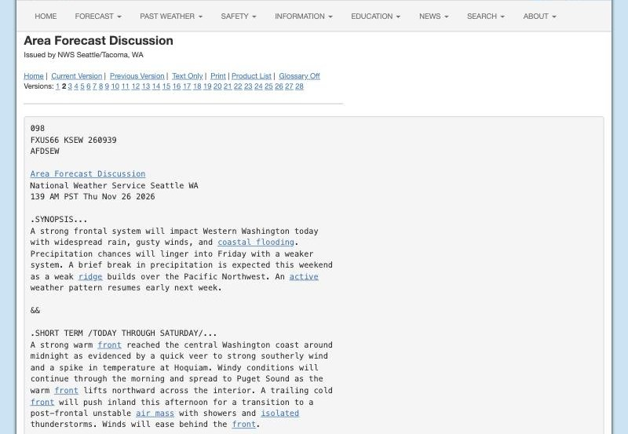 NWS: Area Forecast Discussion, an earlier version</td><td valign="top" width="50%">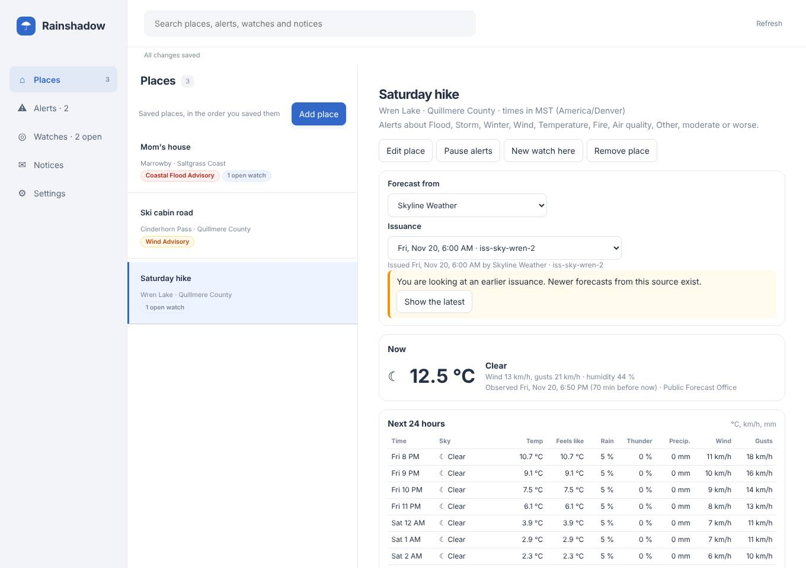 Step 3: An earlier issuance is labelled as such</td></tr>
</table>

**Differences.** NWS shows one office's latest point forecast with its "Last Update"; earlier versions are kept for text products such as the forecast discussion. Rainshadow keeps every issuance of every source, says on the page which one is shown, offers the earlier ones, never mixes sources, and does not let a late arrival with an older issue time replace the latest. AirNow's AQI forecast corresponds to the air-quality source's daily outlook on the place page.

| Step | Action | Expected | Observed on the page | State read back through MCP | Check |
| --- | --- | --- | --- | --- | --- |
| [1. Wren Lake: the latest issuance of the default source, in the place's own time zone](sequences/forecast-01.jpg) | Places: open Wren Lake (saved as “Saturday hike”). | The latest issuance of the default source, iss-pfo-wren-3; hours in America/Denver although the browser runs in Asia/Tokyo; the latest observation. | Issued Fri, Nov 20, 3:00 PM by Public Forecast Office · iss-pfo-wren-3 · first hour: Fri 8 PM \| ☾ Clear \| 10.1 °C \| 10.1 °C \| 5 % \| 0 % \| 0 mm \| 11 km/h \| 18 km/h | `forecast.hourly`: iss-pfo-wren-3, issued 2026-11-20T15:00:00-07:00, 24 rows `conditions.get`: ob-wren-2 | *the place page shows the latest issuance of the default source* |
| [2. Another source: its own latest issuance, never a mix](sequences/forecast-02.jpg) | Forecast from: Skyline. | Skyline's own latest issuance, iss-sky-wren-3; nothing from the other source fills a gap. | Issued Fri, Nov 20, 6:00 PM by Skyline Weather · iss-sky-wren-3 | `forecast.hourly`: source src-skyline: iss-sky-wren-3, issued 2026-11-20T18:00:00-07:00 | *the source picker shows the other source's own issuance, with no fallback* |
| [3. An earlier issuance is labelled as such](sequences/forecast-03.jpg) | Issuance: choose the one before the latest. | The page shows iss-sky-wren-2 and says that newer forecasts from this source exist. | Issued Fri, Nov 20, 6:00 AM by Skyline Weather · iss-sky-wren-2 · You are looking at an earlier issuance. Newer forecasts from this source exist. Show the latest | `forecast.issuances`: iss-sky-wren-2 issued 2026-11-20T06:00:00-07:00, is_latest false | *an earlier issuance is shown as such* |
| [4. A new issuance arrives: after Refresh the page shows it](sequences/forecast-04.jpg) | Infra applies rainshadow.forecast.issued (examples/scenario.json, iss-pfo-wren-4); Refresh. | Wren Lake shows iss-pfo-wren-4, issued 2026-11-20T20:30:00-07:00. | Issued Fri, Nov 20, 8:30 PM by Public Forecast Office · iss-pfo-wren-4 | `env.event_status`: example-forecast-2030 committed `forecast.issuances`: latest iss-pfo-wren-4 | *after Refresh the page shows an issuance that arrived as a scenario event* |
| [5. A late arrival with an older issue time does not replace the latest](sequences/forecast-05.jpg) | Infra applies rainshadow.forecast.issued (event web-late: iss-pfo-wren-web-late, issued 19:30, received 20:50); open Wren Lake. | The page keeps iss-pfo-wren-4 (issued 20:30); the late one is listed as an earlier issuance. | Issued Fri, Nov 20, 8:30 PM by Public Forecast Office · iss-pfo-wren-4 | `forecast.issuances`: iss-pfo-wren-4 (latest) issued 2026-11-20T20:30:00-07:00; iss-pfo-wren-web-late issued 2026-11-20T19:30:00-07:00; iss-sky-wren-3 (latest) issued 2026-11-20T18:00:00-07:00 | *a late arrival with an older issue time does not replace the latest on the page* |

### An alert: acknowledging is refused while an update is unread, then recorded; the alert is cancelled

<table>
<tr><th>Reference</th><th>Rainshadow</th></tr>
<tr><td valign="top" width="50%">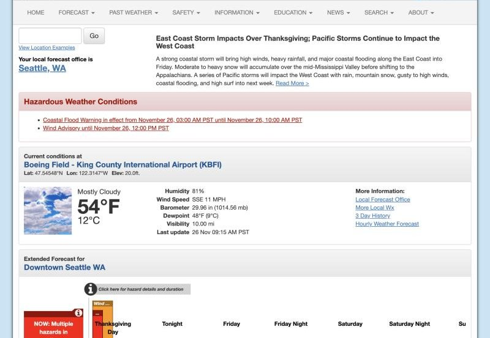 NWS: 7-day point forecast, Downtown Seattle WA</td><td valign="top" width="50%">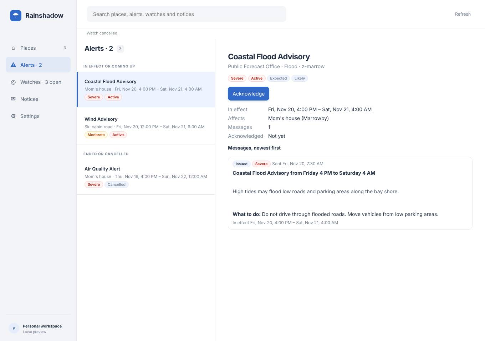 Step 1: Start: the coastal flood advisory for Marrowby, not acknowledged</td></tr>
<tr><td valign="top" width="50%">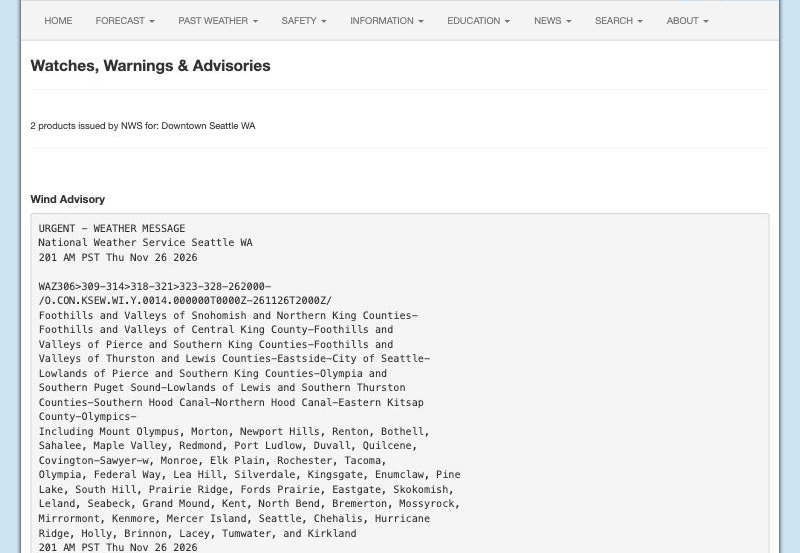 NWS: Watches, Warnings & Advisories for the point, a Wind Advisory</td><td valign="top" width="50%">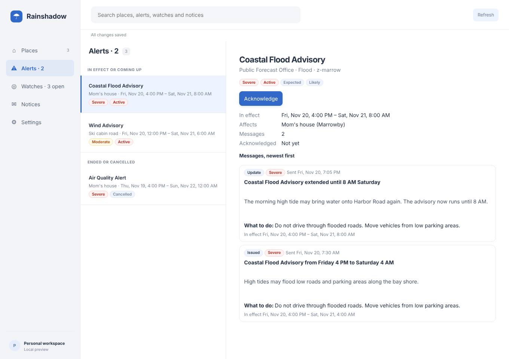 Step 3: After Refresh: the update is first in the thread</td></tr>
<tr><td valign="top" width="50%">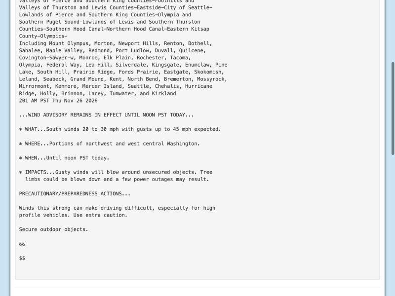 NWS: the same advisory, further down</td><td valign="top" width="50%">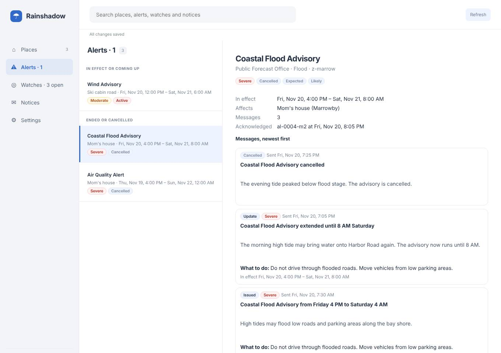 Step 5: The forecaster cancels it: the alert closes and keeps its record</td></tr>
</table>

**Differences.** NWS publishes an alert as messages that continue, update or cancel it. Rainshadow keeps the thread message by message and records which message the person acknowledged; acknowledging is refused while a newer message is unread. NWS has no acknowledgement: that is the plan's own feature.

| Step | Action | Expected | Observed on the page | State read back through MCP | Check |
| --- | --- | --- | --- | --- | --- |
| [1. Start: the coastal flood advisory for Marrowby, not acknowledged](sequences/alert-01.jpg) | Alerts: open al-0004. | One message, in effect, with an Acknowledge control. | Coastal Flood Advisory Public Forecast Office · Flood · z-marrow · Severe Active Expected Likely · Acknowledged: Not yet | `alerts.get`: al-0004 active, 1 message, latest al-0004-m1, acknowledged false | *the alert thread is shown message by message* |
| [2. An update arrives while the page is open: acknowledging is refused](sequences/alert-02.jpg) | Infra applies rainshadow.alert.updated (event web-alert-update, message al-0004-m2); without refreshing, Acknowledge. | The page reads the thread again, finds a newer message and refuses; no acknowledgement is written. | A newer message arrived for this alert. Read it before acknowledging. | `alerts.get`: al-0004 latest al-0004-m2 `env.event_status`: web-alert-update committed `acknowledgements`: 23 (unchanged) | *acknowledging while a newer message is unread is refused and writes nothing* |
| [3. After Refresh: the update is first in the thread](sequences/alert-03.jpg) | Refresh. | Two messages, newest first; the advisory now ends at 8 AM; Acknowledge is offered again. | Coastal Flood Advisory Public Forecast Office · Flood · z-marrow · Severe Active Expected Likely · In effect: Fri, Nov 20, 4:00 PM – Sat, Nov 21, 8:00 AM | `alerts.get`: al-0004 messages al-0004-m1, al-0004-m2 | *after Refresh the thread shows the update first* |
| [4. Acknowledged: the App records the message that was read](sequences/alert-04.jpg) | Acknowledge. | rainshadow.alerts.acknowledge records al-0004-m2; the control is replaced by Acknowledged. | Coastal Flood Advisory Public Forecast Office · Flood · z-marrow · Severe Active Expected Likely · Acknowledged: al-0004-m2 at Fri, Nov 20, 8:05 PM | `acknowledgements`: al-0004 al-0004-m2 at 2026-11-20T20:05:00-07:00 `receipt`: request web-2df59019-b04b-4179-b374-5fed7c5e9533 `version`: epoch 1, revision 7 | *acknowledging records the latest message* |
| [5. The forecaster cancels it: the alert closes and keeps its record](sequences/alert-05.jpg) | Infra applies rainshadow.alert.cancelled (event web-alert-cancel); Refresh. | The alert is Cancelled, listed under Ended or cancelled, with three messages and the acknowledgement of al-0004-m2. | Coastal Flood Advisory Public Forecast Office · Flood · z-marrow · Severe Cancelled Expected Likely · Acknowledged: al-0004-m2 at Fri, Nov 20, 8:05 PM | `alerts.get`: al-0004 cancelled, 3 messages `env.event_status`: web-alert-cancel committed `version`: epoch 1, revision 8 | *after Refresh a cancelled alert says so and keeps its acknowledgement* |

### Watches: saved, edited, stale, retried, refused, cancelled, ended

No reference capture: no public product found lets a person define a watch of forecast conditions over a time window at a place (see above). The watch is the plan's own feature.

| Step | Action | Expected | Observed on the page | State read back through MCP | Check |
| --- | --- | --- | --- | --- | --- |
| [1. A new watch, filled in before sending](sequences/watch-01.jpg) | Wren Lake: New watch here; label “GUI hike”, Sunday 22 November 09:00–12:00 (the place's time), chance of rain at least 35 %, Add condition (chance of thunder). | The form holds the window in the place's own time and two conditions; nothing is written yet. | 2026-11-22T09:00 → 2026-11-22T12:00 · 2 conditions | `watches.list`: 30 watches | — |
| [2. Sent: the watch opens with its first evaluation](sequences/watch-02.jpg) | Send. | rainshadow.watches.create writes the watch with the typed local times; the page shows its latest evaluation. | GUI hike Saturday hike (Wren Lake) · Sun, Nov 22, 9:00 AM – Sun, Nov 22, 12:00 PM · Clear | `watches.list`: w-0031 “GUI hike” 2026-11-22T09:00:00-07:00 → 2026-11-22T12:00:00-07:00, status clear `receipt`: request web-3457d162-1db4-48bc-8e65-fe0507369e3b `version`: epoch 1, revision 1 | *the new watch opens with its evaluation* |
| [3. After a reload: read back from the App](sequences/watch-03.jpg) | Reload the page; open the watch. | The same watch, read back from the App. | GUI hike Saturday hike (Wren Lake) · Sun, Nov 22, 9:00 AM – Sun, Nov 22, 12:00 PM · Clear | `watches.list`: w-0031 present | *a reload keeps the committed watch* |
| [4. Edited: only the end time](sequences/watch-04.jpg) | Edit watch, end 13:00, Save. | rainshadow.watches.update sends only the end; the same record now ends at 13:00. | GUI hike Saturday hike (Wren Lake) · Sun, Nov 22, 9:00 AM – Sun, Nov 22, 1:00 PM · Clear | `watches.list`: w-0031 ends 2026-11-22T13:00:00-07:00 `receipt`: request web-1bfeaf19-18f7-4980-848c-3db1dbc3442b `version`: epoch 1, revision 2 | *an edit sends only the edited field* |
| [5. A form that went stale: the conflict is shown and the other change stands](sequences/watch-05.jpg) | Edit watch; meanwhile another session renames it through MCP (request outside-edit); type “Stale label” and Save. | The App answers stale_version and the form says so; the label stays “Changed elsewhere”. | This record changed. Close this form and refresh before trying again. | `watches.list`: w-0031 “Changed elsewhere” `receipt`: request outside-edit (the other session) `version`: epoch 1, revision 3 | *a stale form shows the conflict and the concurrent change stands* |
| [6. The response is lost: the form says so and keeps its input](sequences/watch-06.jpg) | New watch “Lost response”, Monday 09:00–11:00, send. The test drops the response after the App has committed it. | The form reports the failure and offers to send again with the same request ID. | Failed to fetch | `watches.list`: “Lost response”: 1 | — |
| [7. Sent again: still one watch](sequences/watch-07.jpg) | Send again. | The retry is the same write with the same request ID: one watch. | Watch created. | `watches.list`: “Lost response”: 1 `receipt`: request web-9789d950-9003-43e2-bfdf-a9578b14c395 `version`: epoch 1, revision 4 | *a retry after a lost response has one effect* |
| [8. A window that ends before it starts is refused](sequences/watch-08.jpg) | New watch, Monday 12:00 → 10:00, send. | The App answers invalid_window and the form says why; nothing is written. | start must be before end. | `version`: epoch 1, revision 4 | *an invalid window is refused visibly and writes nothing* |
| [9. Cancel asks first](sequences/watch-09.jpg) | Open the watch, Cancel watch. | A confirmation names the watch. | Cancel Changed elsewhere? The watch stops checking the forecast and alerts. It stays in your history. Cancel Cancel watch | `watches.list`: w-0031 open | — |
| [10. Cancelled: kept, and marked as cancelled](sequences/watch-10.jpg) | Confirm with Cancel watch. | rainshadow.watches.cancel commits the cancellation; the watch stays listed as Cancelled. | Changed elsewhere Saturday hike (Wren Lake) · Sun, Nov 22, 9:00 AM – Sun, Nov 22, 1:00 PM Cancelled | `watches.list`: w-0031 cancelled at 2026-11-20T20:00:00-07:00 `receipt`: request web-05516d93-3a55-4af6-bef2-01faaa8a496d `version`: epoch 1, revision 5 | *cancelling a watch commits it as cancelled* |
| [11. The clock moves past the hike: the watch reads Ended](sequences/watch-11.jpg) | Infra moves the clock to Saturday 21 November 19:00 (env.advance_time, request web-clock); Refresh; open “Saturday hike”. | The watch whose window is over reads Ended; nothing else wrote to it. | Saturday hike Saturday hike (Wren Lake) · Sat, Nov 21, 10:00 AM – Sat, Nov 21, 1:00 PM · Ended | `watches.list`: w-0029 ended, window 2026-11-21T10:00:00-07:00 → 2026-11-21T13:00:00-07:00 | *after a clock move by Infra alone, a watch whose window is over reads ended* |

### Saved places: alerts paused, renamed, added by search, removal refused and done

<table>
<tr><th>Reference</th><th>Rainshadow</th></tr>
<tr><td valign="top" width="50%"> AirNow: Seattle, WA</td><td valign="top" width="50%">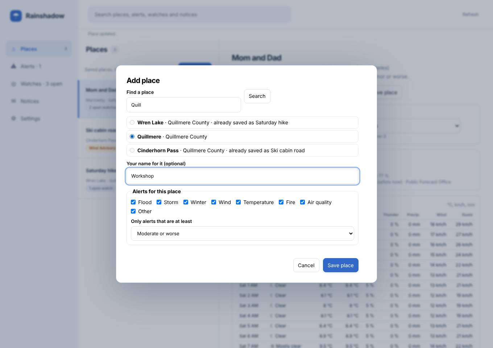 Step 3: Add a place: search, choose, label</td></tr>
</table>

**Differences.** AirNow and NWS find a place by city or ZIP code; Rainshadow saves places from its own regions with a label and an alert rule, and refuses to remove a place an open watch uses.

| Step | Action | Expected | Observed on the page | State read back through MCP | Check |
| --- | --- | --- | --- | --- | --- |
| [1. Alerts paused for Marrowby](sequences/place-01.jpg) | Places: open Marrowby, Pause alerts. | rainshadow.places.update sends only the paused flag. | Alerts paused for this place. · Mom's house Marrowby · Saltgrass Coast · times in PST (America/Los_Angeles) Alerts paused for this place. | `places.list`: pl-marrowby alert rule paused `receipt`: request web-afe8f86d-1c9e-4d82-bdb0-a4526f7b50ef `version`: epoch 1, revision 9 | *the place is paused in the App* |
| [2. Resumed, then renamed: the rule stays](sequences/place-02.jpg) | Resume alerts; Edit place, label “Mom and Dad”, Save. | rainshadow.places.update sends only the label; the alert rule is active again. | Mom and Dad Marrowby · Saltgrass Coast · times in PST (America/Los_Angeles) Alerts about Flood, Storm, Wind, Temperature, Air quality, minor or worse. | `places.list`: pl-marrowby “Mom and Dad”, alert rule paused false `receipt`: request web-dca88a1d-cf76-4ec4-82e2-faa864e89393 `version`: epoch 1, revision 11 | *the place keeps its rule and gets the new label* |
| [3. Add a place: search, choose, label](sequences/place-03.jpg) | Add place; search “Quill”; choose Quillmere; label “Workshop”. | The search lists places from the App's regions; nothing is saved yet. | Wren Lake · Quillmere County · already saved as Saturday hike · results: 3 | `places.list`: 3 saved places | — |
| [4. Saved: listed last, with its forecast](sequences/place-04.jpg) | Save. | rainshadow.places.save stores Quillmere as “Workshop”; it is listed last and opens. | Workshop Quillmere · Quillmere County · times in MST (America/Denver) Alerts about Flood, Storm, Winter, Wind, Temperature, Fire, Air quality, Other, moderate or worse. · Dense Fog Advisory · Upcoming · Sat, Nov 21, 4:00 AM – Sat, Nov 21, 9:00 AM Dense Fog Advisory from 4 AM to 9 AM Saturday Open alert | `places.list`: pl-quillmere “Workshop” `receipt`: request web-a9523323-b6c1-4e4d-9e29-c7a2e6f83cca `version`: epoch 1, revision 12 | *a place found by search is saved with its label* |
| [5. A place with an open watch is not removed](sequences/place-05.jpg) | Open Wren Lake, Remove place, confirm. | The App answers place_in_use and the form names the open watch; the place stays. | Watch w-0029 still uses place pl-wren-lake. Cancel the watch first. | `places.list`: pl-wren-lake still saved `version`: epoch 1, revision 12 | *a place with an open watch is not removed, and the refusal is visible* |
| [6. Removing Quillmere asks first](sequences/place-06.jpg) | Open Quillmere, Remove place. | A confirmation names the place. | Remove Workshop? It leaves your saved places. Earlier notices and ended watches stay in your history. A place with an open watch cannot be removed. Cancel Remove place | `places.list`: pl-quillmere still saved | — |
| [7. Removed](sequences/place-07.jpg) | Confirm with Remove place. | rainshadow.places.remove deletes the saved place. | Place removed. | `places.list`: pl-marrowby, pl-cinderhorn-pass, pl-wren-lake `receipt`: request web-21d79020-62ec-4797-9052-5d228ca20165 `version`: epoch 1, revision 13 | *removing a place takes it out of the saved places* |

### Settings: units

<table>
<tr><th>Reference</th><th>Rainshadow</th></tr>
<tr><td valign="top" width="50%"> NWS: 7-day point forecast, Downtown Seattle WA</td><td valign="top" width="50%">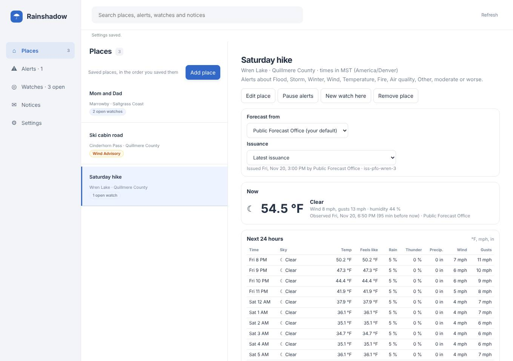 Step 2: The forecast pages follow: °F, mph, in</td></tr>
</table>

**Differences.** NWS shows °F and °C side by side; Rainshadow uses the account's unit setting and the pages show what the App returns.

| Step | Action | Expected | Observed on the page | State read back through MCP | Check |
| --- | --- | --- | --- | --- | --- |
| [1. Saved: US units](sequences/settings-01.jpg) | Settings: Units, US; Save settings. | rainshadow.preferences.update sends only the units. | Settings saved. | `preferences.get`: units us `receipt`: request web-c5606ea5-b6b7-4bfa-9360-46ec43f4ec10 `version`: epoch 1, revision 14 | *the App now uses US units* |
| [2. The forecast pages follow: °F, mph, in](sequences/settings-02.jpg) | Places: open Wren Lake. | The hours are shown in the units the App now returns. | Next 24 hours °F, mph, in · first hour: Fri 8 PM \| ☾ Clear \| 50.2 °F \| 50.2 °F \| 5 % \| 0 % \| 0 in \| 7 mph \| 11 mph | `forecast.hourly`: units {"temperature":"F","wind":"mph","precipitation":"in"} | *the pages show the units the App returns* |

### A Task-like policy

Platform behaviour (the scenario profile narrows tools, objects and fields); no reference product counterpart.

| Step | Action | Expected | Observed on the page | State read back through MCP | Check |
| --- | --- | --- | --- | --- | --- |
| [1. Under a Task-like policy a refused write says so](sequences/restricted-policy-01.jpg) | A second run with the scenario profile: open Marrowby, Pause alerts. | The policy allows changes to Wren Lake only: the page says the action is not allowed; nothing is written. Add place and Remove place are not offered. | This operation is not allowed for the current account and policy. | `places.list`: pl-marrowby alert rule paused false | *a write the policy refuses is shown as refused and changes nothing* |
| [2. A change outside the allowed fields is refused](sequences/restricted-policy-02.jpg) | Open Wren Lake (pausing its alerts is allowed and was done), Edit place, a new label, send. | The App answers permission_denied and the form says so; the label stays. | This operation is not allowed for the current account and policy. | `places.list`: pl-wren-lake “Saturday hike”, alert rule paused true | *a label change outside the allowed fields is refused* |

### The full-window dataset in the web pages

The evaluation dataset loaded into the same pages; see "Full-window evaluation dataset" below.

| Step | Action | Expected | Observed on the page | State read back through MCP | Check |
| --- | --- | --- | --- | --- | --- |
| [1. Two years of forecasts: the first place opens on its latest issuance at the dataset clock](sequences/full-window-01.jpg) | A third run: Infra loads datasets/full-window with env.load_seed at its clock (2026-12-31T20:00:00-07:00); open the access link. | The first saved place shows its latest issuance, iss-pfo-marrow-20261231-15. | Issued Thu, Dec 31, 3:00 PM by Public Forecast Office · iss-pfo-marrow-20261231-15 | `env.load_seed`: ready, 692 records `forecast.hourly`: pl-marrowby: iss-pfo-marrow-20261231-15, issued 2026-12-31T15:00:00-08:00 | *on the full-window dataset the first place opens on its latest issuance at the dataset clock* |
| [2. The winter storm in effect at the clock](sequences/full-window-02.jpg) | Alerts: open the alert in effect. | al-20261229-1 is active; what it announces after the clock (its end) is not counted as history. | Winter Storm Warning Public Forecast Office · Winter · z-cinder · Severe Active Expected Likely · In effect: Thu, Dec 31, 12:00 PM – Sat, Jan 2, 2027, 6:00 AM | `alerts.list`: al-20261229-1 active, ends 2027-01-02T06:00:00-07:00 `coverage.json`: 1 alert ends after the clock; announced times are excluded from every count | *the alert in effect at the dataset clock is listed and opens* |
| [3. A watch for New Year's Day: its window is after the clock](sequences/full-window-03.jpg) | Watches: open “Drive up New Year's Day”. | The watch is open; the coverage report counts when it was created, not the hours it looks at. | Drive up New Year's Day Ski cabin road (Cinderhorn Pass) · Fri, Jan 1, 2027, 9:00 AM – Fri, Jan 1, 2027, 1:00 PM · Triggered | `watches.list`: w-0035 triggered, window 2027-01-01T09:00:00-07:00 → 2027-01-01T13:00:00-07:00 `coverage.json`: 1 watch window after the clock, excluded | *a watch whose window is after the dataset clock is open, and its window is not history* |
| [4. The oldest cancelled-alert notice, from 2025, with its year shown](sequences/full-window-04.jpg) | Notices: kind Alert cancelled; open the last one in the list. | The notice written 2025-06-10T19:00:00-06:00; a date outside the clock's year shows its year. | Cancelled: Severe Thunderstorm Watch for Wren Lake (saved as Lake loop) Written Tue, Jun 10, 2025, 7:00 PM · Alert cancelled Released Moderate | `notices.list`: 10 alert.cancelled notices; oldest ntc-0018 at 2025-06-10T19:00:00-06:00 | *the oldest cancelled-alert notice of the dataset shows its year* |

## Full-window evaluation dataset

`datasets/full-window/` is the delivered evaluation data, separate from the smoke-test fixture. Its card is [`datasets/full-window/README.md`](../datasets/full-window/README.md); the counts are [`coverage.md`](../datasets/full-window/coverage.md) and [`coverage.json`](../datasets/full-window/coverage.json).

- **Files:** `seed.json` (1,319,281 bytes, sha256 `e1f2d87f6d9c8a60…`), `clock.json` (sha256 `db3fed8fd221985e…`), `dataset.json` (sha256 `55144459e3a964b3…`). Clock 2026-12-31T20:00:00-07:00. Declared in `datasets/full-window/dataset.json` (`pale.dataset.v1`).
- **Provenance:** every record is synthetic and fictional (in each family: all synthetic, 0 real, 0 mixed), generated by `dev/dataset.cjs` (fixed seed) through the App's own functions, so each record passes the App's rules. The plan's world is invented by design, so there is no real source data, no collection date and no real anchor to report; the policy's November 2026 anchor is for websites whose earlier data cannot be retrieved.
- **Window and zone:** 2025-01-01 to 2026-12-31 (730 dates), counted in America/Denver. Each record family has one authoritative date field. Timestamps (all with a UTC offset, Mountain or Pacific) are converted to a local date in America/Denver. A record counts when its local date is in the window and it is not after the dataset clock; missing or unparseable dates are counted as invalid and listed. Distinct dates are counted per family and once globally (a date with several records or families counts once). Each family names the Agent tool that reads it; the activity log is read through Infra's env.snapshot.
- **Distinct dates:** actions only 310 of 730 (2025-01-01 to 2026-12-31); all history 310. Months with records: 24 of 24. Longest gaps in the actions: 2025-04-29 to 2025-05-04 (6 days), 2025-05-27 to 2025-06-01 (6 days), 2025-08-05 to 2025-08-10 (6 days).
- **Invalid or missing dates:** none.

| Family | Authoritative date field | Records | In window | Distinct dates | Excluded |
| --- | --- | ---: | ---: | ---: | --- |
| Actions: activity log rows (every event, every account write, and their effects) | `activity[].at` | 771 | 771 | 310 | — |
| The account holder's own writes (activity rows with actor "agent") | `activity[].at` | 92 | 92 | 76 | — |
| Weather forecast issuances, by issue time | `issuances[].issued_at (weather sources)` | 156 | 156 | 97 | — |
| Air-quality forecast issuances, by issue time | `issuances[].issued_at (air-quality source)` | 190 | 190 | 170 | — |
| Observations, by observation time (the newest per place is what conditions.get shows) | `observations[].observed_at` | 50 | 50 | 34 | — |
| Alert messages (issued, updated, cancelled), by sending time | `alerts[].messages[].sent_at` | 164 | 164 | 141 | — |
| Acknowledgements of alert messages | `acknowledgements[].acknowledged_at` | 35 | 35 | 35 | — |
| Watches: created, changed, cancelled | `watches[].created_at, updated_at, cancelled_at` | 39 | 39 | 34 | — |
| Notices, by creation time | `notices[].created_at` | 104 | 104 | 87 | — |
| Places saved at the clock, by the time they were saved | `saved_places[].saved_at` | 3 | 3 | 2 | — |

**Not history: Forecast hours, alert periods and watch windows.** The hours and days a forecast covers, the onset and end an alert announces and the window a watch looks at are excluded from every count above; only issue, sending, acknowledgement, creation and change times count. (forecast rows 6642, forecast rows after clock 201, alert messages with times 151, alerts ending after clock 1, watches 35, watch windows after clock 1).

**Reproduce and load.** `cd apps/rainshadow && npm run check:dataset` regenerates the data in memory and the counts, and compares both with the files. `node apps/rainshadow/tests/dataset.integration.cjs --runtime runtime` loads it with `env.load_seed` at its clock through the public runtime and reads it back through the App's tools month by month; the [full-window sequence](#seq-full-window) above shows it in the web pages.
