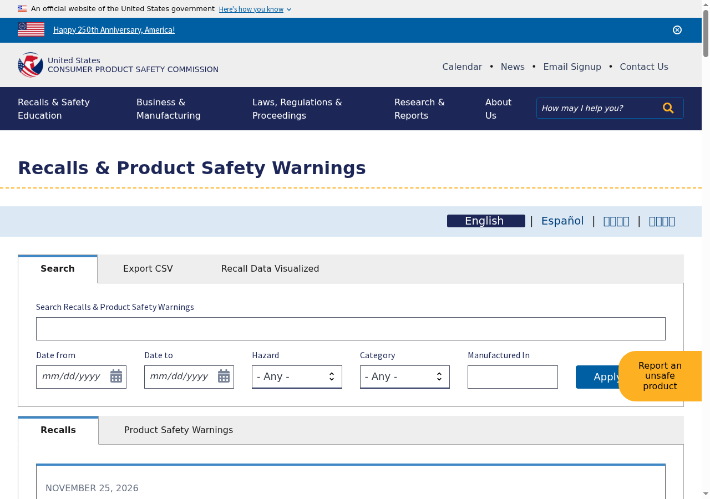
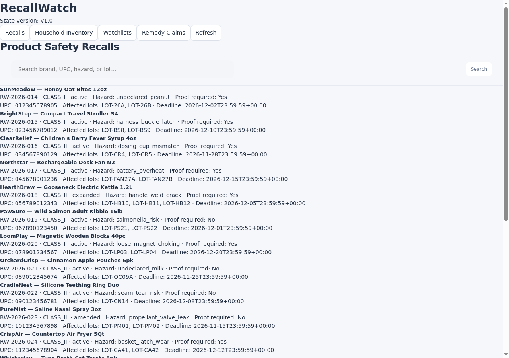
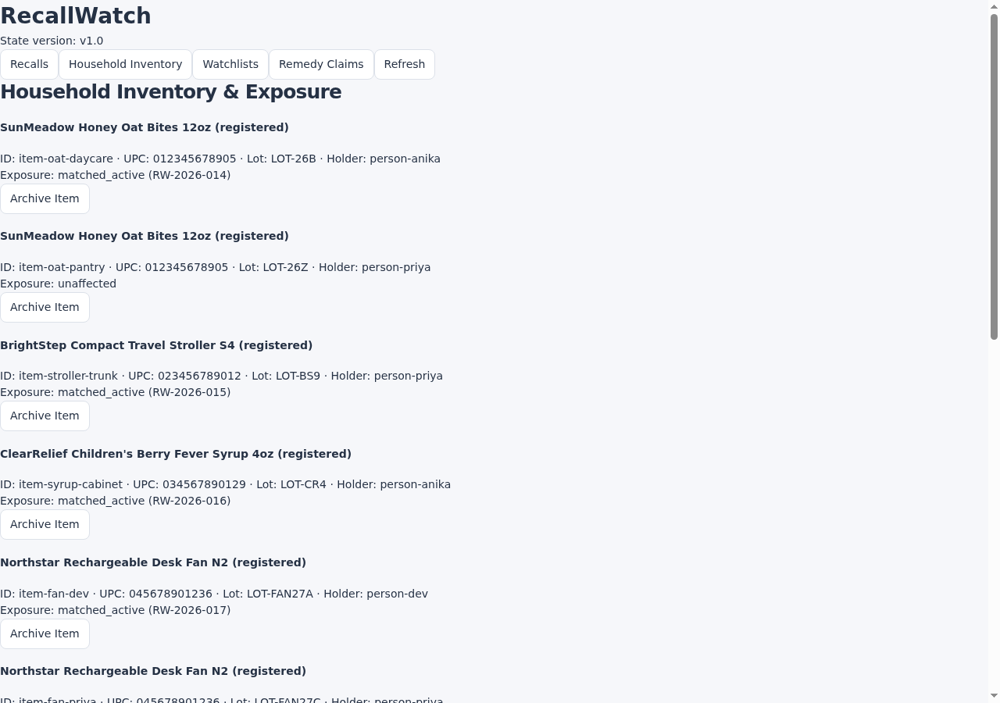
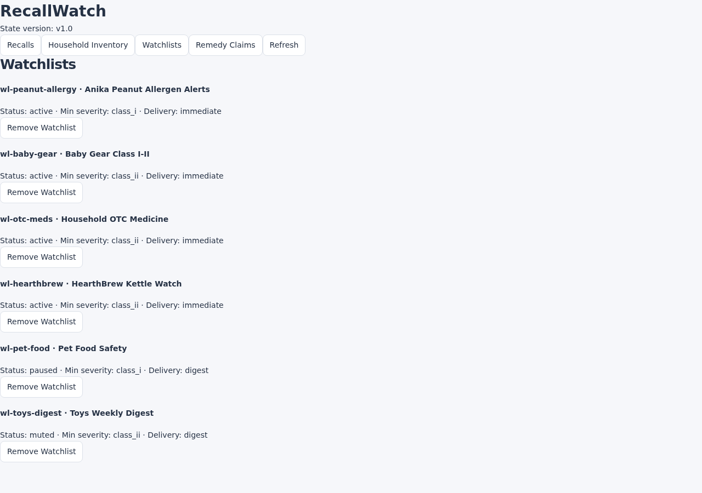
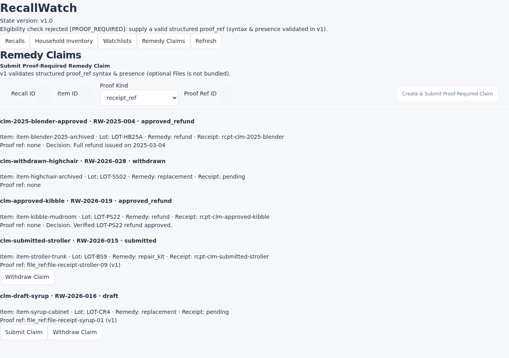
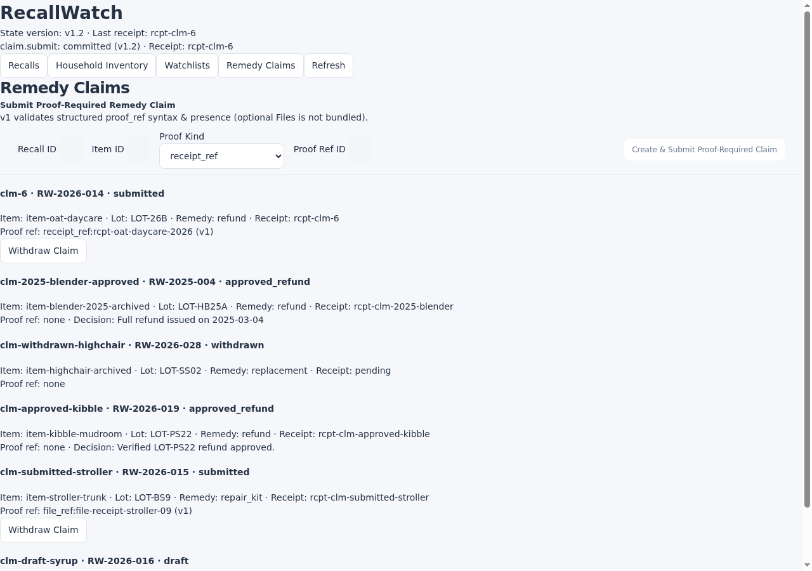
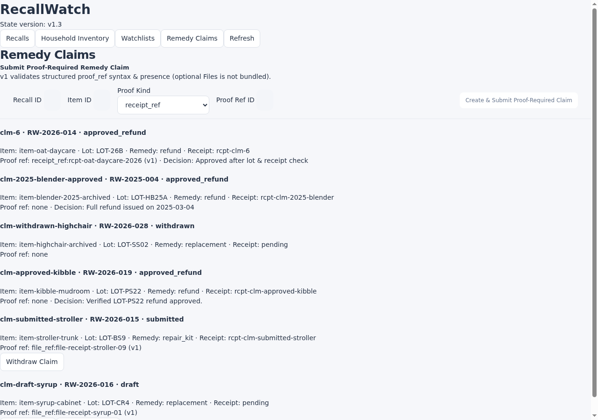

# RecallWatch (`apps/recallwatch`) — Delivery Evidence Index

This index documents the real Chromium GUI workflow sequence, reference-product comparison, proof-reference validation boundary, Mail integration evidence, and full-window 2025–2026 Environment dataset coverage per [`docs/submission-evidence.md`](../../../docs/submission-evidence.md).

## 1. Environment & Capture Metadata

- **Browser:** `HeadlessChrome/153.0.8010.12` (Google Chrome for Testing, real Chromium CDP)
- **Viewport:** `1280×900` (`deviceScaleFactor: 1`)
- **Web Host:** `runtime/web/server.cjs` (PALE runtime `1.6.0`, Core API `1.2.0`)
- **Synthetic run / account:** `rw-browser-evidence` / `acct-priya` (`person-priya`)
- **Reproducible browser command:**
  ```bash
  CHROMIUM_BIN=/path/to/chrome-headless-shell node apps/recallwatch/examples/browser-evidence.cjs
  ```
- **Observed browser checks:** `0` uncaught `pageerror`s, full `Page.reload()` persistence confirmed, independent Infra `claim.decision` event reflected on `Refresh`, direct browser `POST /api/call` to `env.reset` denied with HTTP `403`.

## 2. Reference Product Comparison

| Reference | Source URL | Capture Date (UTC) | Workflow Illustrated | Intentional Differences in RecallWatch |
| :--- | :--- | :--- | :--- | :--- |
| U.S. CPSC Recalls & Product Safety Warnings | https://www.cpsc.gov/Recalls | 2026-11-27 | Public product-safety recall search & filtering by keyword, hazard, category, and date ([`01-ref-cpsc-recalls.png`](screenshots/01-ref-cpsc-recalls.png)) | RecallWatch is an independently branded synthetic portal with no live agency scraping. It adds household lot-level inventory matching (`Household Inventory`), personal alert rules (`Watchlists`), and a stateful remedy-claim lifecycle (`Remedy Claims`) backed by PALE Core optimistic concurrency and virtual time. |



## 3. Ordered Chromium GUI Sequence (4 Delivered Views + Proof-Required Claim Flow)

1. **View 1 — Recalls (`02-recalls-view.png`):** Initial load via `host.accessUrl` -> `/session` handshake -> `recallwatch.recall.search`. Displays synthetic advisories including `RW-2026-014` (`Honey Oat Bites 12oz`, `CLASS_I`, `Proof required: Yes`, affected lot `LOT-26B`).
   
2. **View 2 — Household Inventory & Exposure (`03-inventory-view.png`):** Clicked `Household Inventory` tab (`recallwatch.inventory.list`). Demonstrates lot-level matching: `item-oat-daycare` (`LOT-26B`) shows `matched_active (RW-2026-014)` while identical-UPC `item-oat-pantry` (`LOT-26C`) shows `unaffected`.
   
3. **View 3 — Watchlists (`04-watchlists-view.png`):** Clicked `Watchlists` tab (`recallwatch.watchlist.list`). Displays household alert rules with `Remove Watchlist` controls.
   
4. **View 4 — Proof-Required Claim Rejection (`05-claims-proof-rejected.png`):** Clicked `Remedy Claims` tab, left `Proof Ref ID` empty for `RW-2026-014` / `item-oat-daycare`, and clicked `Create & Submit Proof-Required Claim`. `recallwatch.claim.preview` returned `PROOF_REQUIRED`; the GUI rendered the `[role=alert]` error banner and the MCP snapshot confirmed `0` claims were persisted.
   
5. **View 4 — Proof-Required Claim Submission & Persisted Receipt (`06-claims-proof-submitted.png`):** Entered `rcpt-oat-daycare-2026` (`receipt_ref`, `v1`) and clicked `Create & Submit Proof-Required Claim`. Executed `recallwatch.claim.preview` -> `recallwatch.claim.create_draft` -> `recallwatch.claim.submit`, committing `clm-6` (`status: submitted`, persisted `claim_receipt_id: rcpt-clm-6`, `proof_ref: receipt_ref:rcpt-oat-daycare-2026 (v1)`).
   
6. **Reload Persistence & Independent MCP/Infra Event Update (`07-claims-after-reload-and-mcp.png`):** Executed full `Page.reload()` (verified `clm-6` and `rcpt-clm-6` persisted), then applied an independent Infra `env.apply_event` (`claim.decision` -> `approved_refund`, `$18.50`) and clicked `Refresh` in Chromium; the GUI updated `clm-6` to `approved_refund` with the decision note.
   

## 4. Proof-Reference Validation Boundary (v1)

- `src/common.cjs` (`validateProofRef`, `evaluateClaimEligibility`) validates **presence and structured reference syntax** (`{ kind: "file_ref" | "asset_ref" | "receipt_ref", id, version? }` with `version >= 1`).
- **v1 does not verify document existence, file bytes, or purchase facts**, and does not bundle or require `apps/files`. Optional Files reads remain an independent Agent tool-use workflow outside RecallWatch's standalone package boundary.

## 5. Full-Window Environment Dataset Coverage (2025-01-01 to 2026-12-31)

- **Delivered datasets (kept explicitly distinct):**
  - `fixtures/minimal.json` (manifest: [`contribution/dataset.json`](../contribution/dataset.json)): 44-record smoke fixture used by `app:verify` and unit tests (17 distinct UTC dates from `2025-02-14` to `2026-11-16`, SHA-256 `28bf2cb13c602968e26a94a5e7d14f283fc66dace8a1c2dfe7b071ce50bcae78`).
  - `fixtures/full-window.json` (separate manifest: [`contribution/dataset.full-window.json`](../contribution/dataset.full-window.json)): **446 records** (**100% synthetic `authored`**; SHA-256 `87832fedb1ed89a19db14c3a31ad45471f93685ea56a4d09721f2d152416d09e`) covering **all 24 months** from **`2025-01-02` through `2026-12-27`** with **318 global deduplicated distinct calendar dates** in `UTC` and **0 missing months**:
    - `recalls` (`published_at`): 332 records across 318 distinct dates
    - `inventory` (`created_at`): 76 records across 63 distinct dates
    - `watchlists` (`created_at`): 6 records across 1 distinct date
    - `claims` (`created_at`): 32 records across 29 distinct dates
  - **As-of-clock boundary note:** `fixtures/full-window.json` spans the full 2025–2026 Environment coverage window and is **not** an as-of snapshot at `fixtures/clock.json` (`2026-11-18T09:00:00+00:00`): 18 recall publications and 4 inventory creations are dated on or after that instant. Any Task reusing this corpus for pre-session history should filter to a strict pre-session subset (`< first_session_at`) or stage later records through authorized Infra events (`recall.publish`, etc.).
- **Reproducible calculation & live MCP load/query verification:**
  ```bash
  node apps/recallwatch/examples/coverage-report.cjs
  ```
  Verified live `env.load_seed` -> `status: "ready"`, followed by `recallwatch.recall.search` (332), `recallwatch.inventory.list` (76), and `recallwatch.claim.list` (32).

## 6. Delivery Evidence Summary Table

| Workflow / Requirement | Scope & Pinned Versions | Reference | Implemented Sequence / Actions | Business & MCP Tests | Dependency / Receipts | Date Coverage | Verdict |
| :--- | :--- | :--- | :--- | :--- | :--- | :--- | :--- |
| 4-view Web GUI + proof-required claim flow | Required (`pale.web`, `runtime/web/server.cjs` v1.6.0) | [`01-ref-cpsc-recalls.png`](screenshots/01-ref-cpsc-recalls.png) | `02` -> `07` screenshots via `examples/browser-evidence.cjs` | `npm test` (7/7), `app:verify` (43/43), `browser-evidence.cjs` (`0` errors, `env.reset` 403) | Persisted `clm-6` / `rcpt-clm-6`, reload + Infra `claim.decision` verified | N/A | Passed |
| Outbound Mail notification (`channel.email`) | Delivered optional (`examples/apps/mail` v1.3.0) | N/A (headless Mail receiver) | `examples/mail-integration.cjs` via `runtime/messaging/service.cjs` | `mail-integration.cjs` (Node 20 & 22 PASS) | `mail.get` verified, idempotent retry (`duplicate: true`), ungranted refusal without local rollback, `env.reset` isolation | N/A | Passed |
| Full-window 2025–2026 dataset coverage | Environment evaluation dataset (`fixtures/full-window.json`) | N/A | `examples/coverage-report.cjs` | Live `env.load_seed` + MCP queries (`332` recalls, `76` inventory, `32` claims) | SHA-256 `87832fed...` | **318 distinct UTC dates**, all 24 months (`2025-01`–`2026-12`), 0 gaps | Passed |
