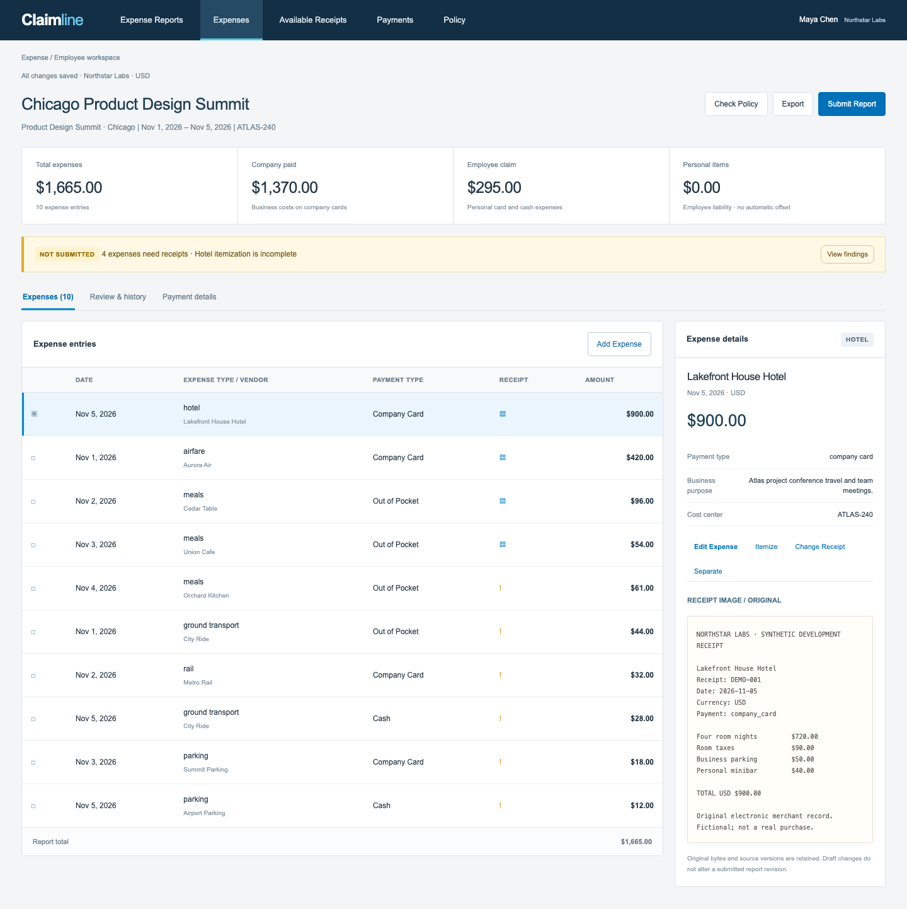

# Claimline first runnable implementation — PR #42

This submits M1 of the approved employee travel-expense proposal. The original
proposal is unchanged. It implements a complete source-to-payment conference
scene with ten expenses, original electronic receipts and a Concur-inspired GUI.
The first version is submitted for review; it is not final upstream acceptance.

## Run

Requirements: Node.js 18+. No external service or model credentials are needed.

```sh
node runtime/web/server.cjs --app claimline --registry apps/claimline/registry.json --run claimline-demo --port 8790
```

Open the printed access link. Save and explicitly match available originals,
itemize the hotel, explain the over-limit meal, check policy and submit. Reviews
and payments use a separate trusted terminal; the employee cannot self-approve.

```sh
node apps/claimline/examples/review.cjs --run claimline-demo --decision returned --reason 'Clarify the business purpose.'
node apps/claimline/examples/review.cjs --run claimline-demo --decision approved --reason 'Evidence checked.'
node apps/claimline/examples/review.cjs --run claimline-demo --payment pay-1 --amount 8000 --status paid --reason local-payment-proof
```

Commands print the exact event and require confirmation. Amounts are USD cents.
See the [App README](../../../apps/claimline/README.md),
[validation map](../../../apps/claimline/VALIDATION.md) and
[provenance inventory](../../../apps/claimline/PROVENANCE.md).

## Proposal coverage

| M1 deliverable | Implementation and evidence |
| --- | --- |
| Capture, link and purpose | Actual original bytes/hash, explicit candidate confirmation and sourced purpose; Mail attachment → immutable Files version → Claimline registration |
| Hotel split and policy | Room/tax/parking/personal itemization; separate company, employee and personal totals; meal limits/attendees also apply to hotel meal parts |
| Submission, return and approval | Immutable submitted versions, return/amend/resubmit, rejection/partial approval, trusted Infra only |
| Local payment reconciliation | Scheduled/failed/paid attempts, stable terminal payment IDs, approved/paid/outstanding balances and overpayment checks |
| Source events | New revision-1 card transactions include merchant/date/payment type/amount; later settlement/refund revisions preserve lineage; receipt corrections/voids retain originals |
| Core lifecycle | Version conflicts, replay, isolated runs, history load/reset, actual MCP restart and policy-constrained resources |
| Browser and public connections | Actual controls, original preview, full report workflow, receiver Mail notice, immutable Files readback/export and reset isolation |

Core requires the App ID as the tool namespace. The proposed `expense.*` tool
groups are published as `claimline.*`; trusted incoming events retain `expense.*`.
Mail 1.3.0 and Files 1.0.0 are run-assembly connections. The App runs independently.

## Verification

[Summary](summary.json) records the exact App package SHA-256, versions, approved
proposal commit and maintainer-base runtime revision. The PR submission records
the exact Git commit for this evidence index.

| Check | Result | Report |
| --- | --- | --- |
| App business and Core runtime | 28 passed, 0 failed | [TAP](business-runtime.tap) |
| Current browser workflow | 11 passed; full report path, real MCP state, reload and mobile layout | [Report](report.json) |
| Mail/Files connected flow | 9 steps passed; actual receivers/bytes, partial approval/payment, deduplication and reset isolation | [Report](connected.json) |
| Public verifier, Node 22 | 48 checks passed | [Report](public-runtime-node22.json) |
| Public verifier, Node 18 | 48 checks passed | [Report](public-runtime-node18.json) |
| Archived upstream-base verifier | 48 checks passed | [Report](base-runtime.json) |
| Existing upstream regression | 22/22 stages passed | [Log](upstream-regression.txt) |

```sh
node --test apps/claimline/tests/business.test.cjs apps/claimline/tests/runtime.test.cjs
node apps/claimline/examples/run-connected.cjs
node apps/claimline/tests/browser.cjs
node runtime/cli.cjs verify --app apps/claimline --output .artifacts/claimline.json
npx --yes --package=node@18.20.8 node runtime/cli.cjs verify --app apps/claimline --output .artifacts/claimline-node18.json
npm test
```

For base compatibility, export the summary's base revision with `git archive`,
then use that checkout's `runtime/cli.cjs verify --app` against this App's absolute
path. This uses the existing base checker without altering it. Full parent-resource
workflows also require review of the included platform registration.

The audit found and fixed four regressions: trip creation leaked Core metadata,
hotel meal parts bypassed meal rules, charge events could not create a new
transaction, and failed payments bypassed approved-balance checks. Their dedicated
tests [failed before the fixes](regressions-before-fix.tap) and now pass within
the 28-test suite. These are author-supplied checks, not independent model trials.



[Payment view](payment.png) · [Mobile report](mobile.png)

## Remaining work and scope

M2/M3 retain the planned additional scenes, timed inputs, photo/PDF coverage,
richer extraction, optional Calendar/Finance bridge, independent reproduction,
human data/workflow/provenance review and final acceptance. The App does not
claim advanced OCR, live cards/payments, FX, ERP/payroll or model qualification.

The platform changes are limited to App registration, a parent-resource access
mapping, an optional validated package-local stylesheet route and a registry-based
clock assertion that retains the seven existing App checks. They require normal
Infra review. The default data and screenshots are fictional, original and CC0;
the code is MIT. No private account state or local access tokens are published.
