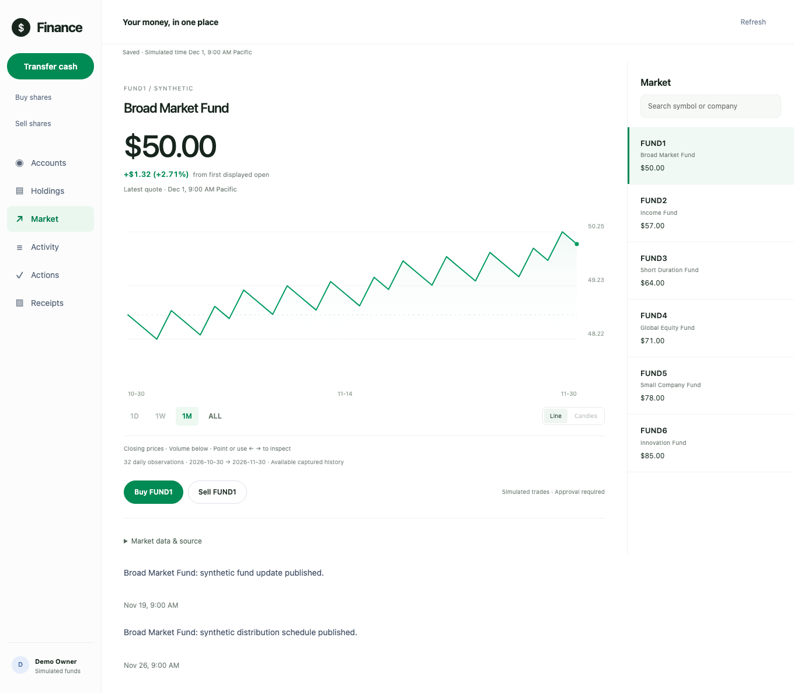

# Finance first runnable implementation

PR #6 now includes a runnable Bank + Brokerage simulation. Transfers and
whole-share buys/sells use exact previews, trusted action-specific approvals and
durable receipts. The six-view GUI uses the same Agent MCP state. Three fictional
scenes cover account history, recurring debit failures/retries and balance fees.
The connected example uses the public Mail and Calendar interfaces.

This is a first-version submission for review. It is not final acceptance.
The approved proposal at `fec36374e5aec9a1cd298306777eee68ce715122` is unchanged.

## Run

Requirements: Node.js 18+ and Python 3.11+ as `python3`.

```sh
node runtime/web/server.cjs --app finance --registry apps/finance/registry.json --run finance-demo --port 8786
```

Open the printed access link. Create a transfer or trade preview in the GUI.
In a separate trusted terminal, review its exact terms:

```sh
node apps/finance/examples/review.cjs --run finance-demo
node apps/finance/examples/review.cjs --run finance-demo --proposal proposal-1
```

Then return to the GUI, refresh and execute the approved action. Agent tools and
the business browser cannot approve themselves. No external money moves.

See the [App README](../../../apps/finance/README.md) for tools, event/reset
semantics, offline replay, optional live collection and the connected example.
The [validation map](../../../apps/finance/VALIDATION.md) maps checks to workflows.

## Current evidence

[Machine-readable summary](summary.json) records the App package SHA-256,
versions and base-runtime commit. The PR lifecycle submission binds this index
to the submitted Git commit. Commands below ran from the repository root.

| Check | Result | Evidence |
| --- | --- | --- |
| App business and Core runtime | 32 passed, 0 failed; includes 8 offline Python provider/batching checks | [TAP](business-runtime.tap) |
| Public App verification, Node 18 | 44 checks passed | [Report](public-runtime-node18.json) |
| Public App verification, Node 22 | 44 checks passed | [Report](public-runtime-node22.json) |
| Maintainer-base runtime compatibility | 44 checks passed using an archived upstream checkout | [Report](base-runtime.json) |
| Shared Web Host | 4 passed, 0 failed | [TAP](web-host.tap) |
| Current synthetic GUI smoke | 5 checks passed: accounts, chart, selected-symbol preview, mobile layout, console | [Report](report.json) |
| Optional live browser rerun | Initial loading exceeded the 30-second test deadline; switching assertions were not reached | [Failure log](live-browser-timeout.log) |

```sh
node --test apps/finance/tests/business.test.cjs apps/finance/tests/runtime.test.cjs
npm run app:verify -- --app apps/finance --output .artifacts/finance.json
npx --yes --package=node@18.20.8 node runtime/cli.cjs verify --app apps/finance --output .artifacts/finance-node18.json
npm run test:web
```

For base compatibility, export the summary's `base_runtime_commit` with
`git archive`, then run that checkout's `runtime/cli.cjs verify --app` against
this App's absolute directory. This uses the base validator, not a changed
candidate validator.

Screenshots contain the bundled fictional scenes, not provider market data:



[Accounts](accounts.png) · [Mobile Market](mobile.png)

## Optional extension and remaining review

The optional collector supports Yahoo chart observations, an Alpha Vantage IBM
daily demo and captured-data replay. Its default watchlist is VOO, QQQ and VOO's
top 30 equity positions from the dated October 31, 2026 selection. Both Alphabet
share classes count separately. The selection does not rebalance automatically.
The provider URLs, dates and selection are recorded in the App. Raw captures,
local runtime state and access links stay outside this public evidence package.

Historical observations are imported in bounded batches. Time spans without
distinct history are disabled. A prior live check passed 16 round-trip chart
switches and rapid switching; that historical pass is not presented as a pass
for the latest live rerun. Large accumulated live state still needs load-time
work. Temporary feed lock/read failures retry; exhausted background failures
keep the page available. Capture exhaustion pauses collection and keeps the
last observations available, with their original timestamps.

Remaining: final full browser/upstream regression, fresh non-author reproduction,
human workflow/data/provenance review, review of the optional market-data scope
and provider reuse terms, maintainer decisions on Environment trials/budget,
commit-bound CI and final maintainer acceptance. Public remote hosting and
production authentication are outside this local Host implementation.

The shared Host change only adds a validated package-local stylesheet route.
Registry registration and its clock check are also included for review.
